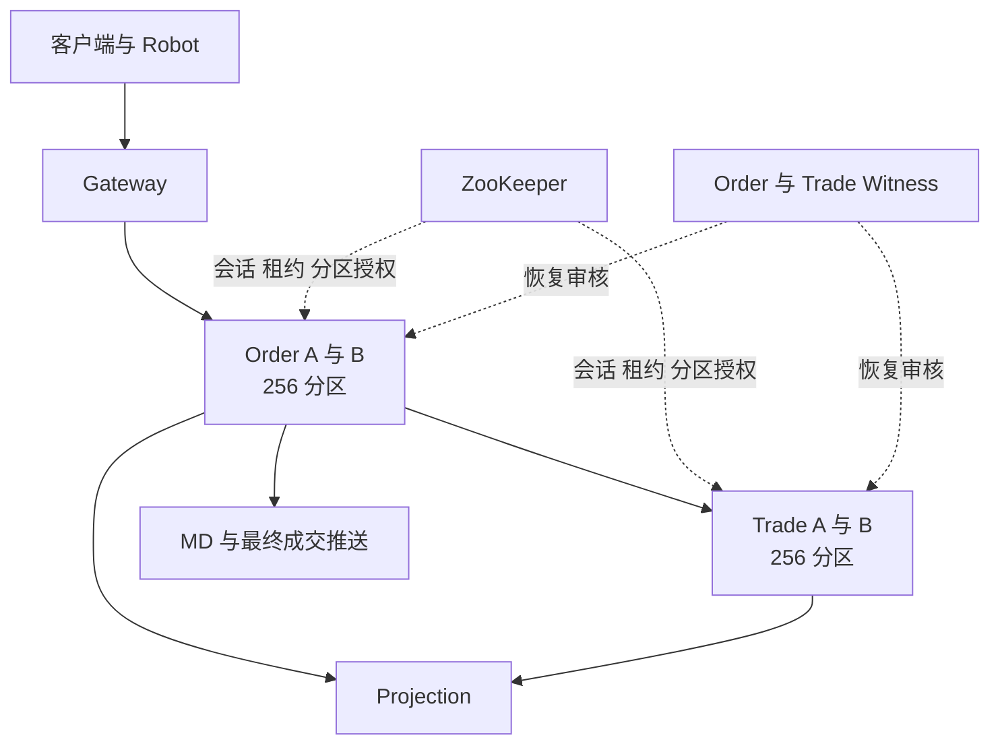
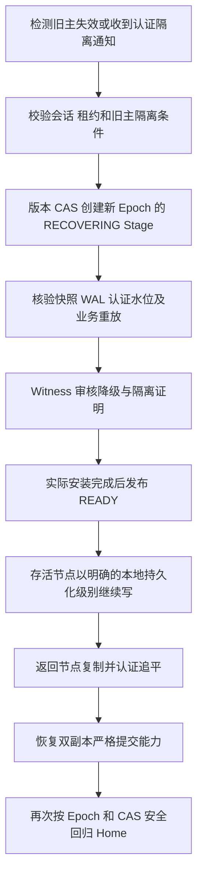

# OpenTradingCore 当前集群机制审阅

更新于 2026 年 11 月 13 日 14 时 10 分。当前新部署 Common `f1649ede`，运行 JAR SHA256 为 `11eacdf419334d67c82934faa45aad9da462db4402707ca7c4c101c324574683`。当前 Order 源码为 `8e1de5e`，新增撤单锁顺序修复及既有 Newing 恢复器的定时调用。两项修复均已在原数据上部署，积压恢复与财务核对通过。

当前实现采用 ZooKeeper 管理节点授权和分区角色，A/B 保存业务日志，独立身份的 Witness 审核降级恢复。Common 提供通用持久化与恢复，Order 和 Trade 分别负责撮合与资金状态机。此前基线曾通过底层及四方向业务故障验证。后续组合场景发现的结算失序和混合确认恢复阻塞已形成修复。当前精确 Common 完整底座门禁及新部署基础业务通过，新代业务故障和压力验证仍在进行，生产交付状态为 NO_GO。

## 服务与分区

Order 和 Trade 各有 256 个分区，分别由自己的 A/B 节点承载。正常状态下 A、B 各主写 128 个分区，同时备份对端的 128 个分区。每个分区有稳定的 Home Primary，以及当前实际持有写权的 Current Primary。

| 组件 | 当前职责 |
|---|---|
| Common | 不透明业务字节的 WAL、复制、快照、提交水位、授权检查、故障接管及回归 |
| Order | 委托状态、订单簿、撮合、撮合意图、结算回执及其重放 |
| Trade | 资金、冻结、持仓、结算、财务去重及其重放 |
| ZooKeeper | 节点会话、临时租约、分区清单及带版本的角色更新 |
| Witness | 使用独立身份验证恢复前缀和隔离条件，签发降级恢复授权 |
| Projection | 从已认证业务日志生成 MySQL 查询视图 |
| MD | 发布盘口和成交，处理恢复后的去重与订阅 |
| Gateway | 接入、鉴权、请求路由与最终消息转发 |

Order 的路由键包含租户、市场及品种，Trade 按租户路由。因此一笔成交通常跨越 Order 和 Trade 两个独立的分区状态机。跨服务结算的一致性由业务流程和持久化重试实现。[职责约束](ARCHITECTURE_SIMPLE_COMMON_BOUNDARY_20261029.zh-CN.md)、[Home 设计](COMMON_AB_HOME_PRIMARY_AUTO_FAILBACK_ARCHITECTURE_20261031.zh-CN.md)

## 当前本机拓扑

当前 Mac 使用一个 Colima 虚拟机，8 vCPU、12 GiB 内存。四个核心进程各有 4 CPU、2 GiB 配额，共同分享这台虚拟机资源。旧 `ha-test-sshfs` 环境已按用户授权正常关停，磁盘保留。

当前 ZooKeeper 容器配置为单节点 standalone。Order 与 Trade 各有一个 Witness 容器，Witness 具有 A/B 数据目录的只读挂载，并拥有自己的签名身份和可写恢复回执目录。A/B、Witness、ZooKeeper 和业务数据都依赖同一台 Mac、同一虚拟机与本机存储。

这些配置支持进程故障、在线替换及持久化恢复验证。整台 Mac 故障、虚拟机故障、共享磁盘损坏和跨主机网络分区需要在独立故障域拓扑中另行验收。生产部署还需要核查 Witness 能否在旧主磁盘完全不可达时完成恢复审核。当前 Common 恢复接口中存在对两端物理数据路径的读取。[Witness 实现](https://github.com/bliplink/com.app.common/blob/f1649ede21e2bd0667f772594d2e84cd801f191f/src/main/java/com/app/common/replication/CommonCertifiedFirstReadyE2Witness.java)、[部署接线](https://github.com/bliplink/dc-quant-deploy/blob/2f9eb5a/scripts/mac-demo-fresh.py)

## 两种确认模式

分区当前的复制状态与客户端确认策略是两个维度。正常双节点时，分区仍有严格的双端认证提交水位，客户端可以选择等待双端确认，或在主节点本地落盘后先返回。节点故障后，Common 可以通过新 Epoch 授权单节点持久化。

| 场景 | 返回所需条件 | 已确认数据的故障边界 |
|---|---|---|
| 正常双节点严格确认 | 主备 WAL 落盘、签名提交证明及必要回执持久化，当前写权仍有效 | 在保留认证副本的单节点故障范围内恢复已确认前缀 |
| 正常双节点异步确认 | 主节点 WAL 落盘、业务应用及当前写权检查完成，后台继续复制 | 未复制的已确认尾部可在主节点故障后丢失 |
| 故障后单节点确认 | 新 Epoch 的合法单节点授权，本机落盘并应用 | 依赖存活节点的本地持久化，后续再追平备节点 |

异步和单节点最终成交回执携带 `LOCAL_DURABLE_ASYNC`、`QuorumDurable=false`、`RpoRisk=true` 等信息。严格确认对应 `QUORUM_DURABLE` 和无单副本风险标记。HTTP 接口确认与最终成交回执分别测量，判断交易完成需要核对最终成交、资金持仓和持久化状态。[确认边界](https://github.com/bliplink/com.app.common/blob/f1649ede21e2bd0667f772594d2e84cd801f191f/src/main/java/com/app/common/replication/CertifiedBusinessCommandBoundary.java)、[Trade 回执传递](https://github.com/bliplink/com.app.dc.ordersvr/blob/8e1de5e40377576dd6b92dffaa151b2cbf2f4b12/src/main/java/com/app/dc/service/state/OrderSignedMatchDeliveryWorker.java)

## 严格写入流程

1. 业务层校验并准备状态变化，将不可变命令交给 Common。
2. Common 检查缓存中的当前分区角色、Epoch 和节点租约。
3. 主节点追加业务 WAL 并执行物理落盘。
4. 通过现有 Netty 复制通道发送原始记录，备节点落盘并返回签名回执。
5. 主节点生成并持久化 CommitIndex 所需的认证提交证明。
6. 双端安装提交证书，保存必要的安装回执及回执账本。
7. 再次检查物理证明和当前写权，完成业务应用并允许对外确认。

RF2 的严格数据多数要求 A/B 两个数据节点。Witness 参与降级授权审核，其签名不能充当第二份业务数据落盘回执。

当前每次普通提交调用已有 GroupCommit 时传入单条命令。写路径还包含多轮签名、提交索引、证书安装和目录落盘，因此每笔命令承担多个同步持久化步骤。业务线程通过本地授权缓存检查写权，ZooKeeper 读写由控制线程承担。[提交流程](https://github.com/bliplink/com.app.common/blob/f1649ede21e2bd0667f772594d2e84cd801f191f/src/main/java/com/app/common/replication/CertifiedBusinessCommandBoundary.java)、[复制与证书安装](https://github.com/bliplink/com.app.common/blob/f1649ede21e2bd0667f772594d2e84cd801f191f/src/main/java/com/app/common/replication/DirectNettyCertifiedBusinessTransport.java)

## 异步写入流程与背压

正常双节点异步模式先完成本地 WAL 落盘、业务应用和授权检查，再由后台执行同一套复制及提交证明流程。恢复时可以使用的双端认证水位随后台复制推进。

当前每个分区最多保留一条尚未完成复制的本地已确认命令。下一次追加需要等待上一条复制完成，或等待 Common 完成合法的状态转换。每个 JVM 共享 8 个异步复制线程。这一限制简化了现有精确物理头与恢复证明，也使备节点延迟和证书处理速度通过背压影响后续业务。

因此，异步确认主要缩短当前请求等待备节点的时间，持续吞吐仍受复制链路约束。扩大待复制队列需要同时定义有界积压、快照边界、故障截断及恢复行为，并重新完成物理门禁。[单条待复制限制](https://github.com/bliplink/com.app.common/blob/f1649ede21e2bd0667f772594d2e84cd801f191f/src/main/java/com/app/common/replication/CertifiedBusinessCommandBoundary.java)

## 写权与旧主隔离

节点控制线程定期从 ZooKeeper 取得并验证整节点授权快照。写入路径检查分区角色、Epoch、授权有效期和隔离状态。Watch 或会话事件会撤销旧授权缓存，后台验证完成后再安装新授权。租约过期后，旧写权保持隔离。

| 当前参数 | 实际配置或观测 |
|---|---|
| 节点写租约 | 15 秒 |
| 节点续租间隔 | 1 秒 |
| 恢复轮询间隔 | 200 毫秒 |
| 快照扫描间隔 | 60 秒 |
| ZooKeeper 客户端请求的会话超时 | 120 秒 |
| 本轮服务日志中的实际协商会话超时 | 40 秒 |

单分区出现不确定 WAL 或应用结果时，Common 会隔离该分区，并通过签名通知进入现有恢复路径。整个节点的授权发生不可恢复隔离时，专用 voter 可以退出，由 Docker 的正式重启策略重新拉起并走认证恢复。故障演练保留的旧容器关闭自动重启，正式 replacement 保持原重启策略。

当前授权快照覆盖整节点分区，清单变化会影响授权缓存刷新。最近修复允许单节点写入在认证清单持续推进时继续等待合法授权，实际 Epoch、角色或隔离拒绝仍立即生效。[节点授权](https://github.com/bliplink/com.app.common/blob/f1649ede21e2bd0667f772594d2e84cd801f191f/src/main/java/com/app/common/replication/NodeClusterControlManager.java)、[授权表与隔离](https://github.com/bliplink/com.app.common/blob/f1649ede21e2bd0667f772594d2e84cd801f191f/src/main/java/com/app/common/replication/NodePartitionGrantTable.java)

## 故障接管与恢复

恢复遵循认证提交前缀，校验快照与 WAL 哈希、Epoch、水位、安装结果及原节点身份。当前分区的 `RECOVERING` 状态阻止对外写入，实际重放和安装完成后才能发布 `READY`。未认证尾部的处理遵守所选确认策略与已经接受的异步 RPO 边界。

返回节点先追平，再通过同一 Common 角色变更机制完成自动回主。A 恢复后重新持有自己的 128 个 Home 分区，B 同理。恢复流程中会经历隔离、降级、双副本重建及 Home 角色交换，因此单次物理故障可跨越多个 Epoch。[恢复与 Home 驱动](https://github.com/bliplink/com.app.common/blob/f1649ede21e2bd0667f772594d2e84cd801f191f/src/main/java/com/app/common/replication/CommonCertifiedWitnessedReturnRunner.java)、[故障观察器](https://github.com/bliplink/com.app.common/blob/f1649ede21e2bd0667f772594d2e84cd801f191f/src/main/java/com/app/common/replication/CommonCertifiedFailoverWatch.java)

当前共享分区清单中的恢复 Stage 逐个推进，Witness 检查也要求对应的唯一当前 Stage。单节点回归驱动使用一个线程，每轮推进一个分区，共享 cold probe 线程数为 2。全量 256 分区的证明、落盘、轮询和角色更新累积为分钟级耗时。200 毫秒轮询间隔单独不能代表故障恢复时间。[Stage 审核](https://github.com/bliplink/com.app.common/blob/f1649ede21e2bd0667f772594d2e84cd801f191f/src/main/java/com/app/common/replication/CommonCertifiedFirstReadyE2Witness.java)

## Order 与 Trade 的成交链路

资金模式下，一笔撮合至少包含三个有因果依赖的业务提交阶段。

1. Order 将撮合结果、双方委托变化及确定性成交身份写入自己的 Common WAL。
2. Order 从已提交日志投影出的待结算意图向 Trade 发送签名请求。Trade 校验原始撮合，持久化并应用双方资金、持仓和去重状态。
3. Trade 返回签名结算回执。Order 将该回执再次写入自己的 Common WAL，随后发布最终客户成交与 MD 消息。

Order 的待结算索引从 Common 日志和快照重建。重试使用原 MatchKey 与确定性 ExecID，Trade 依靠持久化业务去重防止重复经济效果。当前即时发送与回执处理共用两个线程，并有周期性的有界重试扫描。[Order 结算投递](https://github.com/bliplink/com.app.dc.ordersvr/blob/8e1de5e40377576dd6b92dffaa151b2cbf2f4b12/src/main/java/com/app/dc/service/state/OrderSignedMatchDeliveryWorker.java)、[待结算索引](https://github.com/bliplink/com.app.dc.ordersvr/blob/8e1de5e40377576dd6b92dffaa151b2cbf2f4b12/src/main/java/com/app/dc/service/state/OrderCertifiedMatchOutbox.java)

订单撮合状态、Trade 结算、Order 最终结算确认及 SQL 明细投影有各自的推进位置。审阅交易完成语义时，需要明确查询接口和客户消息分别对应哪个位置。

此前 Order FIFO 修复前的异步 15 笔每秒用例触发 Trade 的 `TRADE_COMMON_FILL_OVERFILL_OR_INCONSISTENT_REMAINDER` 拒绝，900 个订单状态为 Filled，限定窗口内最终回执与成交明细未全部完成。原压测窗口保持 NO_GO，后续已通过原成交身份重试完成全部 900 笔结算并核对一致。该问题属于业务结算链路，Common 的物理日志一致不能单独保证跨服务经济结果完成。[Trade 余量校验](https://github.com/bliplink/com.app.dc.tradesvr/blob/aefad60d5107f9b595b20c7b20bb5008584eb3f3/src/main/java/com/app/dc/service/order/TradeCertifiedOpenFillPlan.java)

已部署修复 `55234c2` 让初次结算按分区内的日志前序推进，并在前一笔 Order 结算回执持久化后继续下一笔。已经本地确认的成交保留独立的补复制重试能力。该修复复用了原待结算索引和发送线程，已通过 198 项 Order 测试，含 2 项原有环境依赖跳过，已在原现场完成 Order A 正常退出及 Order B 强制终止的滚动替换，后续 Trade 单节点演练遇到下述 Common 阻塞。原 900 笔订单后来全部完成结算，身份、资金持仓和 MD 精确核对通过，原压测窗口仍保留失败结果。[候选投递实现](https://github.com/bliplink/com.app.dc.ordersvr/blob/55234c23a3ab28f65d30efb7253935c9f7f72847/src/main/java/com/app/dc/service/state/OrderSignedMatchDeliveryWorker.java)

## 异步尾部丢失后的恢复边界

用户已选择按备节点认证水位立即接管，接受尚未复制的已确认尾部可能丢失。旧主返回时需要服从新 Epoch 的权威历史，恢复流程必须处理旧主额外尾部与新历史的冲突。

已通过的实际演练中，Trade 主节点确认第 99 条时备节点仍为第 98 条。主节点被杀后，存活的 Order 撮合意图自动重放，原成交身份只产生一次经济效果，最终双副本和资金持仓核对一致。这一恢复能力依赖原 Order 意图或其他有效重放源仍存在。若相关意图与唯一交易尾部同时消失，自动恢复的保证需要另行定义。[实测记录](T554_CROSS_EPOCH_BUSINESS_ACCEPTANCE_20261110.zh-CN.md)

## 合理性审阅重点

| 事项 | 当前判断 | 需要审阅或验证的内容 |
|---|---|---|
| 通用库与业务职责 | Common 保持不透明字节边界，Order 和 Trade 各负责领域状态 | 跨服务结算顺序与回执完成语义继续在业务层修复 |
| 严格与异步承诺 | 已明确本地落盘、双端提交及异步丢失边界 | 接口确认、委托状态与最终成交的用户语义应保持一致 |
| RF2 降级 | 能维持单节点运行，同时暴露副本风险 | 故障策略与可接受 RPO、RTO 需要共同验收 |
| 写路径证明链 | 物理回执、证书托管和账本提供了可核验恢复依据 | 逐项证明哪些落盘必需，评估已有批量提交与重复持久化成本 |
| 签名的威胁模型 | 当前每笔提交和恢复证据包含多处签名及验证 | 明确防篡改审计、进程故障和恶意节点分别需要哪些证明 |
| 全量分区恢复 | 已具备自动接管、追平及回主能力 | 单 Stage、单回归驱动和全节点清单粒度造成明显串行成本 |
| 正常异步背压 | 每分区一条未复制命令保持了简单恢复边界 | 单副本延迟会传导到后续吞吐，需评估有界批量与流控 |
| Witness 数据访问 | 本机通过只读挂载检查两端物理证据 | 旧主整机与磁盘不可达时，应靠存活证据完成接管 |
| 历史证明与磁盘增长 | 多 Epoch 恢复依赖出生凭据、退休前缀和安装回执 | 明确快照之后旧证明的归档边界及自动保留上限 |
| 生产故障域 | 本机进程与逻辑数据目录分离 | 多主机数据副本、独立 Witness 和 ZooKeeper 多节点拓扑仍需验收 |
| 连续部分成交 | 已发现高负载下余量拒绝和结算积压 | 先修复因果顺序并验证原成交身份，再继续高负载测试 |

优先保留旧主隔离、明确提交边界、真实物理回执和可重放业务身份。精简应围绕重复证明、串行调度和日志投递展开，每一项变化都需要通过相应故障与业务门禁。

## 当前结果与剩余工作

精确 Common `f1649ede` 已通过 210 项安全测试、13 项原生故障测试，以及双向全 256 分区接管、恢复中断续接、第三次崩溃和再次回主验证。全量接管约 199 与 203 秒，回归 Home 约 420 与 372 秒。原 `mac-demo-20261113-115320` 已完成积压业务恢复与精确对账，数据随原代保留。最新同源码严格测量代为 `mac-demo-20261113-134411`，已完成新租户、资金与 ORDER_ONLY 成交及基础财务一致性，四方向持续 Robot 故障验证尚未完成。

### 当前代码基线的异步固定速率测量

以下测量使用 Common `f1649ede`、Order FIFO 修复 `55234c2`，发生在撤单死锁及 Newing 定时调用修复部署之前。每窗 60 秒，背景严格固定 10 个 Robot，单租户、单品种、同一 taker 用户。资金账户各经正常接口入金 100000，最大 16 个 HTTP 请求在途。最终成交延迟包含从客户端发出到收到成交的全过程。

| 提交速率 | 计划数 | 窗内最终成交 | 限定排空后最终成交 | 最终成交 P99 | HTTP 确认 P99 | 结果 |
|---|---|---|---|---|---|---|
| 1 笔每秒 | 60 | 60 | 60 | 80.760 毫秒 | 36.188 毫秒 | PASS |
| 5 笔每秒 | 300 | 300 | 300 | 261.737 毫秒 | 93.671 毫秒 | PASS |
| 10 笔每秒 | 600 | 600 | 600 | 430.571 毫秒 | 134.866 毫秒 | PASS |
| 15 笔每秒 | 900 | 898 | 900 | 683.793 毫秒 | 206.425 毫秒 | 功能通过，窗口存在少量尾部 |
| 25 笔每秒 | 1500 | 855 | 1500 | 29.538 秒 | 375.119 毫秒 | 功能排空通过，性能明显积压 |
| 50 笔每秒 | 3000 | 327 | 907 | 71.005 秒 | 见原始报告 | NO_GO |

50 笔每秒用例实际发出并获接口确认 2819 笔，调度器丢弃 181 个计划槽位。907 是限定测量期间收到的最终成交数，后续持久化成交增加到 935。报告中的 P99 仅统计收到成交的样本，剩余未完成请求必须同时计入判断。100 笔每秒未执行。

单用户单品种压测已在 15 至 25 笔每秒之间出现明显排队拐点。它包含热点订单簿和按用户串行的 Trade 回调，尚不能据此推断分散业务的整集群最大容量。当前 10Robot 稳态为 603 笔成交、2.010 TPS，服务内成交 P99 为 101.706 毫秒。

### 本代下撤单测量

每组以完整下单、状态可见、撤单、订单消失为一个闭环。状态轮询间隔为 50 毫秒，背景为 2 个 Robot。

| 模式 | 并发数 | 完整闭环每秒 | 下单可见 P99 毫秒 | 撤单消失 P99 毫秒 |
|---|---|---|---|---|
| ORDER_ONLY | 1 | 19.694 | 35.690 | 49.865 |
| ORDER_ONLY | 4 | 25.432 | 155.393 | 127.391 |
| ORDER_ONLY | 8 | 26.441 | 284.356 | 192.504 |
| 资金模式 | 1 | 11.505 | 79.260 | 41.066 |
| 资金模式 | 4 | 20.487 | 230.421 | 141.547 |
| 资金模式 | 8 | 22.611 | 377.121 | 202.025 |

### 严格模式的历史对照

此前 Common `5b2ad4c6`、Order FIFO 修复前的严格模式，固定 10 笔每秒时 600 笔在窗口内完成，最终成交 P99 为 98.396 毫秒。50Robot 为 8.880 TPS，服务内成交 P99 为 452.097 毫秒。源码与当前异步样本不同，待当前恢复完成后，需使用同一批最新构建重新做严格与异步对照。

原故障和压测 NO_GO 记录继续保留。生产交付仍待本代四方向故障、分散业务压力、严格异步同版对照，以及恢复后的业务一致性验收。[持续验收记录](T554_CROSS_EPOCH_BUSINESS_ACCEPTANCE_20261110.zh-CN.md)

## 11 月 13 日补充发现与修复状态

10 点的 Trade A 强制终止演练中，存活 B 的 255 个分区进入新 Epoch 单副本状态，P143 一直保留 E2 严格角色。只读观察确认 P143 的 WAL 约 12 KiB，物理写入器已 poison。实际异常来自同一时刻的一笔入金，第 7 条严格写入在等待独立备节点落盘回执时失败，接口返回失败。原先 6 条认证提交和第 7 条未确认尾部均保留。

客户端默认异步策略与业务实际调用可以并存。当前入金等未要求签名成交回执的路径仍调用严格确认接口，成交结算调用按默认策略选择的接口。恢复选择原先只检查命名空间的默认异步策略，于是要求已隔离的 P143 提供健康本地主证明，形成持续拒绝。审阅时应逐条核对业务调用的真实持久化承诺，不能从全局模式推断每条写入的承诺。

Common 候选 `9effc473` 在既有写入器内标记尚未完成独立认证的严格提交。严格调用开始前会等待此前的异步复制排空，因此此类失败可以使用原双端认证前缀恢复。选择恢复源和签署原有退休回执时都保持严格前缀边界，原始未确认尾部继续保存。候选还覆盖严格写入进行中与恢复扫描交错的情况，完整安全测试与物理故障门禁正在执行，尚未部署到业务进程。[Common 候选](https://github.com/bliplink/com.app.common/commit/9effc47389a56306f1ec076294b9f3cb3243c2e8)

本轮 Trade 演练已记录 NO_GO 并取消后续压测。为保留现场并准备同机顺序部署，当前 Robot 与核心服务处于维护停写窗口。业务数据未删除，虚拟磁盘空闲块已在核心停写后回收，主机可用空间从约 7.5 GiB 恢复至约 16 GiB。待精确 Common 候选完成门禁后，继续部署、业务故障与固定背景负载复测。

11 时 24 分补充。修订测试夹具后的精确候选为 Common `f1649ede`，生产逻辑与 `9effc473` 相同，JAR SHA256 为 `11eacdf419334d67c82934faa45aad9da462db4402707ca7c4c101c324574683`。210 项安全测试及 13 项真实进程故障测试全部通过，新增组合已验证单节点接管、已确认异步数据保留、失败严格尾部排除，以及对端重启后的继续写入和 Home 回归。双向全 256 分区与中断恢复门禁仍在执行，业务环境仍处于维护窗口。

12 时补充。Common `f1649ede` 已完成全部底座门禁，双向全量接管约为 199 和 203 秒，回归 Home 约为 420 和 372 秒，256 对 WAL 与 256 对快照逐次匹配。恢复中断续接、第三次崩溃及再次回主也通过。业务镜像构建耗时约 68 秒，Shared 52、Order 198、Trade 226、MD 207 项测试全部无失败，Order 保留 2 项原有环境依赖跳过。原 Mac 顺序部署 `mac-demo-20261113-115320` 耗时 340 秒，已完成新租户、签名 SDK、资金模式和 ORDER_ONLY 成交、公共成交映射、Robot 实际报价成交及财务游标核对。当前 Robot 与核心服务均已运行，旧失败代 `083209` 的数据离线保留。

后续固定单租户单品种测量扩展为最高每秒 100 笔、每窗最多 6000 笔，测试账户各通过正常入金准备 100000 测试资金。原下撤单入口仍使用各 10000 的默认资金。两种确认模式的新对照将使用相同构建产物、资源配额与测量源码，结果分别记录背景 Robot、资金和实际成功数量。该测量覆盖单热分区承载能力，50Robot 的分散业务压力另行记录。

## 高负载后发现的业务恢复缺口

50 笔每秒用例结束后的现场线程转储记录了一组真实 Java 死锁。普通撤单先持有按订单散列的锁，再等待分区屏障。IOC 未成交到期处理已经持有分区屏障，再进入同一撤单流程等待订单锁，形成环路。该问题阻断了相应 Order 业务分区，其他分区和 Common 进程仍有工作。事后 CPU 较低不能解释为尚有可用处理能力。[撤单锁顺序修复](https://github.com/bliplink/com.app.dc.ordersvr/commit/dfa4dfb64fc41d79b6d04bd61518fb5ab57f3bec)

修复统一为先获取分区屏障、再获取订单锁，沿用原撤单提交及 Trade 释放流程。新增双线程真实屏障回归测试在旧实现稳定复现死锁，修复后通过。完整 Order 199 项测试无失败，含 2 项原有环境依赖跳过。13 时 7 分，两端 Order 已用原数据完成受控替换，维护前核对了 256 个分区的真实认证水位、零待复制写入，以及 256 对字节相等的物理 WAL。原死锁进程被强制退出，旧容器和原数据保留。

替换后 maker 自动完成撤单并释放冻结资金，原 10 个 Robot 恢复 RUNNING，但仍有 1882 笔 Suspended 委托未推进。源码核查发现既有 `PendingNewOrderReconciler.runOnce` 没有任何定时或直接调用。新增修复将它接入已有 Spring 定时调度，默认每 5 秒扫描，保留原有主角色、READY、最小年龄、退避和每批 256 笔限制。重发使用原 Newing 身份和 Trade 持久化去重。[恢复器接线修复](https://github.com/bliplink/com.app.dc.ordersvr/commit/8e1de5e40377576dd6b92dffaa151b2cbf2f4b12)

接线回归测试在旧源码失败，修复后的完整 Order 200 项测试无失败，含同样 2 项环境依赖跳过。精确镜像保留原 Common 与 Shared JAR，已推送源码到研发分支。13 时 24 分开始第二次原数据维护，停写前再次通过 256 个认证水位及 256 对 WAL 核验，13 时 25 分完成启动并解除维护暂停，既有恢复器自动推进原积压。13 时 27 分核对原 2819 笔已确认 taker 中 935 笔成交、1884 笔撤单，maker 另为撤单。两账户冻结保证金及手续费均归零，935 对成交身份、原客户已观察成交、持仓和 935 条唯一公共成交通过只读精确核对，财务游标零差异。恢复后两端线程转储未发现死锁，原 10 个 Robot 均正常运行。原 50 笔每秒压测仍保留 NO_GO。

审阅业务恢复时，还需覆盖正常新单、Newing 未完成、结算未回执、撤单待释放这几段中间状态。每一段都需要有实际调用的既有重试入口，并验证进程恢复后自动推进和去重。底层日志可重放与跨服务业务最终完成需要分别验收。

## 同版严格模式测量进展

Common `f1649ede`、Order `8e1de5e`、Trade `aefad60d`，新代 `134411`，原 Mac 顺序部署及基础业务验收耗时 364 秒。部署使用相同精确 JAR 与资源配额。六组下撤单均通过，测量口径仍为完整闭环和 50 毫秒状态轮询，背景 2Robot。

| 模式 | 并发 | 完整闭环每秒 | 下单可见 P99 毫秒 | 撤单消失 P99 毫秒 |
|---|---|---|---|---|
| ORDER_ONLY | 1 | 17.026 | 42.533 | 53.721 |
| ORDER_ONLY | 4 | 24.381 | 166.066 | 109.667 |
| ORDER_ONLY | 8 | 22.513 | 488.301 | 319.69 |
| TRADE | 1 | 9.42 | 77.237 | 58.392 |
| TRADE | 4 | 16.392 | 265.658 | 159.68 |
| TRADE | 8 | 17.57 | 508.482 | 310.712 |

10Robot 稳态、固定速率成交和分散 50Robot 压力正在按序执行。固定速率窗口完成比例低于 95% 时停止升档，原始尾部与延迟继续记录，这个停止条件用于控制测试负载。额外的 25 笔每秒运行剖面安排在容量测量后，记录物理落盘及线程事件，独立标记为带诊断负载的样本。

已停用的 20261109-174426 数据卷包含 722605 个物理文件，约 6.30GB 分配空间。全量压缩后约 867MB，逐文件 SHA、路径、元数据和完整压缩流复核通过后才回收原卷内容，归档保存在本机 `t554-retired-174426-archive-20261113-135018`。原始回滚需先离线解包并复核。当前原 115320 数据和精确新 Common P0 原始证据仍保留。

## 最新严格成交容量与测量修正

同版严格模式、固定背景10Robot，60秒热点窗口的1/5/10/15笔每秒分别全部完成60/300/600/900笔，最终成交P99依次为131.473、119.832、196.523、174.406毫秒。25笔每秒计划1500笔，窗口内完成1144笔，限定排空后全部完成，最终P99为14.300秒，HTTP确认P99为230.674毫秒。已按窗口完成比例停止升档。各档账户均经正常撤单收回，并通过确定性成交、持仓、原始公共成交和财务核对。

50Robot五分钟稳态3371笔成交，11.237TPS，3362个窗口内可配对延迟样本的P50/P95/P99分别为108.114/246.215/404.191毫秒。其余成交缺少同窗入口，按原口径单独计数。10Robot为707笔成交、2.357TPS、P99 102.713毫秒。

容量测量后，已停写四核心与两个Witness再回收虚拟磁盘空闲块，随后恢复原服务、原租约流程与10Robot，财务核对通过，主机约13GiB空闲。下一段稳态校验暴露测量器问题，Docker对同一容器重启后仍保留上次FinishedAt，旧筛选将正在运行的容器误排除。修正以容器Created和是否Running判断可能的日志区间，真实事件仍由Docker日志时间窗口过滤，保留重启前各进程实例的日志。

新增4项生命周期回归测试，旧版其中2项失败，修复后全部通过，Root共71项Mac单测通过。真实原始日志复算后，先前通过的10Robot、50Robot全部成交数与延迟分位完全相同。校验未完成的063524窗口实际读到910笔成交，但原报告仍保留校验未完成，后续完整稳态与故障验证重新执行。
