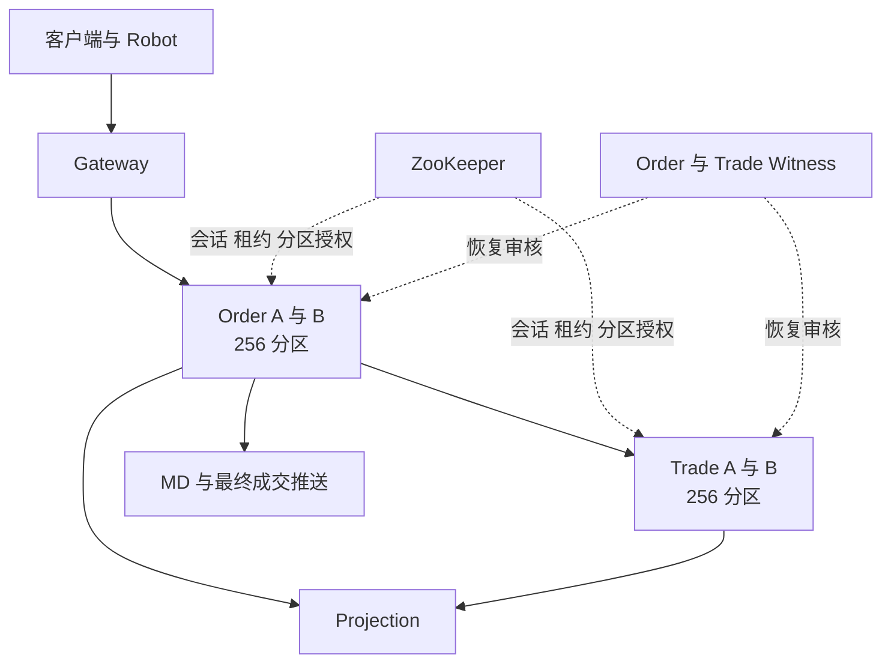
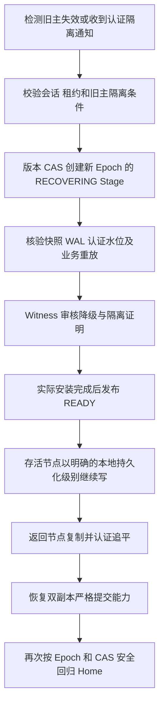

# OpenTradingCore 当前集群机制审阅

更新于 2026 年 11 月 14 日 22 时 30 分。**当前整体 NO_GO：原数据冷恢复仍未完成，原十个 Robot 保持正常停用，988 条原客户成交尚未进入成交财务投影。** Common444 的完整 P0 已通过并在原八个参与进程部署，Trade 同时装入 26cafcb 业务恢复补丁；真实原数据暴露旧 WAL 退休后的重复读锁缺口，P029 卡在恢复中，Trade B 已正常停止无效启动循环。一次有证据的正常 A 重启未解除缺口。修复 560f008 已提交推送，234 项安全测试及 Trade/Order 单测通过，完整 P0 重跑中；尚未部署该修复。严格/异步性能仍未达到高性能要求。


| 审阅问题 | 当前结论与实际边界 |
|---|---|
| 本机是否恢复交易 | 否。Trade 崩溃后冷恢复被拒绝；两个原节点及 Demo Robot 已正常暂停，保留现场等待机制修复 |
| 性能是否达到高性能交易要求 | 否。严格热点 15/s 完整交付、25/s 积压；异步 10/s 完整交付、15/s 积压。不是全 256 分区聚合容量，也不是生产硬件结果 |
| 集群是否稳定 | 否。除分钟级恢复和预占丢失缺口，本轮还出现堆耗尽后无法自动冷恢复的问题；历史故障 PASS 不代表本轮通过 |
| 能否继续扩业务服务 | 可以开发接入；每个服务独立提供业务状态机并走同一 Common 提交/恢复合同，再单独验收 |
| 能否直接扩大同集群节点数 | 三个以上数据节点、在线分区迁移、再平衡与线性扩容尚未验证 |
| Common 是否能供其它服务用 | 可以，已被 Demo、Order、Trade 复用；不能把当前单 Mac A/B 验收外推为任意服务、任意故障域均生产可用 |
| 下一项修复重点 | 完成退休后重试锁冲突修复的完整 P0，原数据恢复及 494 条结算核对；恢复十 Robot 后继续严格/异步多分区容量与性能修复 |

上一版严格四方向故障的物理恢复、受控成交和财务检查通过；故障后逐单补查暴露 IOC 跨多个挂单未实现，可能留下 New 和资金预占。现场已保存，107 个超时 Tape 单及最初故障单通过正常 API 撤销。新修复把全部 maker/taker 成交放入同一个 Order Common 命令、同一个现有待结算项和同一个 Trade 资金批次；IOC 撤余量等待结算确认，FOK 不足不提交部分成交，GTC 余量正常入簿。Common 无业务分支改动，无新增持久化账本或恢复流程。

构建 `/Users/kong/.opentradingcore/mac-demo-build-20261114-122100` 全量测试通过：Order 205 项、原有 2 项跳过；Trade 238 项；Projection 25 项。Shared 源码和全部 267 个 class 字节未变，重新构建仅使 JAR 内 Maven 绝对构建路径元数据变化，归档 SHA 为 `f508e22f19f7…`；Order、Trade、MD、Gateway 均嵌入同一新归档并逐一核验。Gateway 仅更换这些依赖，未引入用户工作区未提交的代理文件。新业务格式可读旧 V1，旧业务不能读新 V2；本次采用顺序全新升级，混合新旧业务版本的滚动升级未验收。现有恢复 Watch 配置从 200 ms 调到允许的 100 ms，实际恢复耗时待重测。

可复用入口 `./mac-colima-saas.sh verify-matching RUN_DIRECTORY` 使用正常自动审批租户、签名客户端、私有成交/状态推送，覆盖 Order-only 与 Trade 各 6 种多挂单情形，核对每条 ExecID/数量/价格、SQL 投影、一个原子资金批次、逐笔公开成交及正常清理后的余额/手续费/资金预占/持仓。脚本完成不等于真实场景通过，结果将另行记录。

12:39 补充：`mac-demo-20261114-122351` 基础物理和业务门禁在 331 秒通过。外层 Bash 当时因执行期间入口脚本发生编辑，在完成后报 `ward: command not found`、返回 127；这是执行一致性错误，未触发部署回滚，已保存 `fresh-wrapper-result-20261114.json`，后续执行期间保持入口脚本固定。该环境真实验证报告 `multi-maker-3326df65.json` 中 Order-only 6 场景全部通过；Trade IOC 跨两个 maker 的 4 条客户成交、一个资金 WAL 批次和两条公开成交都准确，但 `dc_orders_execorders.fee` 未填充（NULL），与实际已扣费用的资金记录不完整。另一个首轮 `multi-maker-5ab3e1ae.json` 是探针数量使用 `.0003` 被接口拒绝，未产生订单，已改为规范十进制格式。

Projection `101b4a0` 从现有已提交 Trade 去重结果中的手续费和已实现盈亏补齐成交历史，使用同一投影事务，不增加业务日志、RPC、ACK 或恢复机制。Order 的无费用 after-image 通过 upsert 保留财务字段，支持两路数据任意先后到达和重复投影；不改变实际账户资金。29 项 Projection 测试通过，真实 MySQL 临时表验证 Order 先到、Trade 先到及后续重复 Order 写入均保留 `-0.01620000`，未写现有业务行。最终构建清单为 `/Users/kong/.opentradingcore/mac-demo-build-20261114-124000`，复用原核心镜像和精确 Common，仅替换 Projection；源码、费用签名结果与真实余额的完整回归继续执行。

12:48 补充：`101b4a0` 的真实 JDBC 投影遇到部分回执不带 Currency，违反成交表主键的非空要求，导致 Trade 认证投影停滞；基础财务门禁拒绝，`mac-demo-20261114-123950` 已自动回滚并恢复原容器。首个完整验证控制器在任何故障或压测阶段开始前退出。Projection `17eaa31` 按现有 Order 成交表的空字符串币种键补齐该缺省值，新增针对该真实输入的断言，29 项回归重新通过并推送。当前最终构建改为 `/Users/kong/.opentradingcore/mac-demo-build-20261114-124900`，只更新 Projection，核心镜像与 Common 保持一致。新控制器 `t554-multi-maker-complete-mac-controller-20261114-1249.json` 在新启动门禁通过后顺序执行严格模式和异步模式，任何失败都阻止后续故障注入。费用核验要求字段非空、条数完整且与实际账户余额逐分一致，不能把 NULL 合计为零后放行。

12:58 真实结果：`mac-demo-20261114-124845` 基础物理和业务门禁 324 秒通过，基础业务自身 106 秒。`multi-maker-70dd6bd5.json` 中 Trade 和 Order-only 各 6 场景全部通过，含跨两个 maker 的 IOC/FOK 全成交、FOK 流动性不足全撤、IOC 部分成交后撤余量、GTC 部分成交入簿后正常撤单、Post-only 交叉撤单。每个实际成交场景有 4 条唯一客户 ExecID、两条准确公开成交，Trade 全部成交在一个资金 WAL 坐标提交；两侧余额等于入金加有符号手续费，持仓数量和使用保证金准确，正常撤完后预占全为零，费用字段全部非空。最终认证财务游标 PASS，控制面代次稳定。此 PASS 仅覆盖上述真实功能，不替代后续负载及新版本故障演练。

13:47 补充：上一环境 10 Robot 五分钟稳态 `robot-steady-10-050319.json` 为 768 请求/768 成交，0 超时未终结 Tape 单，财务游标 PASS；自然流量服务端成交发布 P99=122.297 ms，不能当容量上限。正常下单/撤单 `order-cancel-capacity-ef244911.json` 六窗口全部通过：Order-only 并发 1/4/8 完整循环每秒 17.611/23.354/23.223，New P99=46.605/170.393/352.239 ms，Cancel P99=59.559/124.675/219.435 ms；Trade 分别为 9.392/15.730/17.191 循环/秒，New P99=85.512/278.373/469.231 ms，Cancel P99=63.487/201.364/272.144 ms。这组包含 HTTP 设置、提交与状态轮询，不能冒充原生 TCP 成交确认。

上一环境原生 TCP 1/s 为 60/60 完整成交，客户端最终确认 P50=73.867、P99=538.253 ms。5/s 的 300 笔全部发送并在窗口内成交，P50=69.863、P99=119.222 ms，资金与 SQL 均准确，但客户端另收到 300 个重复最终回执，严格判 NO_GO。**5/s 不是容量边界**：旧容量汇总流程把协议错误也归入停止加压，现已分开；此批结果不能作为新版本有效容量结论。Order 日志中 300 条 ExecID 各仅一次业务发布，但每次通知目标列表重复出现同一 GW 名称；证据为 `native-5tps-duplicate-final-publication-audit-20261114.json`。名单记录的是显示名，不能单凭名称统计推断物理连接数。结合通知库逐条匹配订阅的代码、重叠订阅复现测试和修复后真实回执检查，定位并修正了同一连接被多条规则重复投递的问题。

gateway-api `1a95b80` 在单次通知内按物理连接去重，不按账号去重，不抑制后续新发布。旧实现针对性测试复现 `[GW1,GW1,GW1,GW2]`，修复后为 `[GW1,GW2]`；源码库 10 项测试通过。对现役依赖仅覆盖 `AbstractApiProxy` 外部类，原匿名类和其余依赖保留；现役依赖下 3 项针对性测试通过，ABI 完全相同，规范化字节码比较确认仅 `notify(String,byte[])` 方法变化。Order、Trade、MD、Gateway 四个发布端镜像逐一核对覆盖类和 Common/Shared/原通知 JAR 哈希；没有改变集群 ACK、隔离、日志或恢复。原业务构建为 `mac-demo-build-20261114-133700`，现役新环境基础门禁 331 秒通过，通知与完整业务回归继续执行。

发现重复通知后，自动控制器先只冻结后续步骤，正在执行的 Trade A KILL 完成后再退出，未中断恢复。`ha-trade-a-kill-aninfro6/evidence.json` 为 `COMMON_PHYSICAL_MATCH_AND_FINANCIAL_CURSOR_PASS`：接管 168.359 秒、追平与 Home 回归 308.974 秒，实际单节点业务与持续 Robot、财务以及全部物理 WAL/快照一致。该次使用已有 100 ms Watch 配置，但不能仅凭与旧环境的差异归因于此参数，数据规模和负载也不同。

构建入口现在自动保留已验收的 Gateway 代码、对齐精确 Common/Shared 依赖，再装入通知修复，不编译用户未提交的 Gateway 代理文件。完整构建实跑来源为 `mac-demo-build-20261114-134400-oneclick`，最终通知清单归档于 `mac-demo-build-20261114-134700-oneclick-final`；原有 Order 205 项（2 原有跳过）、Trade 238 项、Projection 29 项和 Mac 入口 100 项通过。通知镜像标签同时包含底层镜像内容 ID 与补丁 hash，确保不同业务或依赖版本不会互相覆盖标签。构建及测试证明不替代当前环境尚未完成的业务门禁。

14:15 通知修复后：新环境 `multi-maker-dc99a622.json` 的 12 场景全部通过，早期 TCP 语义检查 `execution-capacity-474d10b1.json` 为 300/300 完整成交、重复回执 0、财务游标 PASS。真实六个发布端的覆盖类/Common/Shared 文件逐一校验，见 `notification-fixed-real-running-byte-proof-20261114.json`。10 Robot 稳态 `robot-steady-10-055500.json` 为窗口内 422 请求/421 完整成交，0 超时未终结单；唯一差额在窗口结束前 33 ms 进入、结束后 32 ms 完整成交，补查文件 `notification-fixed-single-window-missing-fill-live-audit-20261114.json` 保留原计数并证明正常终结。自然流量 P99=76.678 ms，仍不是容量结论。正常下单/撤单 `order-cancel-capacity-2ddec7d3.json` 六窗口再次通过，Order-only 并发 8 为 23.272 循环/秒，Trade 为 18.939 循环/秒。

最新有效严格模式容量来自 `notification-fixed-strict-native-capacity-20261114.json`，同一环境、同一组 10 Robot、每档 60 秒、最多 16 个在途请求、另列有界尾部等待，最终成交从原生 TCP 推送测量：

| 目标笔/秒 | 计划/发送/最终成交 | 窗口内成交 | 接受 ACK P99 ms | 最终成交 P50 ms | 最终成交 P99 ms | 判断 |
|---|---|---:|---:|---:|---:|---|
| 1 | 60/60/60 | 60 | 38.205 | 71.064 | 105.574 | 完整交付 |
| 5 | 300/300/300 | 300 | 48.069 | 65.498 | 152.188 | 完整交付 |
| 10 | 600/600/600 | 600 | 89.594 | 64.156 | 457.535 | 完整交付，尾部尖峰 |
| 15 | 900/900/900 | 900 | 35.191 | 64.828 | 141.235 | 完整交付 |
| 25 | 1500/1500/1500 | 1310 | 188.786 | 3563.869 | 7532.227 | 持续积压，停止加压 |

全部档位无重复回执、无发送丢弃，已接受请求全部正常终结并核对资金。25/s 在尾部最终补齐，不代表稳定提供 25 TPS；本次最后完整交付档为 15/s，不能把 1310/60 当成已验收稳定容量。各档 P99 不严格单调，不能在没有证据时归因为冷启动。25/s 四核心容器新增 CPU 限流均为 0，内存约 352–731 MiB/2 GiB；没有凭据支持仅增加配额即可解决当前瓶颈。

25/s 慢请求 `T554EXEC-f240305d-1310`：客户端 ACK=45.038 ms、最终成交=7629.114 ms；同一个 Order 进程内，`TRADESVR_CALLBACK_ENQUEUE` 为 14:10:28.574，`TRADESVR_CALLBACK_PROCESS` 为 14:10:35.999，等待 **7425 ms**，随后在 14:10:36.146 发布最终成交（处理开始后 147 ms）。证据 `notification-fixed-strict-25tps-slow-order-callback-timeline-20261114.json`。这笔请求的长延迟主要发生在业务串行回调队列，后续要结合既有分区锁/fsync/物理复制等待证据与同条件异步结果确定优化优先级；不能仅按 CPU 或容器配置推测原因。高性能生产验收仍为 NO_GO。

14:49 最新严格模式四故障全部通过，汇总为 `notification-fixed-strict-four-fault-summary-20261114.json`。每例均为同一原 Mac、同一 Common JAR、原有 Robot 进程持续运行，且在故障节点原先主写的分区观察新报单与真实成交；每例两端 512 项 WAL/快照哈希相等，财务与受控业务检查通过：

| 故障 | 接管观察秒 | 重启后追平回归观察秒 | 降级阶段原 Robot 新成交 |
|---|---:|---:|---:|
| Trade A KILL | 172.564 | 296.464 | 2 |
| Order A TERM | 132.830 | 294.555 | 1 |
| Order B KILL | 175.228 | 296.673 | 1 |
| Trade B TERM | 139.282 | 304.260 | 2 |

**计时口径：两列是分别计时的阶段，不是累计故障至完全恢复 RTO。** 接管观察从故障容器退出后开始，到全部 256 分区 LOCAL READY；回归观察从替换容器启动后开始，到全部 256 分区严格 Home READY。二者之间还有单节点业务观察等步骤，不能把回归列单独当作完整故障恢复耗时。Trade B 回归期间曾观察到 255 分区 READY、P196 正在恢复，随后完成，并未手工重启或发布 READY。当前尚需故障后五分钟稳态及异步全链路门禁；性能和生产故障域限制仍保留。

15:04 进展：严格模式故障后 `robot-steady-10-065035.json` 为 468 请求/468 成交、0 超时未终结 Tape 单、财务游标 PASS，自然流量 P99=113.046 ms。严格模式本机功能范围全部通过。随后同一 Mac 用完全相同镜像顺序部署 `mac-demo-20261114-145043`，启动物理与基础业务门禁 331 秒通过；没有同时运行两套业务环境。

异步 `multi-maker-8f8f573f.json` 的 Trade/Order-only 各六场景全部通过，实际最终回执携带 `LOCAL_DURABLE_ASYNC`、`TradeSettlementQuorumDurable=false`、`TradeSettlementRpoRisk=true` 与真实 Trade 提交坐标。TCP 回执检查 `execution-capacity-589077ce.json` 为 300/300 成交、重复回执 0、财务 PASS；该检查尚未在 10 Robot 背景下测完整容量，不能把它与正式严格模式阶梯直接比较。当前正在异步 10 Robot 五分钟稳态，后续按同条件测六档下单/撤单、原生 TCP 阶梯、受控已确认成交丢失和未复制预占丢失，以及四向自动恢复。

当前实现采用 ZooKeeper 管理节点授权和分区角色，A/B 保存业务日志，独立身份的 Witness 审核降级恢复。Common 提供通用持久化与恢复，Order 和 Trade 分别负责撮合与资金状态机。历史异步故障暴露的堆耗尽和冷启动缺口已修复历史读取与本机提交边界，精确 P0 通过；本版完整业务异步门禁仍待验证。严格模式原生 TCP 热点每秒 15 笔完整交付，每秒 25 笔目标出现明显积压，尚不符合高性能目标。整体生产恢复、性能及多主机故障域验收仍为 NO_GO。后文带时间的进展段落保留历史状态，最新进展见文末。

## 服务与分区

Order 和 Trade 各有 256 个分区，分别由自己的 A/B 节点承载。正常状态下 A、B 各主写 128 个分区，同时备份对端的 128 个分区。每个分区有稳定的 Home Primary，以及当前实际持有写权的 Current Primary。

| 组件 | 当前职责 |
|---|---|
| Common | 不透明业务字节的 WAL、复制、快照、提交水位、授权检查、故障接管及回归 |
| Order | 委托状态、订单簿、撮合、撮合意图、结算回执及其重放 |
| Trade | 资金、冻结、持仓、结算、财务去重及其重放 |
| ZooKeeper | 节点会话、临时租约、分区清单及带版本的角色更新 |
| Witness | 使用独立身份验证恢复前缀和隔离条件，签发降级恢复授权 |
| Projection | 从已认证业务日志生成 MySQL 查询视图 |
| MD | 发布盘口和成交，处理恢复后的去重与订阅 |
| Gateway | 接入、鉴权、请求路由与最终消息转发 |

Order 的路由键包含租户、市场及品种，Trade 按租户路由。因此一笔成交通常跨越 Order 和 Trade 两个独立的分区状态机。跨服务结算的一致性由业务流程和持久化重试实现。[职责约束](ARCHITECTURE_SIMPLE_COMMON_BOUNDARY_20261029.zh-CN.md)、[Home 设计](COMMON_AB_HOME_PRIMARY_AUTO_FAILBACK_ARCHITECTURE_20261031.zh-CN.md)

## 当前本机拓扑



当前 Mac 使用一个 Colima 虚拟机，8 vCPU、12 GiB 内存。四个核心进程各有 4 CPU、2 GiB 配额，共同分享这台虚拟机资源。旧 `ha-test-sshfs` 环境已按用户授权正常关停，磁盘保留。

当前 ZooKeeper 容器配置为单节点 standalone。Order 与 Trade 各有一个 Witness 容器，Witness 具有 A/B 数据目录的只读挂载，并拥有自己的签名身份和可写恢复回执目录。A/B、Witness、ZooKeeper 和业务数据都依赖同一台 Mac、同一虚拟机与本机存储。

这些配置支持进程故障、在线替换及持久化恢复验证。整台 Mac 故障、虚拟机故障、共享磁盘损坏和跨主机网络分区需要在独立故障域拓扑中另行验收。生产部署还需要核查 Witness 能否在旧主磁盘完全不可达时完成恢复审核。当前 Common 恢复接口中存在对两端物理数据路径的读取。[Witness 实现](https://github.com/bliplink/com.app.common/blob/f1649ede21e2bd0667f772594d2e84cd801f191f/src/main/java/com/app/common/replication/CommonCertifiedFirstReadyE2Witness.java)、[部署接线](https://github.com/bliplink/dc-quant-deploy/blob/2f9eb5a/scripts/mac-demo-fresh.py)

## 通信协议与压测口径

服务间业务 RPC 和 Common 复制采用 TCP／Netty。Gateway 同时提供原生 TCP、HTTP API 及 WebSocket 客户端入口。Netty 是网络框架，HTTP、WebSocket 和原生帧属于不同的应用协议。

| 测量 | 发单入口 | 最终成交观测 | 当前覆盖 |
|---|---|---|---|
| 10／50Robot 稳态 | Robot 的 GateWayApi 原生 TCP 长连接 | Order 处理及最终发布日志 | 已完成同版严格与异步测量 |
| Python 固定速率热点 | SDK 调用 Gateway HTTP API | 鉴权 WebSocket 成交推送 | 已完成同版 1／5／10／15／25 档 |
| 原生 TCP 固定速率热点 | 复用运行中 Robot 的 GateWayApi 依赖 | 同一原生 TCP 客户端订阅私有成交 | 本版严格模式 1／5／10／15／25 档已完成，25 档目标未达成；本版异步待测 |

表中的接口成功数表示发单客户端收到业务成功响应，物理副本 ACK 由 Common 另行校验。最终成交通知又位于后续结算阶段。Python 端到端延迟包含 HTTP 入口和网关处理。Robot 服务内延迟从 Order 接收请求计起，省略了客户端至 Gateway 的入口段。

原生 TCP 固定速率客户端使用与 Robot 相同的 GateWayApi、V2 路由及正常鉴权，16 个请求上限、固定发单时刻及 30 秒限定尾部与已有入口测试一致。发单和最终回执的计时在同一 JVM 内完成。建户、入金、签名登录与 maker 准备通过已有 HTTP API 在测量窗外完成，依赖及编译字节均记录 SHA256。该客户端通过 77 项 Mac 测试及独立 Java 成交观测自检，真实严格模式测量见文末。

## 两种确认模式

分区当前的复制状态与客户端确认策略是两个维度。正常双节点时，分区仍有严格的双端认证提交水位，客户端可以选择等待双端确认，或在主节点本地落盘后先返回。节点故障后，Common 可以通过新 Epoch 授权单节点持久化。

| 场景 | 返回所需条件 | 已确认数据的故障边界 |
|---|---|---|
| 正常双节点严格确认 | 主备 WAL 落盘、签名提交证明及必要回执持久化，当前写权仍有效 | 在保留认证副本的单节点故障范围内恢复已确认前缀 |
| 正常双节点异步确认 | 主节点 WAL 落盘、业务应用及当前写权检查完成，后台继续复制 | 未复制的已确认尾部可在主节点故障后丢失 |
| 故障后单节点确认 | 新 Epoch 的合法单节点授权，本机落盘并应用 | 依赖存活节点的本地持久化，后续再追平备节点 |

异步和单节点最终成交回执携带 `LOCAL_DURABLE_ASYNC`、`QuorumDurable=false`、`RpoRisk=true` 等信息。严格确认对应 `QUORUM_DURABLE` 和无单副本风险标记。HTTP 接口确认与最终成交回执分别测量，判断交易完成需要核对最终成交、资金持仓和持久化状态。[确认边界](https://github.com/bliplink/com.app.common/blob/f1649ede21e2bd0667f772594d2e84cd801f191f/src/main/java/com/app/common/replication/CertifiedBusinessCommandBoundary.java)、[Trade 回执传递](https://github.com/bliplink/com.app.dc.ordersvr/blob/8e1de5e40377576dd6b92dffaa151b2cbf2f4b12/src/main/java/com/app/dc/service/state/OrderSignedMatchDeliveryWorker.java)

## 严格写入流程

1. 业务层校验并准备状态变化，将不可变命令交给 Common。
2. Common 检查缓存中的当前分区角色、Epoch 和节点租约。
3. 主节点追加业务 WAL 并执行物理落盘。
4. 通过现有 Netty 复制通道发送原始记录，备节点落盘并返回签名回执。
5. 主节点生成并持久化 CommitIndex 所需的认证提交证明。
6. 双端安装提交证书，保存必要的安装回执及回执账本。
7. 再次检查物理证明和当前写权，完成业务应用并允许对外确认。

RF2 的严格数据多数要求 A/B 两个数据节点。Witness 参与降级授权审核，其签名不能充当第二份业务数据落盘回执。

当前每次普通提交调用已有 GroupCommit 时传入单条命令。写路径还包含多轮签名、提交索引、证书安装和目录落盘，因此每笔命令承担多个同步持久化步骤。业务线程通过本地授权缓存检查写权，ZooKeeper 读写由控制线程承担。[提交流程](https://github.com/bliplink/com.app.common/blob/f1649ede21e2bd0667f772594d2e84cd801f191f/src/main/java/com/app/common/replication/CertifiedBusinessCommandBoundary.java)、[复制与证书安装](https://github.com/bliplink/com.app.common/blob/f1649ede21e2bd0667f772594d2e84cd801f191f/src/main/java/com/app/common/replication/DirectNettyCertifiedBusinessTransport.java)

## 异步写入流程与背压

正常双节点异步模式先完成本地 WAL 落盘、业务应用和授权检查，再由后台执行同一套复制及提交证明流程。恢复时可以使用的双端认证水位随后台复制推进。

当前每个分区最多保留一条尚未完成复制的本地已确认命令。下一次追加需要等待上一条复制完成，或等待 Common 完成合法的状态转换。每个 JVM 共享 8 个异步复制线程。这一限制简化了现有精确物理头与恢复证明，也使备节点延迟和证书处理速度通过背压影响后续业务。

因此，异步确认主要缩短当前请求等待备节点的时间，持续吞吐仍受复制链路约束。扩大待复制队列需要同时定义有界积压、快照边界、故障截断及恢复行为，并重新完成物理门禁。[单条待复制限制](https://github.com/bliplink/com.app.common/blob/f1649ede21e2bd0667f772594d2e84cd801f191f/src/main/java/com/app/common/replication/CertifiedBusinessCommandBoundary.java)

## 写权与旧主隔离

节点控制线程定期从 ZooKeeper 取得并验证整节点授权快照。写入路径检查分区角色、Epoch、授权有效期和隔离状态。Watch 或会话事件会撤销旧授权缓存，后台验证完成后再安装新授权。租约过期后，旧写权保持隔离。

| 当前参数 | 实际配置或观测 |
|---|---|
| 节点写租约 | 15 秒 |
| 节点续租间隔 | 1 秒 |
| 恢复轮询间隔 | 200 毫秒 |
| 快照扫描间隔 | 60 秒 |
| ZooKeeper 客户端请求的会话超时 | 120 秒 |
| 本轮服务日志中的实际协商会话超时 | 40 秒 |

单分区出现不确定 WAL 或应用结果时，Common 会隔离该分区，并通过签名通知进入现有恢复路径。整个节点的授权发生不可恢复隔离时，专用 voter 可以退出，由 Docker 的正式重启策略重新拉起并走认证恢复。故障演练保留的旧容器关闭自动重启，正式 replacement 保持原重启策略。

当前授权快照覆盖整节点分区，清单变化会影响授权缓存刷新。最近修复允许单节点写入在认证清单持续推进时继续等待合法授权，实际 Epoch、角色或隔离拒绝仍立即生效。[节点授权](https://github.com/bliplink/com.app.common/blob/f1649ede21e2bd0667f772594d2e84cd801f191f/src/main/java/com/app/common/replication/NodeClusterControlManager.java)、[授权表与隔离](https://github.com/bliplink/com.app.common/blob/f1649ede21e2bd0667f772594d2e84cd801f191f/src/main/java/com/app/common/replication/NodePartitionGrantTable.java)

## 故障接管与恢复



恢复遵循认证提交前缀，校验快照与 WAL 哈希、Epoch、水位、安装结果及原节点身份。当前分区的 `RECOVERING` 状态阻止对外写入，实际重放和安装完成后才能发布 `READY`。未认证尾部的处理遵守所选确认策略与已经接受的异步 RPO 边界。

返回节点先追平，再通过同一 Common 角色变更机制完成自动回主。A 恢复后重新持有自己的 128 个 Home 分区，B 同理。恢复流程中会经历隔离、降级、双副本重建及 Home 角色交换，因此单次物理故障可跨越多个 Epoch。[恢复与 Home 驱动](https://github.com/bliplink/com.app.common/blob/f1649ede21e2bd0667f772594d2e84cd801f191f/src/main/java/com/app/common/replication/CommonCertifiedWitnessedReturnRunner.java)、[故障观察器](https://github.com/bliplink/com.app.common/blob/f1649ede21e2bd0667f772594d2e84cd801f191f/src/main/java/com/app/common/replication/CommonCertifiedFailoverWatch.java)

当前共享分区清单中的恢复 Stage 逐个推进，Witness 检查也要求对应的唯一当前 Stage。单节点回归驱动使用一个线程，每轮推进一个分区，共享 cold probe 线程数为 2。全量 256 分区的证明、落盘、轮询和角色更新累积为分钟级耗时。200 毫秒轮询间隔单独不能代表故障恢复时间。[Stage 审核](https://github.com/bliplink/com.app.common/blob/f1649ede21e2bd0667f772594d2e84cd801f191f/src/main/java/com/app/common/replication/CommonCertifiedFirstReadyE2Witness.java)

## Order 与 Trade 的成交链路

资金模式下，一笔撮合至少包含三个有因果依赖的业务提交阶段。

1. Order 将撮合结果、双方委托变化及确定性成交身份写入自己的 Common WAL。
2. Order 从已提交日志投影出的待结算意图向 Trade 发送签名请求。Trade 校验原始撮合，持久化并应用双方资金、持仓和去重状态。
3. Trade 返回签名结算回执。Order 将该回执再次写入自己的 Common WAL，随后发布最终客户成交与 MD 消息。

Order 的待结算索引从 Common 日志和快照重建。重试使用原 MatchKey 与确定性 ExecID，Trade 依靠持久化业务去重防止重复经济效果。当前即时发送与回执处理共用两个线程，并有周期性的有界重试扫描。[Order 结算投递](https://github.com/bliplink/com.app.dc.ordersvr/blob/8e1de5e40377576dd6b92dffaa151b2cbf2f4b12/src/main/java/com/app/dc/service/state/OrderSignedMatchDeliveryWorker.java)、[待结算索引](https://github.com/bliplink/com.app.dc.ordersvr/blob/8e1de5e40377576dd6b92dffaa151b2cbf2f4b12/src/main/java/com/app/dc/service/state/OrderCertifiedMatchOutbox.java)

订单撮合状态、Trade 结算、Order 最终结算确认及 SQL 明细投影有各自的推进位置。审阅交易完成语义时，需要明确查询接口和客户消息分别对应哪个位置。

此前 Order FIFO 修复前的异步 15 笔每秒用例触发 Trade 的 `TRADE_COMMON_FILL_OVERFILL_OR_INCONSISTENT_REMAINDER` 拒绝，900 个订单状态为 Filled，限定窗口内最终回执与成交明细未全部完成。原压测窗口保持 NO_GO，后续已通过原成交身份重试完成全部 900 笔结算并核对一致。该问题属于业务结算链路，Common 的物理日志一致不能单独保证跨服务经济结果完成。[Trade 余量校验](https://github.com/bliplink/com.app.dc.tradesvr/blob/aefad60d5107f9b595b20c7b20bb5008584eb3f3/src/main/java/com/app/dc/service/order/TradeCertifiedOpenFillPlan.java)

已部署修复 `55234c2` 让初次结算按分区内的日志前序推进，并在前一笔 Order 结算回执持久化后继续下一笔。已经本地确认的成交保留独立的补复制重试能力。该修复复用了原待结算索引和发送线程，已通过 198 项 Order 测试，含 2 项原有环境依赖跳过，已在原现场完成 Order A 正常退出及 Order B 强制终止的滚动替换，后续 Trade 单节点演练遇到下述 Common 阻塞。原 900 笔订单后来全部完成结算，身份、资金持仓和 MD 精确核对通过，原压测窗口仍保留失败结果。[候选投递实现](https://github.com/bliplink/com.app.dc.ordersvr/blob/55234c23a3ab28f65d30efb7253935c9f7f72847/src/main/java/com/app/dc/service/state/OrderSignedMatchDeliveryWorker.java)

## 异步尾部丢失后的恢复边界

用户已选择按备节点认证水位立即接管，接受尚未复制的已确认尾部可能丢失。旧主返回时需要服从新 Epoch 的权威历史，恢复流程必须处理旧主额外尾部与新历史的冲突。

已通过的实际演练中，Trade 主节点确认第 99 条时备节点仍为第 98 条。主节点被杀后，存活的 Order 撮合意图自动重放，原成交身份只产生一次经济效果，最终双副本和资金持仓核对一致。这一恢复能力依赖原 Order 意图或其他有效重放源仍存在。若相关意图与唯一交易尾部同时消失，自动恢复的保证需要另行定义。[实测记录](T554_CROSS_EPOCH_BUSINESS_ACCEPTANCE_20261110.zh-CN.md)

## 合理性审阅重点

| 事项 | 当前判断 | 需要审阅或验证的内容 |
|---|---|---|
| 通用库与业务职责 | Common 保持不透明字节边界，Order 和 Trade 各负责领域状态 | 跨服务结算顺序与回执完成语义继续在业务层修复 |
| 严格与异步承诺 | 已明确本地落盘、双端提交及异步丢失边界 | 接口确认、委托状态与最终成交的用户语义应保持一致 |
| RF2 降级 | 能维持单节点运行，同时暴露副本风险 | 故障策略与可接受 RPO、RTO 需要共同验收 |
| 写路径证明链 | 物理回执、证书托管和账本提供了可核验恢复依据 | 逐项证明哪些落盘必需，评估已有批量提交与重复持久化成本 |
| 签名的威胁模型 | 当前每笔提交和恢复证据包含多处签名及验证 | 明确防篡改审计、进程故障和恶意节点分别需要哪些证明 |
| 全量分区恢复 | 已具备自动接管、追平及回主能力 | 单 Stage、单回归驱动和全节点清单粒度造成明显串行成本 |
| 正常异步背压 | 每分区一条未复制命令保持了简单恢复边界 | 单副本延迟会传导到后续吞吐，需评估有界批量与流控 |
| Witness 数据访问 | 本机通过只读挂载检查两端物理证据 | 旧主整机与磁盘不可达时，应靠存活证据完成接管 |
| 历史证明与磁盘增长 | 多 Epoch 恢复依赖出生凭据、退休前缀和安装回执 | 明确快照之后旧证明的归档边界及自动保留上限 |
| 生产故障域 | 本机进程与逻辑数据目录分离 | 多主机数据副本、独立 Witness 和 ZooKeeper 多节点拓扑仍需验收 |
| 连续部分成交 | 已发现高负载下余量拒绝和结算积压 | 先修复因果顺序并验证原成交身份，再继续高负载测试 |

优先保留旧主隔离、明确提交边界、真实物理回执和可重放业务身份。精简应围绕重复证明、串行调度和日志投递展开，每一项变化都需要通过相应故障与业务门禁。

## 当前结果与剩余工作

精确 Common `f1649ede` 已通过 210 项安全测试、13 项原生故障测试，以及双向全 256 分区接管、恢复中断续接、第三次崩溃和再次回主验证。全量接管约 199 与 203 秒，回归 Home 约 420 与 372 秒。原 `mac-demo-20261113-115320` 已完成积压业务恢复与精确对账，数据随原代保留。同源码严格测量代 `mac-demo-20261113-134411` 已完成四方向持续 Robot 故障及故障后下撤单、10Robot 复测。异步代 `mac-demo-20261113-160211` 的受控成交 RPO、Trade B 强制终止、Order A 正常退出替换及 Order B 强制终止均通过。随后 Trade A 退出演练暴露存活节点内存耗尽及 LOCAL 主节点冷恢复缺口，本代整体保持 NO_GO，已退役并全量归档。当前严格开发代为 `mac-demo-20261113-183330`，已通过新部署基础业务验收。背景 Robot 缺少 Trade 冻结记录的撤单也待修复。

### 撤单修复前的历史异步固定速率测量

以下测量使用 Common `f1649ede`、Order FIFO 修复 `55234c2`，发生在撤单死锁及 Newing 定时调用修复部署之前。每窗 60 秒，背景严格固定 10 个 Robot，单租户、单品种、同一 taker 用户。资金账户各经正常接口入金 100000，最大 16 个 HTTP 请求在途。最终成交延迟包含从客户端发出到收到成交的全过程。

| 提交速率 | 计划数 | 窗内最终成交 | 限定排空后最终成交 | 最终成交 P99 | HTTP 确认 P99 | 结果 |
|---|---|---|---|---|---|---|
| 1 笔每秒 | 60 | 60 | 60 | 80.760 毫秒 | 36.188 毫秒 | PASS |
| 5 笔每秒 | 300 | 300 | 300 | 261.737 毫秒 | 93.671 毫秒 | PASS |
| 10 笔每秒 | 600 | 600 | 600 | 430.571 毫秒 | 134.866 毫秒 | PASS |
| 15 笔每秒 | 900 | 898 | 900 | 683.793 毫秒 | 206.425 毫秒 | 功能通过，窗口存在少量尾部 |
| 25 笔每秒 | 1500 | 855 | 1500 | 29.538 秒 | 375.119 毫秒 | 功能排空通过，性能明显积压 |
| 50 笔每秒 | 3000 | 327 | 907 | 71.005 秒 | 见原始报告 | NO_GO |

50 笔每秒用例实际发出并获接口确认 2819 笔，调度器丢弃 181 个计划槽位。907 是限定测量期间收到的最终成交数，后续持久化成交增加到 935。报告中的 P99 仅统计收到成交的样本，剩余未完成请求必须同时计入判断。100 笔每秒未执行。

单用户单品种压测已在 15 至 25 笔每秒之间出现明显排队拐点。它包含热点订单簿和按用户串行的 Trade 回调，尚不能据此推断分散业务的整集群最大容量。当前 10Robot 稳态为 603 笔成交、2.010 TPS，服务内成交 P99 为 101.706 毫秒。

### 本代下撤单测量

每组以完整下单、状态可见、撤单、订单消失为一个闭环。状态轮询间隔为 50 毫秒，背景为 2 个 Robot。

| 模式 | 并发数 | 完整闭环每秒 | 下单可见 P99 毫秒 | 撤单消失 P99 毫秒 |
|---|---|---|---|---|
| ORDER_ONLY | 1 | 19.694 | 35.690 | 49.865 |
| ORDER_ONLY | 4 | 25.432 | 155.393 | 127.391 |
| ORDER_ONLY | 8 | 26.441 | 284.356 | 192.504 |
| 资金模式 | 1 | 11.505 | 79.260 | 41.066 |
| 资金模式 | 4 | 20.487 | 230.421 | 141.547 |
| 资金模式 | 8 | 22.611 | 377.121 | 202.025 |

### 严格模式的历史对照

此前 Common `5b2ad4c6`、Order FIFO 修复前的严格模式，固定 10 笔每秒时 600 笔在窗口内完成，最终成交 P99 为 98.396 毫秒。50Robot 为 8.880 TPS，服务内成交 P99 为 452.097 毫秒。源码与当前异步样本不同，待当前恢复完成后，需使用同一批最新构建重新做严格与异步对照。

原故障和压测 NO_GO 记录继续保留。生产交付仍待本代四方向故障、分散业务压力、严格异步同版对照，以及恢复后的业务一致性验收。[持续验收记录](T554_CROSS_EPOCH_BUSINESS_ACCEPTANCE_20261110.zh-CN.md)


## 11 月 13 日补充发现与修复状态

10 点的 Trade A 强制终止演练中，存活 B 的 255 个分区进入新 Epoch 单副本状态，P143 一直保留 E2 严格角色。只读观察确认 P143 的 WAL 约 12 KiB，物理写入器已 poison。实际异常来自同一时刻的一笔入金，第 7 条严格写入在等待独立备节点落盘回执时失败，接口返回失败。原先 6 条认证提交和第 7 条未确认尾部均保留。

客户端默认异步策略与业务实际调用可以并存。当前入金等未要求签名成交回执的路径仍调用严格确认接口，成交结算调用按默认策略选择的接口。恢复选择原先只检查命名空间的默认异步策略，于是要求已隔离的 P143 提供健康本地主证明，形成持续拒绝。审阅时应逐条核对业务调用的真实持久化承诺，不能从全局模式推断每条写入的承诺。

Common 候选 `9effc473` 在既有写入器内标记尚未完成独立认证的严格提交。严格调用开始前会等待此前的异步复制排空，因此此类失败可以使用原双端认证前缀恢复。选择恢复源和签署原有退休回执时都保持严格前缀边界，原始未确认尾部继续保存。候选还覆盖严格写入进行中与恢复扫描交错的情况，完整安全测试与物理故障门禁正在执行，尚未部署到业务进程。[Common 候选](https://github.com/bliplink/com.app.common/commit/9effc47389a56306f1ec076294b9f3cb3243c2e8)

本轮 Trade 演练已记录 NO_GO 并取消后续压测。为保留现场并准备同机顺序部署，当前 Robot 与核心服务处于维护停写窗口。业务数据未删除，虚拟磁盘空闲块已在核心停写后回收，主机可用空间从约 7.5 GiB 恢复至约 16 GiB。待精确 Common 候选完成门禁后，继续部署、业务故障与固定背景负载复测。


11 时 24 分补充。修订测试夹具后的精确候选为 Common `f1649ede`，生产逻辑与 `9effc473` 相同，JAR SHA256 为 `11eacdf419334d67c82934faa45aad9da462db4402707ca7c4c101c324574683`。210 项安全测试及 13 项真实进程故障测试全部通过，新增组合已验证单节点接管、已确认异步数据保留、失败严格尾部排除，以及对端重启后的继续写入和 Home 回归。双向全 256 分区与中断恢复门禁仍在执行，业务环境仍处于维护窗口。


12 时补充。Common `f1649ede` 已完成全部底座门禁，双向全量接管约为 199 和 203 秒，回归 Home 约为 420 和 372 秒，256 对 WAL 与 256 对快照逐次匹配。恢复中断续接、第三次崩溃及再次回主也通过。业务镜像构建耗时约 68 秒，Shared 52、Order 198、Trade 226、MD 207 项测试全部无失败，Order 保留 2 项原有环境依赖跳过。原 Mac 顺序部署 `mac-demo-20261113-115320` 耗时 340 秒，已完成新租户、签名 SDK、资金模式和 ORDER_ONLY 成交、公共成交映射、Robot 实际报价成交及财务游标核对。当前 Robot 与核心服务均已运行，旧失败代 `083209` 的数据离线保留。

后续固定单租户单品种测量扩展为最高每秒 100 笔、每窗最多 6000 笔，测试账户各通过正常入金准备 100000 测试资金。原下撤单入口仍使用各 10000 的默认资金。两种确认模式的新对照将使用相同构建产物、资源配额与测量源码，结果分别记录背景 Robot、资金和实际成功数量。该测量覆盖单热分区承载能力，50Robot 的分散业务压力另行记录。


## 高负载后发现的业务恢复缺口

50 笔每秒用例结束后的现场线程转储记录了一组真实 Java 死锁。普通撤单先持有按订单散列的锁，再等待分区屏障。IOC 未成交到期处理已经持有分区屏障，再进入同一撤单流程等待订单锁，形成环路。该问题阻断了相应 Order 业务分区，其他分区和 Common 进程仍有工作。事后 CPU 较低不能解释为尚有可用处理能力。[撤单锁顺序修复](https://github.com/bliplink/com.app.dc.ordersvr/commit/dfa4dfb64fc41d79b6d04bd61518fb5ab57f3bec)

修复统一为先获取分区屏障、再获取订单锁，沿用原撤单提交及 Trade 释放流程。新增双线程真实屏障回归测试在旧实现稳定复现死锁，修复后通过。完整 Order 199 项测试无失败，含 2 项原有环境依赖跳过。13 时 7 分，两端 Order 已用原数据完成受控替换，维护前核对了 256 个分区的真实认证水位、零待复制写入，以及 256 对字节相等的物理 WAL。原死锁进程被强制退出，旧容器和原数据保留。

替换后 maker 自动完成撤单并释放冻结资金，原 10 个 Robot 恢复 RUNNING，但仍有 1882 笔 Suspended 委托未推进。源码核查发现既有 `PendingNewOrderReconciler.runOnce` 没有任何定时或直接调用。新增修复将它接入已有 Spring 定时调度，默认每 5 秒扫描，保留原有主角色、READY、最小年龄、退避和每批 256 笔限制。重发使用原 Newing 身份和 Trade 持久化去重。[恢复器接线修复](https://github.com/bliplink/com.app.dc.ordersvr/commit/8e1de5e40377576dd6b92dffaa151b2cbf2f4b12)

接线回归测试在旧源码失败，修复后的完整 Order 200 项测试无失败，含同样 2 项环境依赖跳过。精确镜像保留原 Common 与 Shared JAR，已推送源码到研发分支。13 时 24 分开始第二次原数据维护，停写前再次通过 256 个认证水位及 256 对 WAL 核验，13 时 25 分完成启动并解除维护暂停，既有恢复器自动推进原积压。13 时 27 分核对原 2819 笔已确认 taker 中 935 笔成交、1884 笔撤单，maker 另为撤单。两账户冻结保证金及手续费均归零，935 对成交身份、原客户已观察成交、持仓和 935 条唯一公共成交通过只读精确核对，财务游标零差异。恢复后两端线程转储未发现死锁，原 10 个 Robot 均正常运行。原 50 笔每秒压测仍保留 NO_GO。

审阅业务恢复时，还需覆盖正常新单、Newing 未完成、结算未回执、撤单待释放这几段中间状态。每一段都需要有实际调用的既有重试入口，并验证进程恢复后自动推进和去重。底层日志可重放与跨服务业务最终完成需要分别验收。


## 同版严格模式测量进展

Common `f1649ede`、Order `8e1de5e`、Trade `aefad60d`，新代 `134411`，原 Mac 顺序部署及基础业务验收耗时 364 秒。部署使用相同精确 JAR 与资源配额。六组下撤单均通过，测量口径仍为完整闭环和 50 毫秒状态轮询，背景 2Robot。

| 模式 | 并发 | 完整闭环每秒 | 下单可见 P99 毫秒 | 撤单消失 P99 毫秒 |
|---|---|---|---|---|
| ORDER_ONLY | 1 | 17.026 | 42.533 | 53.721 |
| ORDER_ONLY | 4 | 24.381 | 166.066 | 109.667 |
| ORDER_ONLY | 8 | 22.513 | 488.301 | 319.69 |
| TRADE | 1 | 9.42 | 77.237 | 58.392 |
| TRADE | 4 | 16.392 | 265.658 | 159.68 |
| TRADE | 8 | 17.57 | 508.482 | 310.712 |

10Robot 稳态、固定速率成交和分散 50Robot 压力正在按序执行。固定速率窗口完成比例低于 95% 时停止升档，原始尾部与延迟继续记录，这个停止条件用于控制测试负载。额外的 25 笔每秒运行剖面安排在容量测量后，记录物理落盘及线程事件，独立标记为带诊断负载的样本。

已停用的 20261109-174426 数据卷包含 722605 个物理文件，约 6.30GB 分配空间。全量压缩后约 867MB，逐文件 SHA、路径、元数据和完整压缩流复核通过后才回收原卷内容，归档保存在本机 `t554-retired-174426-archive-20261113-135018`。原始回滚需先离线解包并复核。当前原 115320 数据和精确新 Common P0 原始证据仍保留。


## 最新严格成交容量与测量修正

同版严格模式、固定背景10Robot，60秒热点窗口的1/5/10/15笔每秒分别全部完成60/300/600/900笔，最终成交P99依次为131.473、119.832、196.523、174.406毫秒。25笔每秒计划1500笔，窗口内完成1144笔，限定排空后全部完成，最终P99为14.300秒，HTTP确认P99为230.674毫秒。已按窗口完成比例停止升档。各档账户均经正常撤单收回，并通过确定性成交、持仓、原始公共成交和财务核对。

50Robot五分钟稳态3371笔成交，11.237TPS，3362个窗口内可配对延迟样本的P50/P95/P99分别为108.114/246.215/404.191毫秒。其余成交缺少同窗入口，按原口径单独计数。10Robot为707笔成交、2.357TPS、P99 102.713毫秒。

容量测量后，已停写四核心与两个Witness再回收虚拟磁盘空闲块，随后恢复原服务、原租约流程与10Robot，财务核对通过，主机约13GiB空闲。下一段稳态校验暴露测量器问题，Docker对同一容器重启后仍保留上次FinishedAt，旧筛选将正在运行的容器误排除。修正以容器Created和是否Running判断可能的日志区间，真实事件仍由Docker日志时间窗口过滤，保留重启前各进程实例的日志。

新增4项生命周期回归测试，旧版其中2项失败，修复后全部通过，Root共71项Mac单测通过。真实原始日志复算后，先前通过的10Robot、50Robot全部成交数与延迟分位完全相同。校验未完成的063524窗口实际读到910笔成交，但原报告仍保留校验未完成，后续完整稳态与故障验证重新执行。


## 16 时 40 分，剖面计时复核与更正

在正式严格容量窗口结束后，单独运行 25 笔每秒热点用例，并在四核心采集 JFR。该段包含建户、背景 10Robot 和双端副本。1500 个计划槽位实际发出并确认 1482 笔，18 个槽位未发出。1482 笔均收到最终成交，正常清理、精确成交及财务核对通过，诊断压力报告保留 NO_GO。正式性能对照采用先前的独立容量报告。

| 进程 | 记录到的 FileForce 调用次数 |
|---|---|
| Order A | 47079 |
| Order B | 61989 |
| Trade A | 29264 |
| Trade B | 22902 |

四节点合计 161234 次。按调用次数统计，证书托管与回执账本约占 66.5%，业务 WAL 约占 16.6%。样本包含各节点及背景流量，单笔业务的调用数需要单独按请求归因。

此前公布的 69.2% 耗时占比、落盘耗时分位和累计线程耗时已撤回。原始记录中，同一线程连续的多次 FileForce 使用同一 duration，所声明的事件结束时间与随后调用发生重叠。使用独立 RecordingFile API 读取原始 JFR 也复现该现象，当前证据支持记录计时字段存在异常。下一步实际耗时以独立计时来源复核。原始 JFR 和首次统计保留，并附上无效计时字段说明。

调用路径中频繁出现 head.pending、custody 目录、receipt-quorum.pending、custody-ledger 目录、business.wal 和逐条 commit-index 证书。源码显示，普通命令分别持久化 WAL、提交证书、证书托管头和回执账本，并为原子替换执行目录落盘。现有 GroupCommit 与批量证书接口支持有界批次，普通业务入口当前主要传入单条命令。分区屏障与提交锁的等待堆栈也已记录。逐笔写放大、批量接口的实际使用和串行推进需要结合有效计时继续审阅。[证书托管](https://github.com/bliplink/com.app.common/blob/f1649ede21e2bd0667f772594d2e84cd801f191f/src/main/java/com/app/common/replication/DurableWalCertificateCustody.java)、[回执账本](https://github.com/bliplink/com.app.common/blob/f1649ede21e2bd0667f772594d2e84cd801f191f/src/main/java/com/app/common/replication/DurableWalCustodyReceiptLedger.java)

审阅时应将每项证明映射到其处理的具体崩溃窗口，核对既有提交索引、托管头和回执账本之间的必要关系，再评估已有持久化步骤的复用或批量化。物理 ACK、提交前缀、旧主隔离与失败尾部边界继续作为验收条件。

本机为 24 GiB 内存、10 个物理 CPU 核，Colima 分配 8 vCPU 与 12 GiB。严格 10Robot 与 50Robot 正式窗口内，主机 Swapout 增量均为零，热点 25 笔每秒正式窗口的 Swapin 和 Swapout 增量均为零。后续分析将结合这些资源样本、调用次数与有效的独立计时。

## 最新严格模式四方向故障结果

| 故障 | 全 256 分区单副本接管秒数 | 替换节点启动后全量 Home 回归秒数 | 结果 |
|---|---|---|---|
| Trade B 强制终止 | 250.056 | 512.357 | PASS |
| Order A 正常退出替换 | 207.731 | 527.590 | PASS |
| Order B 强制终止 | 238.542 | 513.715 | PASS |
| Trade A 正常退出替换 | 211.162 | 551.699 | PASS |

接管计时从停止旧节点后的接管轮询开始。Home 计时从替换节点启动后的回归轮询开始，两段具有各自的计时起点。每次均核对 256 对不可变安装 WAL、256 对恢复快照、资金持仓、成交身份和公共成交。期间保持原 10 个 Robot，Trade 单节点期间观察到真实资金模式成交，Order A 单节点场景验证 ORDER_ONLY 及 Trade 资金持仓保持原值。随后故障后的六组下撤单及 10Robot 五分钟稳态也全部通过。

## 异步成交的后续确认

资金模式成交首先将 Trade 的本地确认回执写入 Order 的原 Common WAL，用于最终客户通知。随后取得副本确认或重新武装的证明时，Order 可以追加后续确认标记，结束原持久化重试源。正常严格确认可在首次收到双副本回执时完成该流程。因此比较两种模式时，除接口和最终成交延迟，还需核对实际 RPC 与 WAL 提交次数。[后续确认实现](https://github.com/bliplink/com.app.dc.ordersvr/blob/8e1de5e40377576dd6b92dffaa151b2cbf2f4b12/src/main/java/com/app/dc/service/state/OrderStateJournal.java)


## 17 时 20 分，同版严格与异步性能对照

两种模式使用同一批 Common、Shared、Order 和 Trade 镜像，在原 Mac 顺序部署。严格代为 `mac-demo-20261113-134411`，异步代为 `mac-demo-20261113-160211`。每核心进程 4 CPU、2 GiB，MySQL 2 CPU，Projection 1 CPU。正式测量窗口内没有编译、归档、资源调整或剖面采集。热点测试固定背景 10Robot、同一租户品种、每账户正常入金 100000、60 秒发单窗口、最多 16 个未完成 HTTP 请求，尾部最多额外等待 30 秒。

表中最终成交 P99 从实际 HTTP 提交计到鉴权 WebSocket 最终成交回执。HTTP 确认另列，二者具有不同业务完成位置。P99 只覆盖实际收到的样本，未发出的计划槽位及窗口外完成分别列出。

| 模式 | 目标笔每秒 | 计划数 | 接口成功数（HTTP） | 窗内最终成交 | 限定排空后最终成交 | 最终成交 P99 毫秒 | 接口返回 P99 毫秒（HTTP） | 原报告 |
|---|---|---|---|---|---|---|---|---|
| 严格 | 1 | 60 | 60 | 60 | 60 | 131.473 | 27.28 | PASS |
| 严格 | 5 | 300 | 300 | 300 | 300 | 119.832 | 28.981 | PASS |
| 严格 | 10 | 600 | 600 | 600 | 600 | 196.523 | 39.344 | PASS |
| 严格 | 15 | 900 | 900 | 900 | 900 | 174.406 | 43.91 | PASS |
| 严格 | 25 | 1500 | 1500 | 1144 | 1500 | 14300.05 | 230.674 | PASS |
| 异步 | 1 | 60 | 60 | 60 | 60 | 392.457 | 272.011 | PASS |
| 异步 | 5 | 300 | 300 | 300 | 300 | 109.787 | 45.713 | PASS |
| 异步 | 10 | 600 | 600 | 600 | 600 | 204.749 | 52.009 | PASS |
| 异步 | 15 | 900 | 900 | 894 | 900 | 1482.743 | 342.441 | PASS |
| 异步 | 25 | 1500 | 1496 | 805 | 1496 | 30468.476 | 533.923 | NO_GO |

严格 25 笔每秒限定排空后全部完成，但窗内仅完成 1144/1500，存在明显积压。异步同档有 4 个计划槽位未发出，1496 笔已确认订单最终全部完成，窗内完成 805 笔，原报告保持 NO_GO。两种模式均据此停止更高热点档位。异步 1 笔每秒仅 60 个样本，其 P99 对应最大值，该孤立高延迟按原样保留。各档正常撤单清理、确定性成交身份、持仓、原始公共成交及财务游标精确核对均已通过。

上述功能 PASS 不能满足高性能交易系统验收。当前每笔仍有多阶段提交，异步路径还有后续副本确认工作，热点积压说明持续处理速度和排队需要修复。现有要求中的客户端确认 P99 不高于 30 毫秒也未在完整压力范围达成。

| 模式与 Robot 数 | 五分钟成交数 | 实测成交每秒 | 服务内最终成交 P99 毫秒 |
|---|---|---|---|
| 严格 10Robot | 707 | 2.357 | 102.713 |
| 严格 50Robot | 3371 | 11.237 | 404.191 |
| 异步 10Robot | 410 | 1.367 | 62.727 |
| 异步 50Robot | 2289 | 7.63 | 264.603 |

Robot 采用实际行情驱动，两个窗口的自然到达量不同。这些 TPS 是各自窗口的实测流量，整个集群的最高容量仍待更高分散负载确认。服务内延迟从 Robot 请求进入 Order 计到最终成交发布，与上表客户端到端延迟分开记录。

异步六组下撤单均通过，背景 2Robot，保持完整闭环及原 50 毫秒状态轮询口径。

| 模式 | 并发 | 完整闭环每秒 | 下单可见 P99 毫秒 | 撤单消失 P99 毫秒 |
|---|---|---|---|---|
| ORDER_ONLY | 1 | 20.46 | 31.222 | 44.63 |
| ORDER_ONLY | 4 | 26.602 | 141.383 | 104.002 |
| ORDER_ONLY | 8 | 26.198 | 291.495 | 194.067 |
| TRADE | 1 | 11.742 | 80.942 | 29.753 |
| TRADE | 4 | 22.267 | 208.77 | 106.775 |
| TRADE | 8 | 23.224 | 395.994 | 205.758 |

### 独立落盘计时复核

另一次异步 25 笔每秒诊断中，对 Order B 单独采集约 20 秒系统调用。共 8591 次完成的 fsync，返回值全部为零，观测跨度 19.568 秒，没有未解析行、截断调用或超过 100 微秒容差的同线程重叠。P50/P95/P99 分别为 0.705/1.894/3.001 毫秒，最大 108.035 毫秒。业务 WAL 的 P99 为 3.679 毫秒，提交证书文件为 4.539 毫秒。

采集同时运行 JFR 和 ptrace，结果包含诊断及调度开销，只用于分析该节点该窗口。跨线程累计时间不能解释为窗口耗时占比，也不能直接归因到一笔客户交易。原采集器把 Colima 返回码 1 判为 NO_GO，复核发现来宾中的受控 20 秒 timeout 返回 124，strace 已完整脱离全部线程。原状态保留，独立复核记录具体原因和完整性检查后接受实际系统调用样本。异常 JFR duration 字段仍保持无效。

证据位于本机 `mac-demo-20261113-160211/hotspot-profile-20261113-170500/independent-fsync-trace-audit.json`，原始调用文件 SHA256 为 `a488ddd494c2f2b606fb216d4f5e5e8b80fc7582d892c219b64fa540b7d445d7`。

### 异步故障前原数据维护

首次停写校验因 A/B WAL 哈希不匹配中止，核心进程尚未停止，随后恢复 Gateway 与 Robot。原采样没有保存足够的前后水位，无法确定当时是否仍有后台追加，记录保持 NO_GO。

第二次使用四节点各 256 个真实认证物理头，在完整文件哈希前后读取两遍水位。首次尝试即得到前后水位稳定、零待复制、各物理头与实际 WAL 哈希一致、512 对实际 WAL 字节一致，共核对 1024 个认证头。随后受控停止四核心和两个 Witness、离线回收磁盘空闲块，再恢复原服务及原数据。512 个业务分区均恢复严格副本状态，原 10Robot RUNNING，财务游标零差异。精确证据为 `t554-pre-ha-offline-storage-reclamation-20261113-165340/quiescent-e2-v2/attempt-0.json`。

已完成的严格代 `134411` 数据卷经全量逐文件内容与元数据校验后压缩，415142 个文件约 5.22GB 分配空间变为 833.6MB 完整归档，SHA256 为 `723e890cb7ac62af83ca0c4d407355c6f2e5a2c7ffb351456514dc5322276573`。归档保存在 `t554-retired-134411-archive-20261113-164015`，原卷内容已回收。恢复旧代需先离线解包，已压缩的旧 MySQL binlog 还需按原路径和权限恢复。

### 当前剩余验收

- 异步四方向业务故障、单节点成交和恢复后的财务一致性。真实未复制尾部 RPO 已于 17 时 25 分通过。
- 同版 200Robot 稳态及 2～3 倍、5～10 分钟 Burst，期间 Order 与 Trade Primary 强制终止。已有 10Robot、50Robot 正式样本。
- 使用有效计时定位热点积压和分钟级恢复耗时，修复后重新完成精确 Common 门禁及两种模式的同口径对照。
- 一键构建部署的最新源码路径、生产多主机故障域及独立 ZooKeeper 验收。

研发代码已提交到各仓库 `t554-mac-recovery-20261113` 分支。主归档分支 `saas-crypto-latest` 存在独立推进，合并仍待处理，未执行强推。


## 17 时 25 分，异步真实未复制成交恢复通过

用例 `async-rpo-b19e03d0` 在真实 Trade 主节点 P189 上观察到本地已落盘并发布的第 96 条确认，备节点实际 WAL 仍停留在第 95 条。受控暂停备节点约 1.643 秒后，旧主实际退出 137，备节点按自身认证水位接管。原 Order 进程保留的确定性成交意图自动重投，双方持仓恢复为各 0.002，最终成交的单副本风险标记符合所选确认边界。

该恢复依赖 Order 中仍存活的原始业务意图及幂等重试。只有故障节点上的本地数据且没有其他可靠来源时，自动恢复能力受已经接受的异步 RPO 边界限制。此用例验证的是具体跨服务重放路径。

Trade 全 256 分区自动回归 Home 后，512 项物理 WAL／快照内容、客户已观察成交对应的成对财务事件、Robot 单节点成交财务事件和全量财务游标全部通过。Robot 与 Order 保持同一进程，原节点重启策略恢复。证据位于本机 `mac-demo-20261113-160211/async-rpo-b19e03d0/evidence.json`。四方向业务演练随后自动开始。

准备后续 Burst 时，还发现历史已审批租户可能已被正常停用，原租户选择查询仍可能选中它们。驱动现已将测试租户限定为同一稳态报告中的 RUNNING Robot 集合，防止把已停用租户的缺少盘口误判为本次集群故障。3 项针对回归通过，Root 共 74 项 Mac 测试通过。


## 18 时 20 分，空间维护与背景订单核查

两个退役代的完整物理数据已分别归档，逐文件内容、路径、权限、所有权和完整压缩流校验通过后回收原卷内容。

| 退役代 | 文件数 | 原分配字节 | 完整归档字节 | 归档 SHA256 |
|---|---|---|---|---|
| 115320 | 247913 | 3215822848 | 574431710 | 837fc38071cf2f62b1e27dce5929616cd3918dc3e7a4a400c95e8d5b0cd738cf |
| 083209 | 220888 | 2954866688 | 475238843 | da605b64027c224a6217024b62b3102bf41ffd2d75f93b4dcf4beb825c49b8c3 |

当前代在故障用例之间完成受控停写维护。核对当前各 Epoch 的 1024 个真实认证物理头及 512 对实际 WAL，前后水位稳定后才停止核心与 Witness、回收虚拟磁盘空闲块并启动原数据。17 时 49 分恢复，四核心正常启动、双副本角色、原 10Robot 和财务游标均通过，主机空闲约 13.24GB。当前数据未清除，旧代恢复需要离线解包归档及按原路径权限还原已压缩 binlog。

Trade B 强制终止的全量接管为 256.538 秒，替换后 Home 回归 544.963 秒，选定 Robot 在两段的最大成交间隔为 45.142／30.696 秒。Order A 正常退出对应 207.661／549.954 秒，Robot 最大间隔 32.500／30.805 秒。两段计时起点沿用前表说明。

背景 Robot 有一笔未成交委托 `1570848648982499328` 长期停在 Pending_Cancel。只读进程观察确认 Order 保留原委托，Trade 双端当前状态均无该订单冻结及 Newing／Cancel 去重结果。原 Order 保存的本地冻结坐标为 P236／E2／2575，原 A/B WAL 都有这条 Newing 记录。该原始帧是否进入接管认证前缀还需继续核查，原始物理字节存在无法单独证明当前应应用它。受控成交 RPO 用例的通过范围保持原样，全局背景订单恢复仍待完成。


## 19 时，异步后续故障与恢复方案

18 时 22 分，Trade A 退出后的存活 Trade B 在约 201／256 分区接管进度时发生 Java heap space。该 JVM 使用 1 GiB 最大堆，容器上限 2 GiB，属于 JVM 堆内存耗尽，Docker 没有标记容器 OOMKilled。随后节点续租年龄达到 15318 毫秒，超过 15000 毫秒租约，Common 隔离并以 78 退出。隔离行为符合现有约束，内存增长的具体持有对象还需继续定位。

自动重启随后在 P000 的 LOCAL 主角色上被启动认证拒绝。原 Trade A 返回又要求存在可用的独立存活节点租约，形成无法自动恢复的状态。现场有 210 个 READY LOCAL、45 个 READY STRICT 和 1 个 RECOVERING STRICT 分区。已终止失败演练、保存首次异常及两端状态，并停止反复失败的启动。故障用例和后续压力队列保持 NO_GO。

原 Mac 按既有授权顺序部署严格开发代 `183330`，原失败代完整保留后退役。新代启动及基础业务验证耗时 352 秒，建户、ORDER_ONLY、资金模式成交、公共成交映射、Robot 行情报价成交及财务游标通过。新代的基础交易恢复与生产级冷恢复验收分别记录。

失败代 `160211` 的 417085 个文件经全量内容和元数据校验，约 5.999GB 分配空间归档为 1.051GB。归档 SHA256 为 `a3a9ecb876f2f00f8a9c03d30926f8c27fcc71c60d9ceae1855a6d3740bb2817`，保存在本机 `t554-retired-160211-archive-20261113-184113`。原卷内容已回收，恢复原失败现场需要离线解包。当前代在正常认证停写点完成空间回收，原 10Robot 和财务核对恢复通过。

### 已复现的 Common 缺口

新增独立测试先让 Common 自主接管一部分分区，提交并确认两条 LOCAL 命令，再关闭原运行时和会话，使用相同物理数据、新会话及正式启动入口冷启动。对精确原 JAR `11eacdf41933…` 的测试复现启动拒绝，未使用 Order／Trade 业务代码或手工角色切换。

测试源码提交为 Common `d7f688b`，本机证据为 `t554-common-local-owner-cold-restart-red-20261113-184552`。这项新增门禁目前失败，原先通过的 210 安全、13 原生及双向全 256 分区门禁未覆盖这个冷启动时点。后续交付需要补齐该场景并重跑完整底座验收。

### 用户已批准的修复方向

用户已明确同意在现有 Common WAL 中补齐可核验的本地提交边界，并保留全部 ACK 和隔离校验。

拟在现有本地 WAL 旁维护有界提交头，使用真实节点身份签署本分区、Epoch、提交序号及 WAL 前缀摘要。普通本地提交先完成 WAL 落盘，再持久化提交头，完成业务应用和当前写权复核后才返回。该提交头只证明当前一份本地副本，客户端风险语义继续为 LOCAL_DURABLE_ASYNC。

冷启动先认证原签名角色和恢复基线，再验证本地提交头及其覆盖的实际物理 WAL。完整但没有进入该边界的尾部必须保留，并通过原有 Epoch 恢复流程处理。旧版本缺少本地提交头的数据不能依据内存计数或文件长度补造证明。实现需要覆盖零水位、提交头更新中断、业务应用中断、未确认尾部、混合分区启动及返回节点追平。

实现计划复用现有 Common 的日志、签名、认证重放、Stage、Witness 和回归入口。每次本地提交新增的持久化成本也要纳入两种模式的重测。本地提交头原语已实现并通过 8 项测试，冷启动接线正在独立 Common 回归中。生产运行 JAR 尚未替换。

### 原生 TCP 热点实测

同版镜像的新严格代 `183330`，背景固定 10Robot，60 秒固定速率、16 个请求上限、30 秒限定尾部。建户、入金、签名登录和 maker 准备在测量窗外，测量窗内发单及最终成交均走 GateWayApi 原生 TCP。时延由同一客户端 JVM 计时。

| 目标笔每秒 | 计划数 | 接口成功数（TCP） | 窗内最终成交 | 最终样本数 | 接口返回 P50／P99 毫秒 | 最终成交 P50／P99 毫秒 | 结果 |
|---|---|---|---|---|---|---|---|
| 1 | 60 | 60 | 60 | 60 | 12.994／121.225 | 69.291／286.9 | PASS |
| 5 | 300 | 300 | 300 | 300 | 12.424／24.375 | 67.511／117.4 | PASS |
| 10 | 600 | 600 | 600 | 600 | 11.381／18.812 | 66.131／94.873 | PASS |
| 15 | 900 | 900 | 899 | 900 | 13.238／35.84 | 69.836／156.363 | PASS |

1 笔每秒档仅 60 个样本，其 P99 为最大值。每档均保留全部原始样本，功能结果和窗口积压分别验收。当前已完成档位通过正常撤单清理、确定性成交、原始公共成交、持仓及财务游标核对。新代与先前 HTTP 表属于不同运行代，后续应在相同版本与明确负载条件下继续对照。


## 19 时 43 分，TCP 容量边界与 200Robot 扩容失败

原生 TCP 25 笔每秒档计划 1500 笔，全部获得接口返回并最终成交，60 秒发单窗口内完成 1145 笔。接口返回 P50／P99 为 52.932／191.738 毫秒，最终成交 P50／P99 为 9739.351／15619.280 毫秒。正常撤单清理、确定性成交、公共成交、持仓和财务核对通过，积压限制未通过，因此停止更高速率。

严格代183330的10Robot稳态有781笔成交，约2.603笔每秒。50Robot稳态有2515笔成交，约8.383笔每秒，两者五分钟内均保持Order／Trade清单版本2，业务及财务核对通过。Robot自身到达量随行情变化，该自然成交速率只能描述本窗口。

随后200Robot扩容在110个之后停止，审批后的下一Robot未在60秒内出现，正式200Robot五分钟计量窗口尚未开始。现场实际启用113个Robot，出现ERROR、DEGRADED及失效运行租约。压力窗口日志保存在当前运行目录的四份`*-200-full-window.log`。19时16分起观察到物理节点调用超时及Common认证清单刷新拒绝，随后Order／Trade发生自动恢复，清单版本上升至230／114。具体超时诱因还需定位，不能将这次扩容当作200Robot容量通过。

通过Manager正常STOP本轮新增103个Robot，全部运行归属释放，保留原10个，恢复RUNNING。随后按已授权维护流程核验当前Epoch物理日志与提交头，停写回收虚拟盘空闲块后从同一数据启动，原10Robot及财务游标重新通过。维护证据位于`t554-post-failed-200-offline-storage-reclamation-20261113-193702`。当前主机空闲约5.38GB，空间仍需持续监测。


## 20 时 50 分，日志与 data 持久磁盘挂载

用户要求将日志和数据写入映射磁盘。现场核对发现，普通Robot等Compose服务已挂载data／log，四个独立启动的Order／Trade核心只挂载了Common出生数据、认证WAL和Witness证明。核心应用文件日志仍位于容器可写层。服务目录里的data和log是启动脚本创建的符号链接，目标为`/srv/dc/data`、`/srv/dc/log`。

一键部署已补齐每个物理节点独立的原生持久卷，将data和log两个子目录挂到上述真实路径。Common现有细分物理卷、只读对端卷、密钥和Witness权限保持各自原有挂载。新空卷使用volume-nocopy初始化。服务相对路径经既有链接指向同一真实目录。初版额外挂载服务别名目录的配置已在运行部署前修正。

Docker持久卷直接使用守护进程宿主文件系统，可以减少容器可写层存储驱动的额外开销。当前Mac通过Colima运行，所选卷位于其Linux持久磁盘。日志和WAL仍共用本机SSD，日志量和磁盘等待需要继续测量。[Docker持久卷说明](https://docs.docker.com/engine/storage/volumes/)

原运行代183330已完成同版镜像、同一业务数据的受控迁移。迁移前先停写并验证1024个认证物理头及512对实际WAL，归档和逐文件校验原应用日志后复制到新持久卷。四个旧容器保留，替换容器复用原Common物理数据及签名路径。迁移后再次核对1024头和512对WAL，前后完全一致，原10Robot和财务游标通过。Order A容器可写层在迁移后约262kB，应用日志已写入挂载卷。证据目录为`t554-current-runtime-volume-migration-20261113-203552`。

挂载初始化和容器删除重建后的实际读写测试通过，测试根文件系统设为只读，仅在持久挂载点写入。部署脚本的79项Mac测试通过。对应源码已推送研发分支，日志根目录挂载修正提交为`c451316`。同版TCP前后比较已排队，等待Common候选构建和独立验证退出资源占用后计量，目前没有量化挂载后的P99收益。

四个已停止旧容器的7,927,817,130字节应用日志，完整归档并通过第二次源读取、解压及逐文件内容和元数据校验后，压缩为355,267,026字节。仅归档日志的原内容被回收，容器及业务数据保留，证据位于`t554-inactive-container-app-log-archive-20261113-201219`。受控停写回收空闲块后主机空闲约11.02GB。

## 20 时 50 分，提交边界候选验证

Common候选`a79d620`已通过218项安全测试、部分接管后LOCAL主节点冷启动以及13项独立原生场景。全256分区双向SIGKILL验证已记录接管205.420／203.810秒、Home回归426.981／376.897秒，后续重复故障及回归门禁已完成，完整控制器返回成功。该候选未安装进业务核心。

随后提交`475009f`补齐同一主节点在签名退役恢复Stage中断后的启动续接，新增用例先复现旧候选拒绝，再在正式Common入口通过，原始WAL和前序LOCAL确认命令保留。`922f545`将同一本地提交头接到健康双节点的普通异步确认路径，并限制冷退役重放仅覆盖已签提交前缀。真实TCP测试验证备节点尚未复制时本地提交头已经存在，并覆盖异步、严格写入交替。10项提交头测试包含完整未确认尾部保留及旧数据缺少提交证明时拒绝补造。

最新922f545候选已开始独立220项安全及两个冷启动用例，完整物理P0重验尚未完成。当前业务仍运行f1649ede对应的精确JAR。degraded LOCAL自身带不完整或未确认尾部时的自动新Epoch恢复、故障时内存增长根因、背景孤立Pending_Cancel、200Robot与Burst及最新两种模式性能仍待完成，整体生产恢复保持NO_GO。

## 2026-11-14 00:25 磁盘清理、日志限额和历史重放修复

### 磁盘与实际运行

本机可用空间一度降至约 110MiB，虚拟机出现底层写入错误和文件系统日志中止。已暂停交易入口，停止虚拟机服务，保留启动盘与数据盘的停机 APFS 克隆。数据盘离线检查发现 7 个无路径的孤立 inode，修复后的只读全盘检查退出码为 0。修复前后，现役旧环境 9 个卷的 683,330 个文件记录、11,051,053,317 字节文件内容及元数据逐项一致。

完整卷归档为 2,335,496,393 字节，SHA256 为 `0c4010d6f8868a5365ebc47d68775bed8679a5969a3e8ce3224adbad6768790a`。证据根目录为 `/Users/kong/.opentradingcore/t554-host-full-storage-maintenance-20261113-230243`。首次归档受文件系统读错误影响，其失败记录保留，成功归档及完整回读结果位于该目录的 `post-boot-pre-offline-fsck-volume-copy`。

整机清理包含以下可核验处理。

- 停用 Demo 的数据库日志和大型数据库文件共 43,833,231,368 字节，经逐文件 SHA256 和完整解压回读，压缩为 4,261,122,309 字节，节省约 36.9GiB。重启这些旧数据库前需要按记录恢复原文件、权限和属主。
- 清理可重建应用缓存和未挂载的旧下载安装包。完整移除项目的清理前分配量约 3.1GB，Chrome 仍在运行的缓存目录保留部分重建内容。
- 2,880 个归档 Common 构建目录中的重复 JAR，经内容哈希比对后改用同内容硬链接，原路径和字节内容均保留。
- 清理后可用空间约 36–40GiB。旧容器自动重启策略已隔离并保存原配置，现役服务按验证流程恢复。

所有 Common 历史日志、业务卷归档、实际回读、文件系统修复撤销文件和失败启动日志均有本机记录。虚拟机启动期间临时调整的写入限流参数已恢复为原值 `75000`。

### 日志与数据路径

Order/Trade 四个物理节点的 `/srv/dc/data` 和 `/srv/dc/log` 已使用各自的持久卷，既有 Common 子目录、对端只读目录、Witness 和源认证挂载继续生效。服务自身的 `data` 和 `log` 软链接指向这两个根目录。其余 Java 服务沿用 Compose 的主机持久目录映射。

一键部署新增文件日志限额，每文件 50MiB，保留 5 个历史文件，继续使用原有日志级别、文件路径和标准输出。Docker 标准输出已有每文件 50MB、保留 5 文件的设置。旧的大文件已先完整归档，再处理归档后的日志。部署修改已提交并推送为 `dc-quant-deploy` 的 `36e7d71`。

持久卷可减小容器可写层负担，同一 Mac SSD 上的日志、数据库和 WAL 仍会竞争磁盘带宽。映射本身不能证明交易延迟改善。本次已出现的文件系统错误与耗尽空间直接相关，后续压力结果需要在足够空间和受控日志大小下重新测量。

### 映射后的严格模式 TCP 结果

以下结果来自同镜像、同资源配置、10 个背景 Robot 的 60 秒原生 TCP 测量。业务运行 Common 仍为 `f1649ede`。表中 ACK 为业务 TCP 请求回执，最终成交延迟计至客户成交回执。

| 计划订单每秒 | 计划 / 发出 / 最终成交 | 窗口内成交 | ACK P99 ms | 最终成交 P99 ms |
|---|---|---|---|---|
| 1 | 60 / 60 / 60 | 60 | 79.411 | 149.458 |
| 5 | 300 / 300 / 300 | 300 | 103.889 | 221.267 |
| 10 | 600 / 600 / 600 | 600 | 134.393 | 450.675 |
| 15 | 900 / 898 / 898 | 889 | 775.574 | 1522.059 |

15/s 有 2 笔计划订单因客户端同时在途请求达到 16 而未发出。实际发出的 898 笔均取得回执和最终成交，正常清理、公开成交映射及财务核对通过。该档计划负载未完成，性能为 NO_GO，后续 25/s 未继续加压。

这些测量与较早未映射时的结果使用相同镜像和资源，但历史数据量、市场状态和热身条件不同。单凭两组数值无法判断持久卷映射对延迟的独立影响。资源采样中四个核心容器的 CPU 配额限流累计值为 0，磁盘等待仍可观察到。异步模式原生 TCP 容量及新 Common 的严格模式容量仍待复测。

### 新 Common 候选与边界

候选源码为 `47a1f5daee5af7a9a94920e433be2b36518e5396`，JAR SHA256 为 `ea809767b92e99fa7c1cff701d7695d5c9a0beef2cc39a7695874b27f8baebae`，已推送 `com.app.common` 的 `t525-common-current-epoch` 分支。候选解决以下已经有回归证据的问题。

- 私有 LOCAL 日志的未公开尾部阻塞同一持有者冷启动。恢复先核验已有签名提交边界和新节点授权，完整归档原文件，再原子安装已认证前缀，之后重新打开现有写入器。共享 RF2 日志沿用现有跨 Epoch 退役路径。
- 本地提交边界之后可能存在更晚的真实严格双副本确认。恢复同时核验已有本地边界与原有双副本托管收据，保留较高的真实已确认前缀。
- 历史重放整段驻留并限制总量为 64MiB。旧环境 Order P251 的 E4 原始日志为 70,828,424 字节，48,710 条记录，复现了冷启动拒绝。新实现先完整认证前缀，再逐帧重放，并在重放时重新检查 CRC、完整 SHA 和物理文件边界。

旧环境 P251 的真实日志已在只读挂载、256MB JVM 堆下通过新读取路径，原始 RSA 双签及托管收据验证通过，完整前缀 SHA 为 `de3d80708ddd3269e0d022aff34929210eabd2cb6daea862ebeef3752267ba56`。未修改其业务日志。原型的 230 项安全测试和三种 LOCAL 冷启动场景通过，精确候选正在重新执行安全测试、三种冷启动、原生故障和全 256 分区强杀、追平及重复回主门禁。

该候选尚未进入现役 Order/Trade。此前 `922f545` 已完成其精确完整 P0，但本轮新增修复仍需独立完成同样门禁。Trade 原有堆耗尽需要在实际业务故障场景复测，历史帧驻留已作为已确认的内存占用来源处理，单一根因归属仍待验证。

### 2026-11-14 00:32 实际日志轮转核验

已从 13 个运行中的 Java 进程读取实际文件 Appender，全部为 `RollingFileAppender`，最大文件大小为 52,428,800 字节，历史文件数为 5。覆盖 Order/Trade 四节点、Gateway、Login、MD、APS、Admin、Manager、Projection、Robot 和 Liq。每个服务的实际数据和日志根目录均有持久挂载，Docker 标准输出限额也已核对。临时只读观察工具在验证后已从容器清理，证明保存在 `/Users/kong/.opentradingcore/t554-live-bounded-logging-verification-20261114-002048`。

精确候选 `47a1f5d` 的 230 项安全测试和三种冷启动测试已通过，完整原生故障及 256 分区门禁继续执行。


## 2026-11-14 02:04 整机清理核验与精确 P0 通过

### 本轮回收结果

Mac 可用空间为 87,948,279,808 字节，约 81.9GiB。Docker 数据盘约 60GiB 可用，空闲块回收记录为 65,275,817,984 字节。两轮清理共移除 133 个旧镜像，检查保留容器及其派生镜像引用后使用普通删除操作。清理了 362 个已停止、自动重启关闭的旧 Demo 容器和 198 个旧测试数据卷。实际运行容器、当前业务卷和源码均按引用保护。

更早废弃 Demo 的原始测试数据已删除，保留容器元数据、限定日志、6,237 个选定物理证明文件及其哈希。故障样本 `mac-demo-20261112-181322` 保留原始数据。本次最近退役的 `mac-demo-20261113-183330` 另有 9 卷完整归档，覆盖冷启动尝试后的 683,358 个文件系统条目、661,288 个物理文件，归档大小 2,214,208,750 字节，SHA256 为 `bc836239f4f7258d63cc57a525ed3256ce818b1db665df7e488f109bb8ad29bf`。归档完成逐文件内容与元数据对照、完整解压回读及第二次归档哈希校验后，原卷内容才被回收。

修复时保留的 20GiB 启动盘和 150GiB 数据盘 APFS 整盘克隆，经完整哈希记录后已移除。后续恢复依据为保留的业务卷完整归档、修复撤销文件和故障样本。此前保留的两个已停机 Colima 测试虚拟机磁盘继续保留。系统保护目录的访问限制使整机占用扫描清单不完整，清理按能确认归属的缓存、安装包及开发测试产物执行。

空闲块回收时短暂暂停 Robot/Liq 和交易入口，四个核心节点保持运行。恢复后严格 Home 状态、10 个 Robot RUNNING 和财务投影与认证源核对通过。详细记录位于以下本机目录。

- `/Users/kong/.opentradingcore/t554-retired-183330-all-volume-archive-20261114-013813`
- `/Users/kong/.opentradingcore/t554-obsolete-demo-storage-retirement-20261114-014651`
- `/Users/kong/.opentradingcore/t554-verified-repair-clone-retirement-and-trim-20261114-015007`
- `/Users/kong/.opentradingcore/t554-old-image-reclamation-20261114-014419`
- `/Users/kong/.opentradingcore/t554-old-image-reclamation-20261114-015118`

### 最新精确版本门禁

Common `47a1f5daee5af7a9a94920e433be2b36518e5396` 的 230 项安全测试、三种 LOCAL 冷启动、13 项原生故障及全 256 分区物理门禁全部通过，JAR SHA256 为 `ea809767b92e99fa7c1cff701d7695d5c9a0beef2cc39a7695874b27f8baebae`。全量门禁覆盖 A/B 双向 SIGKILL、在线追平回主、第三次强杀、重复回主以及中断恢复，最终 256 份 WAL 和 256 份快照一致。

| 物理故障方向 | 接管耗时 s | 追平及 Home 回归耗时 s |
|---|---|---|
| A 故障及回归 | 202.654 | 419.868 |
| B 故障及回归 | 205.092 | 370.026 |

这些时间来自独立 Common 门禁。业务环境故障及严格、异步原生 TCP 性能继续复测，恢复耗时优化仍待完成。完整证明位于 `/Users/kong/.opentradingcore/t554-common-verifications/20261114-001814`。

### 异步未复制预占后的撤单修复

旧异步样本 Trade P236 的 A/B 原始 WAL 均到 2/2575，但 RSA 和双托管收据认证的接管前缀仅到 2/2574。Order 已存在的订单，其 Trade 预占落在未认证尾部，导致撤单反复返回原预占不存在。已通过真实历史签名核验确认这个差异，原始尾部保留为证据。

Trade 提交 `645c9a9` 通过现有业务提交入口处理可信内部发起的完整未成交撤单。原预占和 Newing 收据均不存在时，仅持久化既有 OPEN_ORDER 删除和终态去重变更，Common 提交后才应用，资金和持仓保持原值。已有预占仍走原有财务释放路径，部分成交或已有 Newing 收据缺失状态继续拒绝。外部调用者不能启用该分支，Gateway 提交 `83128f8` 拒绝公共 session 携带内部转发分隔符。

针对实际缺口的回归先复现旧路径失败，新实现的 15 项撤单测试通过，覆盖旧版无指纹收据、快照恢复、延迟 Newing、提交失败、重复调用和单副本风险回执。Gateway 10 项入口测试通过，新增非法 session 用例已验证旧版失败、新版通过。完整业务构建使用相同已验证 Common JAR，Shared 52 项、Trade 234 项通过，Order 200 项中有 2 项既有假设跳过，其余通过。Mac 部署脚本 81 项测试通过。

相关代码已推送 Trade/Gateway 的 `t554-mac-recovery-20261114` 研发分支，部署脚本 `ba3d384` 已推送主仓 `t554-mac-recovery-20261113`。新 Gateway 镜像以现役精确镜像为基础，仅覆盖上述两个已测试入口类及精确 Common/Shared JAR，其余现役类保持原镜像字节。正在顺序部署并验证真实业务，撤单新分支的故障现场验收和两种模式的新性能结果仍为待完成。

## 2026-11-14 10:16 本版真实业务与严格模式容量

`mac-demo-20261114-085255` 已通过新部署正常业务门禁。此前第一次部署暴露 Gateway 覆盖类与保留代理二进制之间的方法兼容错误，已自动回退并保留失败日志；`39d2543` 恢复原有公开行情方法签名，同时保留入口鉴权修复。以真实保留代理二进制调用的回归在内，Gateway 11 项测试通过，随后本代完整正常业务部署通过。四个 Order/Trade 节点的实际 Common JAR 均复核为上述 `ea8097…`。

### 十个 Robot 稳态与正常下撤单

08:59:26 至 09:04:26 的五分钟稳态中，475 个 Tape 请求全部成交，报价 478 笔。自然到达速率约 1.583 笔成交/秒，不代表容量上限。Order 接收至最终发布的 P50/P95/P99/P99.9 为 52.386/67.691/80.959/84.777 毫秒。财务核对最终 22 份余额、22 份持仓和 2,080 条前驱关系一致；首次投影水位落后一项，一秒后复核通过，原检查均保留。

正常下撤单每档持续 60 秒，采用已有 SDK 入口和 50 毫秒状态轮询。完整周期包括下单、观察 New、撤单及观察订单消失。下表属于功能及该入口的周期容量，不能当作原生 TCP 最终成交延迟。

| 模式 | 并发 | 完整周期/秒 | 下单至 New P99 ms | 撤单至消失 P99 ms |
|---|---:|---:|---:|---:|
| ORDER_ONLY | 1 | 19.722 | 38.994 | 53.143 |
| ORDER_ONLY | 4 | 26.965 | 148.592 | 103.093 |
| ORDER_ONLY | 8 | 23.784 | 1373.965 | 652.118 |
| TRADE | 1 | 9.718 | 83.506 | 61.915 |
| TRADE | 4 | 18.892 | 228.687 | 140.598 |
| TRADE | 8 | 20.352 | 386.417 | 213.395 |

六档正常清理及财务核对通过。接口初始成功响应可能仍为 Pending，与最终 New、成交和双物理副本确认分别记录。

### 严格模式原生 TCP 热点容量

同版、十个后台 Robot，每档 60 秒、最多 16 个在途请求、30 秒限定尾部。发单与最终成交回执在同一原生 TCP 客户端 JVM 内计时。正式窗口内没有重编译、归档和线程诊断。

| 目标笔/秒 | 计划/实际发送/最终成交 | 发单窗口内成交 | 初始 ACK P99 ms | 最终成交 P50 ms | 最终成交 P99 ms |
|---|---|---:|---:|---:|---:|
| 1 | 60/60/60 | 60 | 287.687 | 62.665 | 377.762 |
| 5 | 300/300/300 | 300 | 46.735 | 62.007 | 197.404 |
| 10 | 600/600/600 | 600 | 79.907 | 60.078 | 419.482 |
| 15 | 900/900/900 | 900 | 32.296 | 60.498 | 143.944 |
| 25 | 1500/1236/1236 | 980 | 3154.612 | 1615.263 | 37691.808 |

25 档有 264 个计划请求因在途上限未实际发送，已发送请求没有缺失最终成交，全部已正常清理及资金核对。该档目标容量未达成，50/100 档停止。不能把 1,236/60 当作稳定每秒成交能力，也不能把低档位 P99 的非单调变化归因于未经验证的“预热”。本机严格模式高性能验收仍为 NO_GO。

完整报告：`/Users/kong/.opentradingcore/mac-demo-20261114-085255/latest-47a-strict-native-capacity-20261114.json`。五个原始报告分别为 `execution-capacity-5320aaf9.json`、`fbaeb186`、`0d063694`、`3e36c788`、`4c7f6cb9`，均在同目录。

### 故障门禁与探针修复

| 方向 | 全 256 分区单节点接管 s | 追平及 Home 回归 s | 当前结果 |
|---|---:|---:|---|
| Trade A SIGKILL | 242.553 | 527.284 | 物理文件、单 Trade 成交风险回执、Robot 持续交易、财务通过 |
| Order A TERM | 204.445 | 511.905 | 物理文件、ORDER_ONLY、Robot 持续交易、财务通过 |
| Order B SIGKILL，首次 | 243.864 | 507.358 | 物理及签名真实业务通过；Robot 探针无效，原失败保留并重跑 |
| Trade B TERM | 待测 | 待测 | 后续门禁 |

首次 Order B 探针按近 180 秒成交日志选中 B2LU82；它已在故障前 7.762 秒通过正常租户 API 停用。探针错误地把历史活跃当作当前运行。修复 `9a83bf0` 要求启用、RUNNING、有效 owner 和 30 秒内心跳，并在每次观察刷新集合。三项回归与全部 84 项 Mac 测试通过，已推送主仓研发分支。

按故障前保存的十租户名单和原始分区归属选取全部四个受 Order B 影响的 Robot，历史补查确认均持续循环，最长间隔为 63.425 秒，回归期间均有新报价和真实成交，双边记账核对通过。全分区接管后至替代进程启动仅约四秒，多数租户在该窗没有成交，不能补判原门禁 PASS，因此使用修正探针和明确的原始运行租户重跑。补查文件为同代 `order-b-invalid-observer-baseline-cohort-audit-20261114.json`。

### 性能瓶颈的已知证据

25 档慢单 `T554EXEC-4c7f6cb9-1208` 的初始 ACK 为 4,320.387 毫秒，最终成交为 37,795.470 毫秒。Order 在 09:20:55.493 将 Trade 回调入队，09:21:28.766 才处理，排队 33.273 秒；随后约 162 毫秒发布最终成交。鉴权和命令准备均接近零毫秒，初始 strategy 处理为 4,317 毫秒。不能把整段延迟归为容器写日志。

10:13 开始的独立 25 笔/秒诊断采集了两台 Order 的线程样本。已见回调阻塞在公平分区写锁，持锁撮合路径等待 Common 物理副本回执，以及回调自身在 WAL 落盘和物理证书安装等待。这一诊断带观察开销，单独保存，不计入上述正式容量。尚需结合本版异步测量确定优化效果；增加回调线程或取消 ACK 校验没有证据支持。

### 后续空间管理

02:04 清理后主机可用约 82 GiB；旧 `234403` 代因首次新版部署回退继续运行约七小时，其两个 Trade 周期快照目录合计占用约 17 GiB，另有旧 MySQL binlog。10:02 主机约剩 40 GiB。应在本版正式性能窗口外处理已停用旧代数据，保留所需证明并复核引用。现役快照不在这次清理范围，持续快照的保留策略仍需单独核查。

## 2026-11-14 10:36 补充验证入口与锁等待证据

修正探针后的 Order B 强杀已完整通过：全分区单节点接管 244.360 秒，追平回主 538.937 秒，固定原始运行 Robot L1TCGQ 在 LOCAL 窗口有六笔新成交，Home 回归后继续成交，512 项物理文件核对及财务通过。原错误探针记录保持原状态。Trade B 正常退出已通过 LOCAL 双方最终成交回执、明确的单副本风险标记及 Robot 实际交易，正在追平回主。

独立诊断在发单窗及限定尾部覆盖的 34 份节点线程快照中，共有 170 次回调线程观察：126 次空队列等待、27 次分区写锁等待、7 次本地 fsync、7 次物理备节点等待、1 次 Java monitor 等待及 2 次其他状态。26 次分区锁等待可在同一快照关联到实际持锁线程，其中 12 次持锁线程正在 fsync，10 次等待物理备节点，另有 4 次其他等待或执行状态。它们是离散栈观察次数，不能换算成 CPU 占比或时长。证据为 `callback-queue-diagnostic-20261114-101323/callback-lock-owner-evidence.json`。

正式严格模式 25 档的三次资源采样中，四个核心容器累计 CPU 限流时间均为零，内存约 365–732 MiB，各自限额为 2 GiB。Docker CPU 读数约 10%–60%，其中 100% 表示一个核。该采样分辨率不能排除短时峰值，但目前没有提高核心 CPU/内存配额即可解决回调积压的证据。

本机统一入口新增原生 TCP 单档测量与顺序异步恢复检查：

```bash
./mac-colima-saas.sh verify-execution RUN_DIRECTORY --transport tcp --rate 15 --seconds 60
./mac-colima-saas.sh verify-async-recovery RUN_DIRECTORY
```

第二条先运行真实未复制成交丢失与自动重结算检查，再运行未复制预占丢失与正常撤单检查。第一项失败立即退出，不继续注入第二项故障。它要求现役异步确认及正常 Home 状态；首次成交丢失场景要求初始 E2，须在其他故障之前运行。两个检查均复用现有 Common 运行时，短暂暂停备节点有四秒独立释放上限，保留实际主备 WAL、真实认证水位和恢复证据。

预占丢失专项脚本及精确 Epoch 观察回归已经准备；它要求真实 Trade 资金字段完整，接管、撤单与旧主回归后的数值与故障前相同。正常撤单必须在同一个 LOCAL 坐标持久化既有 OPEN_ORDER 删除和终态去重两项变更。专项实机结果待本版异步阶段完成，不能把脚本测试当作实机通过。

## 2026-11-14 10:46 严格模式四方向业务故障全部通过

| 方向 | 全 256 分区单节点接管 s | 追平及 Home 回归 s | LOCAL Robot 新成交数 | 结果 |
|---|---:|---:|---:|---|
| Trade A SIGKILL | 242.553 | 527.284 | 1 | PASS |
| Order A TERM | 204.445 | 511.905 | 1 | PASS |
| Order B SIGKILL，修正探针重跑 | 244.360 | 538.937 | 6 | PASS |
| Trade B TERM | 214.856 | 548.014 | 10 | PASS |

四项均核对 256 份 WAL 与 256 份恢复快照在两个物理节点字节一致，全部 READY 并回到各 128 个 Home 主分区。各项覆盖同一 Robot 进程在故障前、单节点及回归后的新报价/成交，成交分录成对，财务投影与认证源一致。两项 Trade 故障还要求受控 maker/taker 在备节点返回前收到真实最终成交回执，且带明确的单副本持久化风险。替代进程采用新物理身份和新 ZooKeeper 租约，旧进程保持隔离。

独立复核汇总为同代 `strict-common-47a-four-fault-summary-20261114.json`，包含四份原始证明路径和 SHA256。原 Order B 错误观察结果保留，没有改写为成功。严格模式高性能结果仍为 NO_GO，本版异步和故障后五分钟稳态未完成，整体门禁尚未通过。新本机命令入口、专项脚本及 93 项回归已通过并推送 GitHub。

## 2026-11-14 11:41 稳态逐单审计发现业务撮合缺口

10:45:09–10:50:09 的十 Robot 稳态聚合检查通过：795 个 Tape 请求、794 个窗口内最终成交，服务内成交 P50/P95/P99/P99.9 为 55.015/93.415/132.682/287.452 毫秒；控制代次未改变，74 份余额、74 份持仓和 79,482 条前驱关系核对通过。这个检查允许少量请求没有成交，不能证明每个 IOC 都已到终态。

补查唯一未成交请求发现真实缺口，而非时间窗边缘：DNTVJD 的订单 `1571114423181950976` 在 10:47:48.381 创建，Trade 预占成功，Order 已持久化 New；撮合线程于 10:47:48.443 抛出 `ORDER_MATCH_MULTI_MAKER_REQUIRED`。最佳挂单数量不足以覆盖该 IOC，当前认证路径只支持单个 maker 覆盖全部 taker，异常后没有继续跨多个 maker，也未释放剩余预占。订单直到补查时仍在真实 OpenOrder 接口中为 New。

保存两份原始 Order WAL 投影、Trade 预占变更、原始接口订单及资金后，已通过原用户正常撤单关闭此单，冻结保证金减少 0.2684072。进一步按故障前十个 Robot 名单，对仅属于 RobotSvr-Tape、IOC/FOK、超过 60 秒的非终态订单逐项留证和正常撤单，又关闭 107 笔旧订单。没有删除 WAL、直接改资金表、放宽物理 ACK 或修改旧证明。

本机证据位于同代 `ioc-multi-maker-gap-20261114-110432/evidence.json` 及 `aged-tape-ioc-normal-cancel-20261114-113338.json`。原聚合稳态 PASS 文件和四方向故障证明保留原样；它们不能替代新增的逐单终态门禁。

正在补齐现有业务路径：Order 将同一个 incoming order 按价格/时间顺序跨多个 maker 生成完整计划，全部腿一次进入原 Common 日志；Trade 在一个已有的 STATE_BATCH 提交内计算全部账户、持仓、费用和幂等结果。继续使用原 Order→Trade 签名接口、原待结算索引、原快照/重放及原回执；Common JAR 保持精确 P0 已通过版本。IOC 剩余量在真实结算后走现有撤单，FOK 流动性不足时不产生部分撮合，PO 交叉时走正常取消。源码尚未部署，完整门禁待重建与实机验证。

现场数量 0.0004 需跨两个 maker 的回归已在旧代码复现相同异常，新计划测试通过，提交前真实订单簿保持原状。现有 Order 结算相关 29 项、Trade 既有集成 12 项，以及新增 Trade 多挂单四项已通过；新增用例覆盖同一 maker 账户承接多个订单、单次原子提交、全部 LOCAL 回执同一坐标、失败不改资金和重复投递不重复收费。仍需完成全量测试、SQL/MD 逐笔核对及故障后重放。

### 此阶段的磁盘回收

已停用 `234403` 代的九个卷完整归档，逐项核验 753,126 个文件、770,285 个目录项。源文件逻辑大小 25,765,948,066 字节，实际占块 28,031,893,504 字节；完整压缩备份为 5,969,042,556 字节，SHA256 `8ee8b5f7e8b5bee9bd0e01435a4af3c5e528e42cbffa74961984db83351f1828`。核对原始源与解压内容、完整 gzip 读回和压缩文件再次哈希后，才清空旧卷内容。

旧 MySQL binlog 另从 3,503,069,004 字节压缩为 496,007,930 字节，逐文件完整解压哈希一致后移除原件。若恢复旧 MySQL，需要先按保留的清单还原 binlog。空间回收短暂暂停交易入口、Robot/Liq，11:06:14–11:06:35 共约 21 秒，随后原进程恢复；四个核心节点保持运行。系统回收约 36.8 GiB 虚拟机空闲块，主机可用空间约 56 GiB。归档目录为 `/Users/kong/.opentradingcore/t554-retired-234403-all-volume-archive-20261114-105025`。


## 2026-11-14 15:52 异步正式容量、成交丢失恢复与当前阻塞

本版异步原生 TCP 阶梯来自现役环境 `notification-fixed-async-native-capacity-20261114.json`，与严格模式相同的代码、8 CPU/12 GiB Colima、10 Robot 背景、每档 60 秒、最多 16 在途，另列有界尾部等待。所有已接受请求最终成交并经正常业务清理及资金核对，重复回执、协议错误和发送丢弃均为 0。

| 目标笔/秒 | 计划/发送/最终成交 | 窗口内成交 | 接受 ACK P99 ms | 最终成交 P50 ms | 最终成交 P99 ms | 判断 |
|---|---|---:|---:|---:|---:|---|
| 1 | 60/60/60 | 60 | 18.300 | 46.420 | 73.837 | 完整交付 |
| 5 | 300/300/300 | 300 | 39.320 | 43.068 | 243.923 | 完整交付 |
| 10 | 600/600/600 | 600 | 71.788 | 44.218 | 217.460 | 完整交付 |
| 15 | 900/900/900 | 827 | 754.130 | 305.907 | 5439.510 | 积压，停止加压 |

异步低负载中位延迟较低，但本次容量没有超过严格模式。最后完整交付档为异步 10/s、严格 15/s；首次明显积压分别为 15/s、25/s，不能将档位当作精确容量上限，更不能宣称生产高性能达标。生产吞吐和 P99 数值门槛尚待基于实测确定。

异步慢样本 `T554EXEC-074af739-897` 的接受 ACK=60.545 ms、最终成交=9326.954 ms：Order 风控回调入队 15:21:37.925、开始处理 15:21:42.117，排队 4192 ms；最终发布 15:21:47.189，处理开始后又用 5072 ms。实际 Order 提交帧撮合时间为 15:21:43.078，Trade 原子资金帧为 15:21:46.971，Order 本机结算标记 15:21:47.184，稍后另有复制完成退休标记。帧内业务时间不等于 fsync 完成时间，不能把这些差额直接归为单一网络或磁盘耗时。证据 `notification-fixed-async-15tps-slow-order-callback-timeline-20261114.json`。该档四核心容器 CPU 新增限流均为 0，内存约 372–689 MiB/2 GiB；需要继续定位业务串行队列和提交等待，而非直接扩大 Docker 配额。

15:30 实机 `async-rpo-5a7207b2/evidence.json` 通过：真实本机成交确认早于备机复制，主节点 KILL 后以备机已认证前缀接管，保留的 Order 撮合意图自动重试资金结算，成交和资金恢复一致，旧主返回后全部物理 WAL/快照相等并恢复严格 Home。原 Robot 和 Order 进程保持。这个结论依赖仍存在的权威 Order 意图，不能扩写为任何唯一副本丢失数据均可恢复。

15:31 预占丢失专项在制造故障前正确失败：原十 Robot 中 KEM5EN 为 DEGRADED，不能把非正常背景流量算作稳定通过。初看持仓空返回错误，随后实查持仓与资金接口正常、原进程继续报单成交；当前持续问题是报价替换未收敛，存在多代挂单。旧 Tape 完整盘口许可在新目标替换期间仍可沿用，刚补的目标报价会再次被吃掉，妨碍完整目标确认。Robot 最小修复复用现有替换目标状态，目标未完成时禁止新的 Tape 发单，完成后自然恢复；不新增集群恢复机制，不修改 Common。已完成旧实现失败/新实现通过的回归和全量 Robot 测试，实际更新与恢复验证尚未完成。当前异步整体功能仍为 NO_GO。

## Common 复用与继续扩服务的边界

可以继续开发新的业务服务，并复用 Common。现有 Order、Trade 已使用同一精确 Common JAR，各自通过 `OrderCommonRecoveryBinding`、`TradeCommonRecoveryBinding` 实现 `CommonCertifiedProductionPhysicalRecovery.BusinessPorts`。新服务应自行提供业务校验、byte[] 编解码、确定性提交后应用、重放和快照；Common 统一承担 WAL、提交水位、复制、隔离、接管及回归。每个新服务必须单独验证业务一致性及相同 Common 生命周期。

增加服务种类与扩大同一个集群的数据节点数量是两项验收。本机目前验证的是每个服务 A/B 两数据节点、RF2、各 128 Home 主分区；尚未证明三个以上数据节点的在线加入、分区迁移、负载再平衡或线性扩容。也尚未覆盖独立主机、独立磁盘及网络分区。可以推进业务接入开发，不能据此宣告生产横向扩容和多故障域稳定性已经通过。


15:59 性能实现核对：精确 Common 47a 的 `CertifiedBusinessCommandBoundary.commitThenApplyAsync` 在下一条提交入口调用 `awaitAsyncReplication()`，每分区同时只允许一条尚未完成物理认证的命令。前一条后台复制/认证完成前，后续本机追加也被背压。严格和异步实际提交均将单元素列表传入 force 屏障；`certifyAndPersistBatch` 有接口，但没有现役生产调用点。Order 的风控响应以 userID 分配到 5 条串行处理通道。这些是源码事实，说明“本机先确认”并不等于持续批量异步管线，不能把成本占比或所有长延迟直接归因于它。记录 `notification-fixed-capacity-implementation-findings-20261114.json`；后续优化应在同一 Common 提交路径实现有界批量/流水并保留本机提交边界、真实物理 ACK 与隔离，再以同版 P0 和业务故障重验，不能直接删除等待或认证。

Robot 修复 `9f25597` 已推送开发分支。现役原 Robot 的 `RobotWorker` 修复前源码重建 class 与现役 class SHA256 完全相同，修复仅覆盖这个外部类，原内部类、依赖和其它服务镜像不变。129 项测试通过，旧版针对性回归失败、新版通过。15:54 完成一次有计划的 Robot 正常更新，四个核心节点容器 ID、镜像和重启计数逐一保持；原十租户全部 RUNNING，含 KEM5EN。新 Robot 进程的完整五分钟门禁与后续故障仍在运行，不能将更新前后的 Robot 进程宣称为同一个。证据 `~/.opentradingcore/t554-robot-quote-turnover-20261114-1550/release.json`。


16:02 Robot 更新后 `robot-steady-10-075931.json` 五分钟稳态通过：535 请求/535 窗口内完整成交、0 超时未终结 Tape 单，70 份余额、70 份持仓与全部财务游标核对 PASS。自然流量 P99=661.345 ms，不能视为高性能达标或新的容量阶梯。四个核心进程未变化，后续预占丢失专项已实际故障并进入自动接管。Mac 新安装无现役可继承 Robot 镜像时的默认值更新为这份已验收单类修复；顺序 fresh 仍优先继承当前正常 Robot 镜像。容量对比表来自本次 Robot 更新之前，两种模式当时使用相同旧 Robot，保留原始条件，不改写为更新后性能。


16:09 对已有压测日志只读补查，未重新发单或改变服务。严格 25/s 原 1500 单匹配到 1500 个订单，其中 1499 单具有完整 Newing 四阶段日志；风控回调入队至开始处理 P50/P95/P99/最大为 3367/7008/7340/7429 ms，而处理内订单提交段为 41/68/88/372 ms。异步 15/s 全 900 单具备四阶段：排队 53/4834/5157/5222 ms，处理内提交 37/132/369/863 ms。缺失日志不补造；提交段包含业务操作和等待，不是纯 fsync。两份 `historical-newing-callback-profile-execution-capacity-*.json` 记录原始容器、时间界限、阶段数量及最慢样本。这把队列积压从单个样本扩展为整档证据，仍不能仅靠该统计决定增加线程数：同用户、同分区及业务提交后的先后关系必须保持。


## 2026-11-14 16:40 预占用例检查修正与真实 TCP 空会话边界修复

`async-reservation-loss-f870be41/evidence.json` 原始 NO_GO 保留。首要失败来自探针在 Common 原始 WAL 中直接搜索明文订单号，而既有 TradeJournalRecord 的分区、事件 ID、载荷均为 Base64。保存的单帧经 CRC、P079/4/118 和既有七列日志信封解码，确为 `1571193126670876672:Newing` 的 `NEWING_OPEN_PREPARED`，OPEN_ORDER 精确属于受控账号。修复后的探针严格检查物理坐标、CRC、信封与业务事件/账户，不接受字节子串误匹配。三项回归覆盖真实编码、错订单/账号和坏 CRC/Epoch；Mac 总回归 103 项通过。

原用例在完成 LOCAL 撤单前即失败，finally 中“订单复活”错误是后置检查口径错误：那张订单根本没有执行 LOCAL 撤销。原错误保留，另存审计说明；没有把它改成 PASS。随后通过正常 API 清理时实际发现 `TRADE_CANCEL_ORIGINAL_RESERVATION_NOT_FOUND`。资金回归后仍与故障前完全一致；订单进入现有 Pending_Cancel 重试，未直接修改资金、订单或 WAL。

根因是实际 GateWayApi 把缺省转发用户写成 `serverSession=NOP=null`，Trade handler 仅把 Java null/空串视为内部调用，字符串 `null` 被当成用户会话。Trade 已有安全的“无原预占、无历史 lifecycle、未成交、内部服务请求”两项终态 Common 提交实现，但线上真实调用进不到该分支。Trade `2cf5fdc` 补齐这个精确线上信号，不放宽已有金额、数量、生命周期或持久化校验。Gateway `abb0b9b` 同时在公共入口拒绝保留用户会话 `null`，继续拒绝客户端转发封套，避免公共调用冒充内部调用；签名入口本来只允许登录交换。修复没有改变 Common。

验证：Trade 239 项全通过，Gateway 入口 11 项全通过；各自旧代码针对性回归失败，新代码通过。Gateway 干净源码导出完整套件 27 项仍有原有代理/配置测试失败，及一次 CSV 毫秒时间戳刷新的测试失败，未称全量通过，也未编译用户未提交的 SaasGWProxy 与对应测试。发布字节码比较确认 Trade 仅 handler 方法、Gateway 仅 check 方法变化；其它方法、原内部类、Common 和 Shared 原样保留。证据 `~/.opentradingcore/t554-internal-cancel-wire-20261114-1625/overlay-proof.json`。

16:38 Gateway 正常更新完毕，四核心和 Robot 的容器 ID、进程起点与重启计数未变。真实 HTTP API 携带 `null` 会话返回 `10004 AUTHENTICATED_SESSION_REQUIRED`，证据 `gateway-update.json`。随后启动 Trade A KILL，并以相同 Common/Shared 的单类镜像正常替换。控制器依次验证四向故障（两 Trade 节点在回归时更新），再重跑预占丢失和故障后十 Robot 稳态。当前全部新版本门禁尚未完成，功能验收维持 NO_GO；严格模式此前通过记录仍对应 ef0186f 批次，不能混写成当前新补丁全验通过。


## 2026-11-14 17:10 新版故障进展与多分区容量入口

Trade A KILL `ha-trade-a-kill-rf77wpva/evidence.json` 已通过：单节点接管观察 207.623 秒、替换节点启动后追平及 Home 观察 433.887 秒。Order A TERM `ha-order-a-term-tanzra_k/evidence.json` 已通过：152.847 秒、434.389 秒。两项实际单节点业务、原 Robot 报单成交、资金与持仓、全部物理 WAL/快照比对均通过。数据与 Epoch 已积累多次 RPO 演练，不能单凭这些耗时与此前严格模式环境差异断言确认策略改变了恢复速度。当前在 Order B KILL 回归阶段；Trade B 更新和预占专项重跑未完成。

此前失败用例中的那张订单，在新版 Trade A 回归后由原有 Pending_Cancel 重试自动收尾，无人工状态/资金修改：P079/10/1 的 `CANCEL_OPEN_PREPARED` 仅 OPEN_ORDER REMOVE、DEDUPE_RESULT UPSERT 两项。真实查询确认订单不再开放，余额、已用保证金、冻结保证金和冻结费用等于故障前。补充证明 `async-reservation-loss-f870be41/postfix-existing-cancel-retry-audit-20261114.json`；原用例仍保留 NO_GO，不能代替尚未重跑的完整 LOCAL 预占丢失专项。

已准备的新入口：`./mac-colima-saas.sh verify-distributed-execution RUN_DIRECTORY --streams 4 --rate-per-stream 5 --seconds 60`。它在同一现役环境正常注册受控租户、使用独立资金账户和不同 Order/Trade 分区，覆盖 A/B 两端，同时启动原生 TCP 流。各流使用共同的 60 秒发单时钟，单列真实启动偏差、调度丢弃、窗口内成交、尾部补齐与最终成交 P50/P95/P99/P99.9。还要求每条最终回执的严格/异步持久化标记与实际配置相符、SQL 逐单/逐笔一致、正常清理后的财务源/投影一致，以及原十 Robot 窗口内真实成交和终态核对。没有新建平行服务环境，也未改 Common。

客户端缓存身份现在包含源码 hash 和实际 Robot 镜像 ID，Robot 正常更新后不会因命中旧缓存而无法测试。111 项 Mac 回归通过，原生客户端实际 Java 8 编译和自检通过；新增多分区负载尚未在机器上运行，不能把入口或单测当作容量结果。将在当前恢复门禁完成、磁盘余量核对后运行，随后同条件比较严格模式。


## 2026-11-14 18:38 最新现场、真实业务恢复缺口与批准边界

Trade 两节点已完成 `2cf5fdc` 更新，Common/Shared 字节不变。最新异步四方向故障均为 `COMMON_PHYSICAL_MATCH_AND_FINANCIAL_CURSOR_PASS`；每项均包含受影响路由上的原 Robot 单节点持续真实成交、财务游标及 512 对最终 WAL/快照相等：

| 故障 | 自动接管观察秒 | 替换节点启动后追平/Home 观察秒 |
|---|---:|---:|
| Trade A KILL | 207.623 | 433.887 |
| Order A TERM | 152.847 | 434.389 |
| Order B KILL | 187.489 | 373.851 |
| Trade B TERM | 185.456 | 435.137 |

两列是不同起点的观测时钟，不能把第二列当作故障发生至完全恢复的总 RTO。证据汇总 `notification-fixed-async-four-fault-summary-20261114.json`。当前数据、Epoch 和累积故障历史不同于严格模式，不将差异归因于异步确认策略。

随后 `async-reservation-loss-89c6ef17/evidence.json` 仍为 NO_GO：受控 P253 的 LOCAL 预占先于备节点复制确认；整 Trade 节点暂停期间，原 Robot LJ0M5U 所在 P163 也丢失一笔预占。Order 已持久撮合，但 Trade 对该原撮合返回 `TRADE_COMMON_MATCH_SIGNED_RESERVATION_NOT_FOUND`；原有逐分区待结算顺序将后续撮合挡在其后。它是业务恢复缺口，不能用“物理集群回到 READY”掩盖，也不能绕过资金冻结直接结算。测试 finally 已恢复物理节点、Home、全部 512 对物理一致性和财务游标，受控测试订单通过正常 API 撤销；这些清理通过不改变测试 NO_GO。

首笔缺失预占的原订单 `1571215085894963200`，原 Common 坐标 `P163/12/400`。直接调用当前 Common 的认证历史读取 API 得到 `EXCLUDED_AFTER_CERTIFIED_PREFIX origin=12/400 acceptedHead=399 nextEpoch=13 nextSequence=1 currentEpoch=15`，确认它确实被新历史排除，非单纯 SQL 投影缺行。观察器无业务 apply、WAL 写入、ACK 或角色改写。证据 `rpo-certified-original-coordinate-400-read-audit-20261114.json`。

18:01 通过正常管理 API 停用唯一受影响 Robot LJ0M5U，防止继续累积未结算意图；18:38 实查其它九个原 Robot 均 RUNNING。四核心未为此停机、重启或清数据。原始撮合、资金和故障证据保留，未补钱、未直接改 SQL 业务行。

拟议处理是在原签名撮合重试中，先认证原持久撮合及原预占坐标，再正向证明该坐标被已接受历史排除、完整核对后续已接受历史没有重用该订单，最后通过现有 Newing 路径按当前可用资金重新预占，继续原原子撮合结算。仅首笔未结算成交可进入，余额不足、历史不全、已有生命周期和未知认证继续拒绝；不新增账本、不伪造物理 ACK、不解除 Fencing。该资金恢复语义已向负责人提出明确确认，**尚未收到答复，未接线、未部署、未执行**。依据 AGENTS.md：`Do not add recovery workflows ... without an explicit necessity approved by the project owner.`

四个候选准备/只读历史核验类及测试保留在 Trade 工作区，干净私有构建使用精确 Common47/Shared 后全套 250 项测试通过；这些不是上线验收。现有 Common47 公开认证历史接口要求物理双副本 writer，单节点 LOCAL 历史读取仍需通用层补齐并先走 Demo+Common P0；不能把 STRICT 接口伪装成 LOCAL，也不能在 Trade 自建认证链。目前多分区压测入口已准备但未运行，顺序 fresh 不得用于掩盖当前未结算意图。

### 旧环境日志回收

仅对已停用且重启策略为 no 的四个旧命名空间执行压缩：183330、085255、133826、124845。七个 MySQL binlog 原共 5,826,593,202 字节，压缩为 793,492,843 字节，净回收 5,033,100,359 字节（约 4.69 GiB）。每个文件完整解压 SHA256 与原件一致、再次确认引用容器停用并写入离线恢复说明后才移除原件；压缩文件保留原目录。现役 binlog、Common WAL 和业务数据未动。清理证明 `/Users/kong/.opentradingcore/t554-inactive-host-binlog-archive-20261114-183235/state.json`；18:36 主机可用约 15.8 GiB。


本次只读健康补查：九个已启用原 Robot 仍为 RUNNING，正常查询的 Tape IOC/FOK 无超过 30 秒未终结订单。首轮完整一致快照检查中，90 份余额和 88 份持仓在财务消费游标上均为零字段差异，371,792 条前驱链接无断裂，但有两分区财务游标落后源投影，原报告保留 `NO_GO / FINANCIAL_CURSOR_DIFFERS_FROM_SOURCE`。随后七次短间隔坐标采样中三次全部分区追平，其余差异分区及消费坐标持续推进，支持短暂消费滞后的判断；不把不同时间的坐标和余额观察拼成同一快照 PASS。完整一致快照复核另行保存。相关文件 `post-containment-readonly-health-20261114-1840.json`、`post-containment-readonly-cursor-samples-20261114-1845.json`；均无业务写入。

后续完整一致快照复核返回 `PASS_FINANCIAL_CURSOR`：90 份余额、88 份持仓零差异，全部财务游标与源水位相等、前驱链无断裂，且无非零无来源财务行。证据 `post-containment-full-financial-recheck-20261114-1847.json`。前轮游标滞后 NO_GO 原样保留。此 PASS 证明当次资金投影一致，不代表 Order 的丢失预占撮合已完成；LJ0M5U 仍停用、整体业务恢复仍 NO_GO。


## 2026-11-14 原预占恢复已获批准，开始真实接线验证

负责人已明确选择“允许核验后自动重新预占并继续结算”，此前等待批准的状态结束。Trade `a734572` 已提交并推送；在原签名撮合 admission 中，仅准确捕获原预占缺失，重新取得现有分区业务锁，重查幂等结算，再认证原 Order WAL 内的 LOCAL 坐标和后续全部已接受历史。恢复出的 Newing 使用原始委托价和原数量，经原五项风险检查、当前余额、Common 提交及 after-apply 冻结，随后重试原原子双边/多挂单结算。未知历史、已有生命周期、非首次成交和资金不足继续拒绝。

干净源码全套 256 项测试通过；新增真实 RSA→原风险/Newing→原结算回归验证重复投递不重复扣款、历史不明不写、资金不足不补钱、无 Common 提交不 apply、旧主失权不进入恢复。业务补丁以当前 Trade 镜像为底，仅覆盖十个相关 class；原有未改方法字节码逐一核对，Common/Shared 精确 SHA 不变。镜像 `local/otc-t554-trade:reservation-reconcile-a734572-e5b5356d3887`，证明 `~/.opentradingcore/t554-signed-reservation-readmission-20261114-v2/overlay-proof.json`。已开始 Trade B 正常 TERM、A 自动接管、带补丁回归，尚未把源码/单测当作现场恢复 PASS。

性能实现进一步核对：严格单条提交除 WAL 复制外，依次执行备节点安装证书、备节点保存双物理安装回执，之后本机保存回执账本并验证 ACK；这不是一次单向网络发送即可完成的成本。当前所有步骤均真实保留，不以减少必要 ACK 或删掉安全证明作为优化。需以逐阶段实测区分该成本与回调排队，再优先复用现有批量提交能力。Common47 尚无性能代码变更。


## 2026-11-14 19:14 新故障：原 Trade 堆耗尽及冷恢复拒绝

`ha-trade-b-term-xfn672_n` 在 19:05 正常停止旧 Trade B 后，原 Trade A 出现 `OutOfMemoryError: GC overhead limit exceeded / Java heap space`。容器内存上限 2 GiB、Java `-Xmx1g`；Docker OOMKilled=false 不能排除 JVM 堆耗尽。此前设置的监控成功保存 1,145,970,389 字节真实堆转储。GC/堆压力期间节点租约续期失败，原 Common 按已批准的隔离合同自动退出；随后原 A 冷启动反复被 `receipt ledger head != physical custody` 拒绝。

已中断后续演练，原 NO_GO 现场保留。正常启动刚停下的旧 B 后，B 又反复被 `Common interrupted rearm does not follow the exact witnessed LOCAL role` 拒绝。本轮尚未启动补丁镜像，新增业务恢复代码没有进入运行现场。不得通过改水位、删证书、伪造 READY 或清数据让启动通过。

因重复启动无法推进，已保存两个原容器 ID、镜像、重启计数及原重启策略，通过正常 Manager STOP 暂停九个此前运行中的原 Robot 和本轮自建 G0DJSF（LJ0M5U 此前已停用），随后正常停止两 Trade 节点的重启循环。所有原业务/WAL/证明数据保留，Order 未停。证明 `trade-oom-incident-containment-20261114.json`、私有日志目录 `~/.opentradingcore/t554-trade-oom-incident-20261114`。正在只读解析真实堆转储和核对故障窗口；新 Common 修复必须先 Demo+Common P0，再同版业务集成。此前 19:05 前的九 Robot/资金快照结论不得冒充当前仍可交易。


## Common101 内存与冷恢复候选：已完成的证据及待验项目

Common `101ebba` 已提交并推送 GitHub，精确候选 JAR SHA256 `793ca307d3de76c34377ed8f46a81111cdf28016c6a5e49a23198be761d608b3`，尚未安装到业务环境。

真实 HPROF 全流解析覆盖 1,145,970,389 字节；约 438 MB 字节数组，约 310 MB 字符数组，约 40.6 万个 PResult、309 万个 String。最大数组的只读引用追踪发现 37 个大数组由 `CommonCertifiedGenesisQuorum.Verified.image` 持有；这是直接引用证据，未把浅大小当成完整支配树保留大小。其它大数组由 ConcurrentHashMap 表持有，业务幂等工作集也需纳入堆预算。

修复让已落盘、双 RSA 认证的快照只保留原哈希、长度、Epoch 和不可变文件位置，实际使用时重新按原哈希读取和校验；未落盘的纯内存验证仍返回隔离副本。它不改变文件、签名、ACK、READY 或业务数据格式。用完全相同的 144 MiB 历史快照、96 MiB 子进程堆预算验证：精确原 Common47 出现 OOM，新版完成全部读取及隔离副本检查；后续篡改、删除文件均被拒绝。证明 `~/.opentradingcore/t554-trade-oom-incident-20261114/sealed-image-memory-red-green-proof.json`。

冷恢复修复保留原认证回执边界：WAL=2、已安装双 RSA 证书=2、独立回执账本=1 时，识别为原未决尾部并交现有隔离恢复处理，既不晋升为已确认，也不删除尾部。返回备节点可核验同一份“原主保留所有者”的严格恢复 Stage 并保持预留，只有 Stage 原主恢复其 writer；避免误读成 LOCAL 转 STRICT。真实 ZooKeeper、签名 Stage、返回备节点认证和原主冷重启的专项通过。

截至本次记录，232 项安全回归及一项真实单节点冷重启通过，其余冷恢复专项和完整 256 分区物理故障门禁仍在进行；最终 P0 以 `~/.opentradingcore/t554-local-owner-p0-controller-20261114-memory-custody-101.json` 为准，未通过前不替换业务 Common。Trade `a734572` 原预占恢复的 256 项单测已通过；重新按精确候选 JAR 编译业务单测只作构建兼容性核验，不作为 P1/P2 上线通过。

现役 MySQL 的五个已关闭旧二进制日志已在确认无复制客户端后逐文件归档，完整解压 SHA256 与原件相等，再通过 `PURGE BINARY LOGS TO` 正常清理；保留最近一个关闭日志和当前写入日志。无业务表修改、无文件强删。证明 `~/.opentradingcore/t554-active-mysql-closed-binlog-archive-20261114-193734/state.json`，主机空间回到约 11 GiB。Trade 和 Robot 仍按事故收敛记录暂停，未以新环境掩盖原未结算意图。


21:15 最新状态，取代此前候选 101 的“正在验证”结论：**101 已被完整物理测试拒绝并撤回，未部署。** 其 13 个原生故障场景中，正常双节点异步备节点租约过期场景失败：允许备节点在保留旧 LOCAL owner 的阶段提前重新入场，会阻止原协调器等待其租约退出。新候选 `44435a1` 已恢复该处原有入场顺序和全部物理隔离校验；原生针对性测试通过。不能把这个失败解释成可放宽租约条件。

当前生产修复候选 Common `44435a11d5e574a738cf8e7841d164dca4968581`，JAR SHA256 `41473b785ad60adf1daa1be7fd3ea87b38404db61868d736a70dd000ebf97bdf`：

- 已认证、已封存快照只保留原文件路径、长度和认证摘要，每次取回重新校验，避免长期持有全部原始镜像。原 47a 在 96 MiB 子 JVM 保留 144 MiB 封存镜像时真实 OOM，修复版通过；保留损坏、替换、缺失文件的拒绝行为。尚无真实 TCP 延迟改善结论。
- 冷恢复识别 WAL/物理托管均到 2、托管回执账本只到 1 的未完成尾部，通过原机制恢复，不能把第二条自动解释为已提交。
- 新增通用只读 accepted history 接口，LOCAL 当前代次只读取原签名本地提交水位内的帧；也允许由原见证完成记录明确排除的直接前一代次游标。更老历史、缺少完成证据、越界、poison 均拒绝，不能把 LOCAL 当双副本证明。
- Trade `26cafcb` 仅在原持久撮合证据、Common 明确历史排除、首次结算和现有资金足额同时满足时，通过原 Newing/资金结算路径重新预占。负责人已批准此范围；没有补钱、修改 SQL 资金、伪造 ACK 或另建账本。

该精确候选的 233 项安全测试、完整 LOCAL owner 冷启动、被中断保留 owner 的冷启动、未发布 LOCAL 尾部冷启动均通过。Trade 258 项全通过，Order 205 项无失败、2 项原有跳过。完整 Demo+Common 双向故障、重复恢复及 256 分区门禁仍在运行，**P0/P1/P2 尚未整体通过**。八个参与进程的新镜像已逐一验证相同 Common 字节，仅准备了原环境维护计划，未部署。计划保留原容器、镜像、挂载数据；Trade 容器调整至 3 GiB、Java 堆 2 GiB、直接内存上限 512 MiB，并开启标准 OOM 转储及退出，沿用正常自动重启和认证恢复。

直接读取原当前 Order 主节点的已有待结算队列，确认 LJ0M5U 有 **494 条尚未得到本地结算确认**，首个原 maker 仍为 `1571215085894963200`。此前投影观察的 168 并非完整 backlog。只读观察不改变 WAL、ACK、业务状态。完整门禁通过后先在同一原环境自动消化这 494 条并核对财务，再正常启动原十个 Robot；测试 Robot 继续停用。原 Trade 两节点和全部原 Robot 目前仍正常暂停，整体保持 NO_GO。

性能限制仍须逐项实测修复：Trade 以 location 分区，同租户账户共享同一分区；异步模式每分区最多一条未复制写入；严格提交包含真实 WAL、认证和托管回执交互。旧严格 25/s、异步 15/s 的主要恶化包括前置队列等待，不能归因于容器日志或单次落盘。恢复后将先测原生 TCP 多分区并行容量和 P50/P95/P99/P99.9，再在单独诊断窗口测 fsync/fdatasync 耗时，与业务排队、复制等待分开，诊断开销不混入容量结论。当前没有宣称高性能达标，也没有把增加节点当已验证的热点扩容方案。


21:23 同一原 Order A 数据卷的存储诊断：ext4、单独临时文件、20 次预热加 300 次样本，探针结束已删除自己产生的文件，未改业务 WAL。64 B / 1 KiB / 8 KiB 追加并 `force(true)` 的 P50 分别为 0.333 / 0.313 / 0.442 ms，P99 为 1.181 / 0.862 / 1.834 ms；1 KiB 创建、force、原子替换和目录 force 的 P50=0.775、P99=3.077 ms。原数据与日志已挂 Docker volume，并非容器临时可写层。该结果只是当前无 Trade 流量下的存储基线，不能代替负载下的 fsync 成本或整套吞吐与 P99，也不能简单乘以调用次数估算交易延迟。证据与源码：`/Users/kong/.opentradingcore/t554-original-runtime-storage-probe-20261114-212225/`。当前 Colima 为 8 CPU / 12 GiB，VM 可用内存约 6 GiB、磁盘可用 28 GiB；Swap 已使用约 2.8 GiB，但当次内存压力 avg10/60/300 为零，不能仅凭 Swap 历史占用推断正在换页。


21:42 补充：候选 444 的 13 个真实原生故障场景已全部通过（1210 秒），包括正常双节点异步备节点租约过期及未认证严格尾部排除，当前进入完整 256 分区双向崩溃、重复 Home 回归与被中断恢复阶段。原 494 条待结算撮合的完整原始帧已只读保存，逐条 SHA256 校验、唯一撮合键和原 Order WAL 坐标均通过；按源码确定性规则得到 988 个唯一客户 ExecID，升级前这 988 条在成交财务投影中均不存在。恢复后必须逐一核对 order/user/side/symbol、成交数量/价格和非空费用/已实现盈亏，再核验整体财务游标，不能以队列归零代替财务证明。证据为 `t554-common444-coordinated-upgrade-20261114/original-494-evidence-v2/`。完整升级与原交易恢复的顺序控制器已启动等待精确 P0；P0 失败会拒绝升级及 Robot 启动。


22:30 最新原机结果：Common444 的 233 安全测试、13 原生故障场景、完整 256 分区双向 SIGKILL、被中断返回、第三次崩溃、重复 Home、全部 WAL/快照比对均通过。双方向全量接管约 201.331 / 202.939 秒，接管后返回 Home 413.956 / 370.701 秒；这是全分区阶段时长，不能当单笔请求延迟。该结果没有解决分钟级恢复速度。精确门禁 `t554-common-verifications/20261114-210151`，Common444 JAR SHA `41473b785ad60adf1daa1be7fd3ea87b38404db61868d736a70dd000ebf97bdf`，八个原数据参与进程已于 22:02 正常升级并逐一核验。保留全部原容器、镜像和原挂载。

真实原数据随后出现门禁未覆盖的冷重试组合：Trade P029 为 epoch15/STRICT/RECOVERING，其余分区等待；B 冷启动角色校验拒绝，Order 有两个 LOCAL 分区未返回严格。标准 JFR 捕获到 `OverlappingFileLockException`：`signRetiredOnRejoin → resumeRetainedOwnerRecovery → recoverAndPublish` 重试时，恢复源已在本 JVM 持有同一旧 WAL 读锁。等待其他物理条件后，再次退休会重复加锁，异常原 message 为 null，原诊断只显示 `P029=null`。异常栈保存在 `t554-common444-coordinated-upgrade-20261114/recovery-exception-profile-221141/exception-stacks.json`。正常停止 B 启动循环、对 A 做一次有依据的正常重启后仍阻塞，证明不能把重启当修复；没有删除文件、改写角色或财务数据。

Common 修复 `560f008f7d3aa8e4ce6e69c1d939d90f2ec4c2a2` 仅使保留原 owner 的冷重试重新核验**已有**退休签名、精确原 WAL 哈希和当前真实 Stage，不重复取得已被恢复读取器持有的锁、不重新签名。首次退休仍持有原 OS 锁直到签名和落盘；修改原 WAL 仍被拒绝。真实文件锁回归在原444代码复现失败，修复版通过，16 项本地提交边界测试无失败。精确新 JAR SHA `b3ec05220123747fdcf05f0d8d257694e0386464a1822cc637e6f0b18b165028` 的234项安全测试、Trade258项、Order205项（原有2跳过）通过；完整冷恢复与双向物理门禁正在重跑。新八进程镜像与同环境维护计划已验证，只有准备，没有部署。旧444等待控制器已停止，560的有界接续已准备并等待精确门禁，继续原494/988逐笔与完整财务核验后才恢复十Robot、原生TCP多分区测量及独立JFR诊断。

恢复性能还有结构性限制：回主推进器单线程、一次推进一个分区，阶段绑定全局集群状态记录；实际阻塞会让其他分区进入等待。此诊断的8秒窗口还记录10112次“另一个LOCAL分区仍安装中”的内部等待异常；这是恢复控制开销，不是客户错误计数或实际交易吞吐。后续优化需要测量阶段推进、认证、复制、落盘与队列等待，不能凭缩短检测周期或增加CPU宣称解决。
