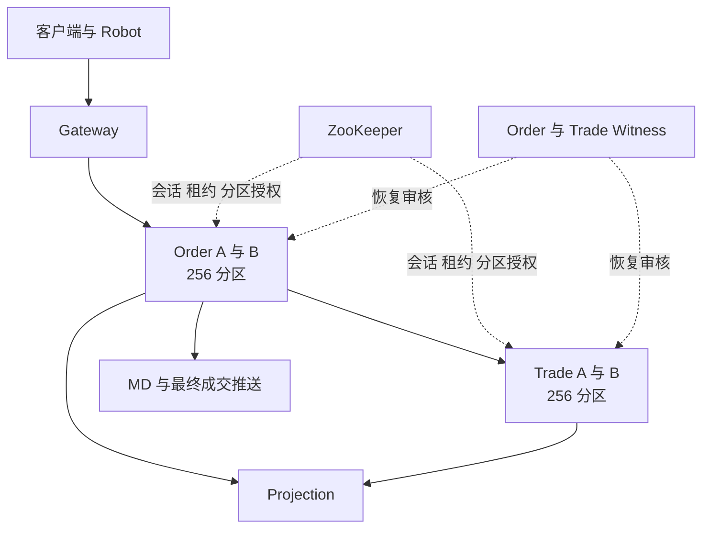
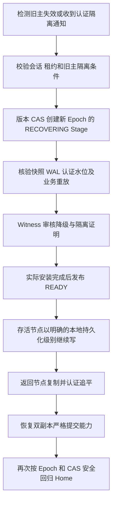

# OpenTradingCore 当前集群机制审阅

更新于 2026 年 11 月 13 日。对应 Common `5b2ad4c6`，运行 JAR SHA256 为 `2571ee62270ca5e280100423954eb5d1183380a78268fff3422b21af5faceb4e`。

当前实现采用 ZooKeeper 管理节点授权和分区角色，A/B 保存业务日志，独立身份的 Witness 审核降级恢复。Common 提供通用持久化与恢复，Order 和 Trade 分别负责撮合与资金状态机。该版本曾通过底层及四方向业务故障验证。11 月 13 日的后续负载与故障组合又发现结算失序及混合确认路径恢复阻塞，生产交付状态为 NO_GO。

## 服务与分区

Order 和 Trade 各有 256 个分区，分别由自己的 A/B 节点承载。正常状态下 A、B 各主写 128 个分区，同时备份对端的 128 个分区。每个分区有稳定的 Home Primary，以及当前实际持有写权的 Current Primary。

| 组件 | 当前职责 |
|---|---|
| Common | 不透明业务字节的 WAL、复制、快照、提交水位、授权检查、故障接管及回归 |
| Order | 委托状态、订单簿、撮合、撮合意图、结算回执及其重放 |
| Trade | 资金、冻结、持仓、结算、财务去重及其重放 |
| ZooKeeper | 节点会话、临时租约、分区清单及带版本的角色更新 |
| Witness | 使用独立身份验证恢复前缀和隔离条件，签发降级恢复授权 |
| Projection | 从已认证业务日志生成 MySQL 查询视图 |
| MD | 发布盘口和成交，处理恢复后的去重与订阅 |
| Gateway | 接入、鉴权、请求路由与最终消息转发 |

Order 的路由键包含租户、市场及品种，Trade 按租户路由。因此一笔成交通常跨越 Order 和 Trade 两个独立的分区状态机。跨服务结算的一致性由业务流程和持久化重试实现。[职责约束](ARCHITECTURE_SIMPLE_COMMON_BOUNDARY_20261029.zh-CN.md)、[Home 设计](COMMON_AB_HOME_PRIMARY_AUTO_FAILBACK_ARCHITECTURE_20261031.zh-CN.md)

## 当前本机拓扑

当前 Mac 使用一个 Colima 虚拟机，8 vCPU、12 GiB 内存。四个核心进程各有 4 CPU、2 GiB 配额，共同分享这台虚拟机资源。旧 `ha-test-sshfs` 环境已按用户授权正常关停，磁盘保留。

当前 ZooKeeper 容器配置为单节点 standalone。Order 与 Trade 各有一个 Witness 容器，Witness 具有 A/B 数据目录的只读挂载，并拥有自己的签名身份和可写恢复回执目录。A/B、Witness、ZooKeeper 和业务数据都依赖同一台 Mac、同一虚拟机与本机存储。

这些配置支持进程故障、在线替换及持久化恢复验证。整台 Mac 故障、虚拟机故障、共享磁盘损坏和跨主机网络分区需要在独立故障域拓扑中另行验收。生产部署还需要核查 Witness 能否在旧主磁盘完全不可达时完成恢复审核。当前 Common 恢复接口中存在对两端物理数据路径的读取。[Witness 实现](https://github.com/bliplink/com.app.common/blob/5b2ad4c6e305d81bf43abe1ea4ea5b82cad102ce/src/main/java/com/app/common/replication/CommonCertifiedFirstReadyE2Witness.java)、[部署接线](https://github.com/bliplink/dc-quant-deploy/blob/2f9eb5a/scripts/mac-demo-fresh.py)

## 两种确认模式

分区当前的复制状态与客户端确认策略是两个维度。正常双节点时，分区仍有严格的双端认证提交水位，客户端可以选择等待双端确认，或在主节点本地落盘后先返回。节点故障后，Common 可以通过新 Epoch 授权单节点持久化。

| 场景 | 返回所需条件 | 已确认数据的故障边界 |
|---|---|---|
| 正常双节点严格确认 | 主备 WAL 落盘、签名提交证明及必要回执持久化，当前写权仍有效 | 在保留认证副本的单节点故障范围内恢复已确认前缀 |
| 正常双节点异步确认 | 主节点 WAL 落盘、业务应用及当前写权检查完成，后台继续复制 | 未复制的已确认尾部可在主节点故障后丢失 |
| 故障后单节点确认 | 新 Epoch 的合法单节点授权，本机落盘并应用 | 依赖存活节点的本地持久化，后续再追平备节点 |

异步和单节点最终成交回执携带 `LOCAL_DURABLE_ASYNC`、`QuorumDurable=false`、`RpoRisk=true` 等信息。严格确认对应 `QUORUM_DURABLE` 和无单副本风险标记。HTTP 接口确认与最终成交回执分别测量，判断交易完成需要核对最终成交、资金持仓和持久化状态。[确认边界](https://github.com/bliplink/com.app.common/blob/5b2ad4c6e305d81bf43abe1ea4ea5b82cad102ce/src/main/java/com/app/common/replication/CertifiedBusinessCommandBoundary.java)、[Trade 回执传递](https://github.com/bliplink/com.app.dc.ordersvr/blob/a478e35baff86c46603c4f7b50e90a03d5827bb5/src/main/java/com/app/dc/service/state/OrderSignedMatchDeliveryWorker.java)

## 严格写入流程

1. 业务层校验并准备状态变化，将不可变命令交给 Common。
2. Common 检查缓存中的当前分区角色、Epoch 和节点租约。
3. 主节点追加业务 WAL 并执行物理落盘。
4. 通过现有 Netty 复制通道发送原始记录，备节点落盘并返回签名回执。
5. 主节点生成并持久化 CommitIndex 所需的认证提交证明。
6. 双端安装提交证书，保存必要的安装回执及回执账本。
7. 再次检查物理证明和当前写权，完成业务应用并允许对外确认。

RF2 的严格数据多数要求 A/B 两个数据节点。Witness 参与降级授权审核，其签名不能充当第二份业务数据落盘回执。

当前每次普通提交调用已有 GroupCommit 时传入单条命令。写路径还包含多轮签名、提交索引、证书安装和目录落盘，因此每笔命令承担多个同步持久化步骤。业务线程通过本地授权缓存检查写权，ZooKeeper 读写由控制线程承担。[提交流程](https://github.com/bliplink/com.app.common/blob/5b2ad4c6e305d81bf43abe1ea4ea5b82cad102ce/src/main/java/com/app/common/replication/CertifiedBusinessCommandBoundary.java)、[复制与证书安装](https://github.com/bliplink/com.app.common/blob/5b2ad4c6e305d81bf43abe1ea4ea5b82cad102ce/src/main/java/com/app/common/replication/DirectNettyCertifiedBusinessTransport.java)

## 异步写入流程与背压

正常双节点异步模式先完成本地 WAL 落盘、业务应用和授权检查，再由后台执行同一套复制及提交证明流程。恢复时可以使用的双端认证水位随后台复制推进。

当前每个分区最多保留一条尚未完成复制的本地已确认命令。下一次追加需要等待上一条复制完成，或等待 Common 完成合法的状态转换。每个 JVM 共享 8 个异步复制线程。这一限制简化了现有精确物理头与恢复证明，也使备节点延迟和证书处理速度通过背压影响后续业务。

因此，异步确认主要缩短当前请求等待备节点的时间，持续吞吐仍受复制链路约束。扩大待复制队列需要同时定义有界积压、快照边界、故障截断及恢复行为，并重新完成物理门禁。[单条待复制限制](https://github.com/bliplink/com.app.common/blob/5b2ad4c6e305d81bf43abe1ea4ea5b82cad102ce/src/main/java/com/app/common/replication/CertifiedBusinessCommandBoundary.java)

## 写权与旧主隔离

节点控制线程定期从 ZooKeeper 取得并验证整节点授权快照。写入路径检查分区角色、Epoch、授权有效期和隔离状态。Watch 或会话事件会撤销旧授权缓存，后台验证完成后再安装新授权。租约过期后，旧写权保持隔离。

| 当前参数 | 实际配置或观测 |
|---|---|
| 节点写租约 | 15 秒 |
| 节点续租间隔 | 1 秒 |
| 恢复轮询间隔 | 200 毫秒 |
| 快照扫描间隔 | 60 秒 |
| ZooKeeper 客户端请求的会话超时 | 120 秒 |
| 本轮服务日志中的实际协商会话超时 | 40 秒 |

单分区出现不确定 WAL 或应用结果时，Common 会隔离该分区，并通过签名通知进入现有恢复路径。整个节点的授权发生不可恢复隔离时，专用 voter 可以退出，由 Docker 的正式重启策略重新拉起并走认证恢复。故障演练保留的旧容器关闭自动重启，正式 replacement 保持原重启策略。

当前授权快照覆盖整节点分区，清单变化会影响授权缓存刷新。最近修复允许单节点写入在认证清单持续推进时继续等待合法授权，实际 Epoch、角色或隔离拒绝仍立即生效。[节点授权](https://github.com/bliplink/com.app.common/blob/5b2ad4c6e305d81bf43abe1ea4ea5b82cad102ce/src/main/java/com/app/common/replication/NodeClusterControlManager.java)、[授权表与隔离](https://github.com/bliplink/com.app.common/blob/5b2ad4c6e305d81bf43abe1ea4ea5b82cad102ce/src/main/java/com/app/common/replication/NodePartitionGrantTable.java)

## 故障接管与恢复

恢复遵循认证提交前缀，校验快照与 WAL 哈希、Epoch、水位、安装结果及原节点身份。当前分区的 `RECOVERING` 状态阻止对外写入，实际重放和安装完成后才能发布 `READY`。未认证尾部的处理遵守所选确认策略与已经接受的异步 RPO 边界。

返回节点先追平，再通过同一 Common 角色变更机制完成自动回主。A 恢复后重新持有自己的 128 个 Home 分区，B 同理。恢复流程中会经历隔离、降级、双副本重建及 Home 角色交换，因此单次物理故障可跨越多个 Epoch。[恢复与 Home 驱动](https://github.com/bliplink/com.app.common/blob/5b2ad4c6e305d81bf43abe1ea4ea5b82cad102ce/src/main/java/com/app/common/replication/CommonCertifiedWitnessedReturnRunner.java)、[故障观察器](https://github.com/bliplink/com.app.common/blob/5b2ad4c6e305d81bf43abe1ea4ea5b82cad102ce/src/main/java/com/app/common/replication/CommonCertifiedFailoverWatch.java)

当前共享分区清单中的恢复 Stage 逐个推进，Witness 检查也要求对应的唯一当前 Stage。单节点回归驱动使用一个线程，每轮推进一个分区，共享 cold probe 线程数为 2。全量 256 分区的证明、落盘、轮询和角色更新累积为分钟级耗时。200 毫秒轮询间隔单独不能代表故障恢复时间。[Stage 审核](https://github.com/bliplink/com.app.common/blob/5b2ad4c6e305d81bf43abe1ea4ea5b82cad102ce/src/main/java/com/app/common/replication/CommonCertifiedFirstReadyE2Witness.java)

## Order 与 Trade 的成交链路

资金模式下，一笔撮合至少包含三个有因果依赖的业务提交阶段。

1. Order 将撮合结果、双方委托变化及确定性成交身份写入自己的 Common WAL。
2. Order 从已提交日志投影出的待结算意图向 Trade 发送签名请求。Trade 校验原始撮合，持久化并应用双方资金、持仓和去重状态。
3. Trade 返回签名结算回执。Order 将该回执再次写入自己的 Common WAL，随后发布最终客户成交与 MD 消息。

Order 的待结算索引从 Common 日志和快照重建。重试使用原 MatchKey 与确定性 ExecID，Trade 依靠持久化业务去重防止重复经济效果。当前即时发送与回执处理共用两个线程，并有周期性的有界重试扫描。[Order 结算投递](https://github.com/bliplink/com.app.dc.ordersvr/blob/a478e35baff86c46603c4f7b50e90a03d5827bb5/src/main/java/com/app/dc/service/state/OrderSignedMatchDeliveryWorker.java)、[待结算索引](https://github.com/bliplink/com.app.dc.ordersvr/blob/a478e35baff86c46603c4f7b50e90a03d5827bb5/src/main/java/com/app/dc/service/state/OrderCertifiedMatchOutbox.java)

订单撮合状态、Trade 结算、Order 最终结算确认及 SQL 明细投影有各自的推进位置。审阅交易完成语义时，需要明确查询接口和客户消息分别对应哪个位置。

当前异步 15 笔每秒用例已触发 Trade 的 `TRADE_COMMON_FILL_OVERFILL_OR_INCONSISTENT_REMAINDER` 拒绝，900 个订单状态已为 Filled，最终回执与成交明细未全部完成。该用例保持 NO_GO，正在核查连续部分成交的投递顺序、累计成交量和剩余量。该问题属于业务结算链路，Common 的物理日志一致不能单独保证跨服务经济结果完成。[Trade 余量校验](https://github.com/bliplink/com.app.dc.tradesvr/blob/aefad60d5107f9b595b20c7b20bb5008584eb3f3/src/main/java/com/app/dc/service/order/TradeCertifiedOpenFillPlan.java)

在验修复 `55234c2` 让初次结算按分区内的日志前序推进，并在前一笔 Order 结算回执持久化后继续下一笔。已经本地确认的成交保留独立的补复制重试能力。该修复复用了原待结算索引和发送线程，已通过 198 项 Order 测试，含 2 项原有环境依赖跳过，已在原现场完成 Order A 正常退出及 Order B 强制终止的滚动替换，后续 Trade 单节点演练遇到下述 Common 阻塞。原 900 笔订单后来全部完成结算，身份、资金持仓和 MD 精确核对通过，原压测窗口仍保留失败结果。[候选投递实现](https://github.com/bliplink/com.app.dc.ordersvr/blob/55234c23a3ab28f65d30efb7253935c9f7f72847/src/main/java/com/app/dc/service/state/OrderSignedMatchDeliveryWorker.java)

## 异步尾部丢失后的恢复边界

用户已选择按备节点认证水位立即接管，接受尚未复制的已确认尾部可能丢失。旧主返回时需要服从新 Epoch 的权威历史，恢复流程必须处理旧主额外尾部与新历史的冲突。

已通过的实际演练中，Trade 主节点确认第 99 条时备节点仍为第 98 条。主节点被杀后，存活的 Order 撮合意图自动重放，原成交身份只产生一次经济效果，最终双副本和资金持仓核对一致。这一恢复能力依赖原 Order 意图或其他有效重放源仍存在。若相关意图与唯一交易尾部同时消失，自动恢复的保证需要另行定义。[实测记录](T554_CROSS_EPOCH_BUSINESS_ACCEPTANCE_20261110.zh-CN.md)

## 合理性审阅重点

| 事项 | 当前判断 | 需要审阅或验证的内容 |
|---|---|---|
| 通用库与业务职责 | Common 保持不透明字节边界，Order 和 Trade 各负责领域状态 | 跨服务结算顺序与回执完成语义继续在业务层修复 |
| 严格与异步承诺 | 已明确本地落盘、双端提交及异步丢失边界 | 接口确认、委托状态与最终成交的用户语义应保持一致 |
| RF2 降级 | 能维持单节点运行，同时暴露副本风险 | 故障策略与可接受 RPO、RTO 需要共同验收 |
| 写路径证明链 | 物理回执、证书托管和账本提供了可核验恢复依据 | 逐项证明哪些落盘必需，评估已有批量提交与重复持久化成本 |
| 签名的威胁模型 | 当前每笔提交和恢复证据包含多处签名及验证 | 明确防篡改审计、进程故障和恶意节点分别需要哪些证明 |
| 全量分区恢复 | 已具备自动接管、追平及回主能力 | 单 Stage、单回归驱动和全节点清单粒度造成明显串行成本 |
| 正常异步背压 | 每分区一条未复制命令保持了简单恢复边界 | 单副本延迟会传导到后续吞吐，需评估有界批量与流控 |
| Witness 数据访问 | 本机通过只读挂载检查两端物理证据 | 旧主整机与磁盘不可达时，应靠存活证据完成接管 |
| 历史证明与磁盘增长 | 多 Epoch 恢复依赖出生凭据、退休前缀和安装回执 | 明确快照之后旧证明的归档边界及自动保留上限 |
| 生产故障域 | 本机进程与逻辑数据目录分离 | 多主机数据副本、独立 Witness 和 ZooKeeper 多节点拓扑仍需验收 |
| 连续部分成交 | 已发现高负载下余量拒绝和结算积压 | 先修复因果顺序并验证原成交身份，再继续高负载测试 |

优先保留旧主隔离、明确提交边界、真实物理回执和可重放业务身份。精简应围绕重复证明、串行调度和日志投递展开，每一项变化都需要通过相应故障与业务门禁。

## 当前结果与剩余工作

精确 Common 已通过 210 项安全测试、13 项原生故障测试，以及双向全 256 分区接管、恢复中断续接、第三次崩溃和再次回主验证。最新业务代完成真实异步 RPO、Order A/B、Trade A/B 带 Robot 故障，以及恢复后的六组下撤单和 10Robot 稳态检查。

| 已完成测量 | 结果 |
|---|---|
| 最新四方向业务全量接管 | 约 201 至 251 秒 |
| 最新四方向追平回归 | 约 502 至 522 秒 |
| 最新严格客户端 10 笔每秒 | 600 笔全部在 60 秒窗口内完成，最终成交 P99 约 98 毫秒 |
| 最新严格 50Robot | 8.88 笔成交每秒，服务内成交 P99 约 452 毫秒 |
| 最新异步客户端 10 笔每秒 | 600 笔完成，最终成交 P99 约 208 毫秒 |
| 最新异步客户端 15 笔每秒 | 60 秒窗内 165 笔最终成交，限定排空后 169 笔，已收到成交的 P99 约 70.4 秒，结算拒绝待修复 |

严格固定速率样本有 10 个背景 Robot。异步 10 和 15 笔样本实际有 11 个背景 Robot，额外成员来自此前准备失败的测试租户。该成员已正常收回，准备流程已修复，后续复测固定原 10 个成员。原结果保留其实际负载条件。

分钟级恢复与高负载结算问题仍阻止生产级交付。当前继续修复结算顺序并核对现场，随后补齐异步 50Robot、严格 15 笔每秒和修复后的完整对照。测试窗口、测量口径和失败记录见持续验收文档。[持续验收记录](T554_CROSS_EPOCH_BUSINESS_ACCEPTANCE_20261110.zh-CN.md)

## 11 月 13 日补充发现与修复状态

10 点的 Trade A 强制终止演练中，存活 B 的 255 个分区进入新 Epoch 单副本状态，P143 一直保留 E2 严格角色。只读观察确认 P143 的 WAL 约 12 KiB，物理写入器已 poison。实际异常来自同一时刻的一笔入金，第 7 条严格写入在等待独立备节点落盘回执时失败，接口返回失败。原先 6 条认证提交和第 7 条未确认尾部均保留。

客户端默认异步策略与业务实际调用可以并存。当前入金等未要求签名成交回执的路径仍调用严格确认接口，成交结算调用按默认策略选择的接口。恢复选择原先只检查命名空间的默认异步策略，于是要求已隔离的 P143 提供健康本地主证明，形成持续拒绝。审阅时应逐条核对业务调用的真实持久化承诺，不能从全局模式推断每条写入的承诺。

Common 候选 `9effc473` 在既有写入器内标记尚未完成独立认证的严格提交。严格调用开始前会等待此前的异步复制排空，因此此类失败可以使用原双端认证前缀恢复。选择恢复源和签署原有退休回执时都保持严格前缀边界，原始未确认尾部继续保存。候选还覆盖严格写入进行中与恢复扫描交错的情况，完整安全测试与物理故障门禁正在执行，尚未部署到业务进程。[Common 候选](https://github.com/bliplink/com.app.common/commit/9effc47389a56306f1ec076294b9f3cb3243c2e8)

本轮 Trade 演练已记录 NO_GO 并取消后续压测。为保留现场并准备同机顺序部署，当前 Robot 与核心服务处于维护停写窗口。业务数据未删除，虚拟磁盘空闲块已在核心停写后回收，主机可用空间从约 7.5 GiB 恢复至约 16 GiB。待精确 Common 候选完成门禁后，继续部署、业务故障与固定背景负载复测。

11 时 24 分补充。修订测试夹具后的精确候选为 Common `f1649ede`，生产逻辑与 `9effc473` 相同，JAR SHA256 为 `11eacdf419334d67c82934faa45aad9da462db4402707ca7c4c101c324574683`。210 项安全测试及 13 项真实进程故障测试全部通过，新增组合已验证单节点接管、已确认异步数据保留、失败严格尾部排除，以及对端重启后的继续写入和 Home 回归。双向全 256 分区与中断恢复门禁仍在执行，业务环境仍处于维护窗口。
