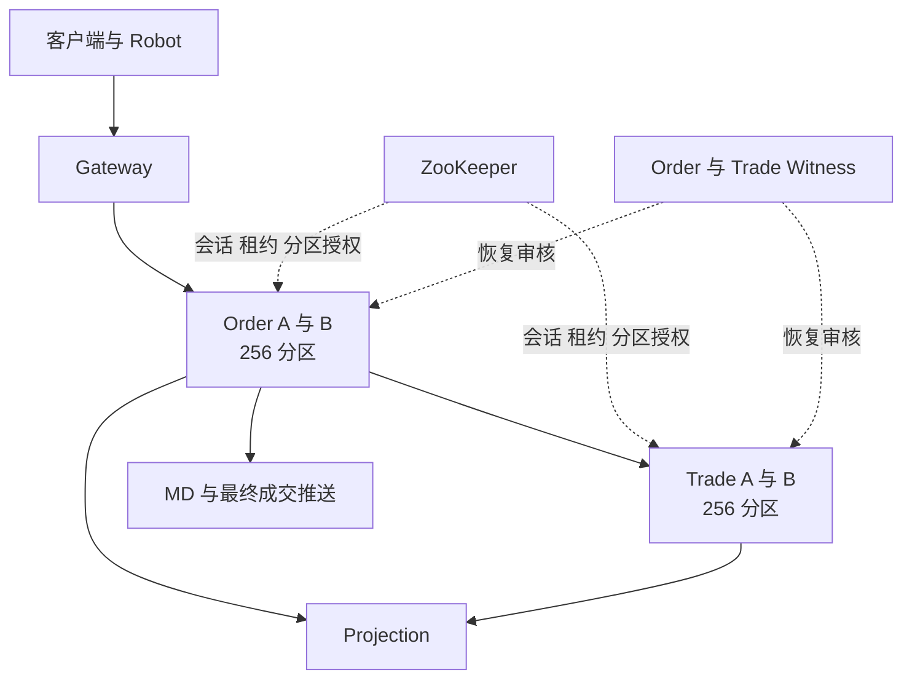
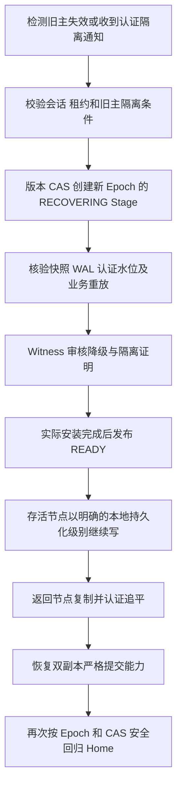

# OpenTradingCore 当前集群机制审阅

更新于 2026 年 11 月 14 日 00 时 25 分。现役开发 Demo 为 `mac-demo-20261113-234403`，使用此前验证过的 Common `f1649ede`，运行 JAR SHA256 为 `11eacdf419334d67c82934faa45aad9da462db4402707ca7c4c101c324574683`。Order 源码为 `8e1de5e`。磁盘空间不足导致旧环境存储错误后，已按用户授权在同一 Mac 顺序重建开发 Demo。真实成交、Order Only、公开成交映射、10 个 Robot 及资金持仓投影核对通过。旧环境数据另有完整归档。

当前实现采用 ZooKeeper 管理节点授权和分区角色，A/B 保存业务日志，独立身份的 Witness 审核降级恢复。Common 提供通用持久化与恢复，Order 和 Trade 分别负责撮合与资金状态机。历史严格模式四方向业务故障已通过，异步模式第四方向暴露的堆耗尽和冷启动缺口仍在修复。Common 新候选 `47a1f5d` 正在执行精确版本完整门禁。现役新 Demo 的业务通过记录覆盖正常交易，A/B 故障验收待本轮复测。整体生产恢复、性能及多主机故障域验收均为 NO_GO。后文带时间的进展段落保留历史状态，最新进展见文末。

## 服务与分区

Order 和 Trade 各有 256 个分区，分别由自己的 A/B 节点承载。正常状态下 A、B 各主写 128 个分区，同时备份对端的 128 个分区。每个分区有稳定的 Home Primary，以及当前实际持有写权的 Current Primary。

| 组件 | 当前职责 |
|---|---|
| Common | 不透明业务字节的 WAL、复制、快照、提交水位、授权检查、故障接管及回归 |
| Order | 委托状态、订单簿、撮合、撮合意图、结算回执及其重放 |
| Trade | 资金、冻结、持仓、结算、财务去重及其重放 |
| ZooKeeper | 节点会话、临时租约、分区清单及带版本的角色更新 |
| Witness | 使用独立身份验证恢复前缀和隔离条件，签发降级恢复授权 |
| Projection | 从已认证业务日志生成 MySQL 查询视图 |
| MD | 发布盘口和成交，处理恢复后的去重与订阅 |
| Gateway | 接入、鉴权、请求路由与最终消息转发 |

Order 的路由键包含租户、市场及品种，Trade 按租户路由。因此一笔成交通常跨越 Order 和 Trade 两个独立的分区状态机。跨服务结算的一致性由业务流程和持久化重试实现。[职责约束](ARCHITECTURE_SIMPLE_COMMON_BOUNDARY_20261029.zh-CN.md)、[Home 设计](COMMON_AB_HOME_PRIMARY_AUTO_FAILBACK_ARCHITECTURE_20261031.zh-CN.md)

## 当前本机拓扑

当前 Mac 使用一个 Colima 虚拟机，8 vCPU、12 GiB 内存。四个核心进程各有 4 CPU、2 GiB 配额，共同分享这台虚拟机资源。旧 `ha-test-sshfs` 环境已按用户授权正常关停，磁盘保留。

当前 ZooKeeper 容器配置为单节点 standalone。Order 与 Trade 各有一个 Witness 容器，Witness 具有 A/B 数据目录的只读挂载，并拥有自己的签名身份和可写恢复回执目录。A/B、Witness、ZooKeeper 和业务数据都依赖同一台 Mac、同一虚拟机与本机存储。

这些配置支持进程故障、在线替换及持久化恢复验证。整台 Mac 故障、虚拟机故障、共享磁盘损坏和跨主机网络分区需要在独立故障域拓扑中另行验收。生产部署还需要核查 Witness 能否在旧主磁盘完全不可达时完成恢复审核。当前 Common 恢复接口中存在对两端物理数据路径的读取。[Witness 实现](https://github.com/bliplink/com.app.common/blob/f1649ede21e2bd0667f772594d2e84cd801f191f/src/main/java/com/app/common/replication/CommonCertifiedFirstReadyE2Witness.java)、[部署接线](https://github.com/bliplink/dc-quant-deploy/blob/2f9eb5a/scripts/mac-demo-fresh.py)

## 通信协议与压测口径

服务间业务 RPC 和 Common 复制采用 TCP／Netty。Gateway 同时提供原生 TCP、HTTP API 及 WebSocket 客户端入口。Netty 是网络框架，HTTP、WebSocket 和原生帧属于不同的应用协议。

| 测量 | 发单入口 | 最终成交观测 | 当前覆盖 |
|---|---|---|---|
| 10／50Robot 稳态 | Robot 的 GateWayApi 原生 TCP 长连接 | Order 处理及最终发布日志 | 已完成同版严格与异步测量 |
| Python 固定速率热点 | SDK 调用 Gateway HTTP API | 鉴权 WebSocket 成交推送 | 已完成同版 1／5／10／15／25 档 |
| 原生 TCP 固定速率热点 | 复用运行中 Robot 的 GateWayApi 依赖 | 同一原生 TCP 客户端订阅私有成交 | 严格模式 1／5／10 档已完成，后续档位继续测量 |

表中的接口成功数表示发单客户端收到业务成功响应，物理副本 ACK 由 Common 另行校验。最终成交通知又位于后续结算阶段。Python 端到端延迟包含 HTTP 入口和网关处理。Robot 服务内延迟从 Order 接收请求计起，省略了客户端至 Gateway 的入口段。

原生 TCP 固定速率客户端使用与 Robot 相同的 GateWayApi、V2 路由及正常鉴权，16 个请求上限、固定发单时刻及 30 秒限定尾部与已有入口测试一致。发单和最终回执的计时在同一 JVM 内完成。建户、入金、签名登录与 maker 准备通过已有 HTTP API 在测量窗外完成，依赖及编译字节均记录 SHA256。该客户端通过 77 项 Mac 测试及独立 Java 成交观测自检，真实严格模式测量见文末。

## 两种确认模式

分区当前的复制状态与客户端确认策略是两个维度。正常双节点时，分区仍有严格的双端认证提交水位，客户端可以选择等待双端确认，或在主节点本地落盘后先返回。节点故障后，Common 可以通过新 Epoch 授权单节点持久化。

| 场景 | 返回所需条件 | 已确认数据的故障边界 |
|---|---|---|
| 正常双节点严格确认 | 主备 WAL 落盘、签名提交证明及必要回执持久化，当前写权仍有效 | 在保留认证副本的单节点故障范围内恢复已确认前缀 |
| 正常双节点异步确认 | 主节点 WAL 落盘、业务应用及当前写权检查完成，后台继续复制 | 未复制的已确认尾部可在主节点故障后丢失 |
| 故障后单节点确认 | 新 Epoch 的合法单节点授权，本机落盘并应用 | 依赖存活节点的本地持久化，后续再追平备节点 |

异步和单节点最终成交回执携带 `LOCAL_DURABLE_ASYNC`、`QuorumDurable=false`、`RpoRisk=true` 等信息。严格确认对应 `QUORUM_DURABLE` 和无单副本风险标记。HTTP 接口确认与最终成交回执分别测量，判断交易完成需要核对最终成交、资金持仓和持久化状态。[确认边界](https://github.com/bliplink/com.app.common/blob/f1649ede21e2bd0667f772594d2e84cd801f191f/src/main/java/com/app/common/replication/CertifiedBusinessCommandBoundary.java)、[Trade 回执传递](https://github.com/bliplink/com.app.dc.ordersvr/blob/8e1de5e40377576dd6b92dffaa151b2cbf2f4b12/src/main/java/com/app/dc/service/state/OrderSignedMatchDeliveryWorker.java)

## 严格写入流程

1. 业务层校验并准备状态变化，将不可变命令交给 Common。
2. Common 检查缓存中的当前分区角色、Epoch 和节点租约。
3. 主节点追加业务 WAL 并执行物理落盘。
4. 通过现有 Netty 复制通道发送原始记录，备节点落盘并返回签名回执。
5. 主节点生成并持久化 CommitIndex 所需的认证提交证明。
6. 双端安装提交证书，保存必要的安装回执及回执账本。
7. 再次检查物理证明和当前写权，完成业务应用并允许对外确认。

RF2 的严格数据多数要求 A/B 两个数据节点。Witness 参与降级授权审核，其签名不能充当第二份业务数据落盘回执。

当前每次普通提交调用已有 GroupCommit 时传入单条命令。写路径还包含多轮签名、提交索引、证书安装和目录落盘，因此每笔命令承担多个同步持久化步骤。业务线程通过本地授权缓存检查写权，ZooKeeper 读写由控制线程承担。[提交流程](https://github.com/bliplink/com.app.common/blob/f1649ede21e2bd0667f772594d2e84cd801f191f/src/main/java/com/app/common/replication/CertifiedBusinessCommandBoundary.java)、[复制与证书安装](https://github.com/bliplink/com.app.common/blob/f1649ede21e2bd0667f772594d2e84cd801f191f/src/main/java/com/app/common/replication/DirectNettyCertifiedBusinessTransport.java)

## 异步写入流程与背压

正常双节点异步模式先完成本地 WAL 落盘、业务应用和授权检查，再由后台执行同一套复制及提交证明流程。恢复时可以使用的双端认证水位随后台复制推进。

当前每个分区最多保留一条尚未完成复制的本地已确认命令。下一次追加需要等待上一条复制完成，或等待 Common 完成合法的状态转换。每个 JVM 共享 8 个异步复制线程。这一限制简化了现有精确物理头与恢复证明，也使备节点延迟和证书处理速度通过背压影响后续业务。

因此，异步确认主要缩短当前请求等待备节点的时间，持续吞吐仍受复制链路约束。扩大待复制队列需要同时定义有界积压、快照边界、故障截断及恢复行为，并重新完成物理门禁。[单条待复制限制](https://github.com/bliplink/com.app.common/blob/f1649ede21e2bd0667f772594d2e84cd801f191f/src/main/java/com/app/common/replication/CertifiedBusinessCommandBoundary.java)

## 写权与旧主隔离

节点控制线程定期从 ZooKeeper 取得并验证整节点授权快照。写入路径检查分区角色、Epoch、授权有效期和隔离状态。Watch 或会话事件会撤销旧授权缓存，后台验证完成后再安装新授权。租约过期后，旧写权保持隔离。

| 当前参数 | 实际配置或观测 |
|---|---|
| 节点写租约 | 15 秒 |
| 节点续租间隔 | 1 秒 |
| 恢复轮询间隔 | 200 毫秒 |
| 快照扫描间隔 | 60 秒 |
| ZooKeeper 客户端请求的会话超时 | 120 秒 |
| 本轮服务日志中的实际协商会话超时 | 40 秒 |

单分区出现不确定 WAL 或应用结果时，Common 会隔离该分区，并通过签名通知进入现有恢复路径。整个节点的授权发生不可恢复隔离时，专用 voter 可以退出，由 Docker 的正式重启策略重新拉起并走认证恢复。故障演练保留的旧容器关闭自动重启，正式 replacement 保持原重启策略。

当前授权快照覆盖整节点分区，清单变化会影响授权缓存刷新。最近修复允许单节点写入在认证清单持续推进时继续等待合法授权，实际 Epoch、角色或隔离拒绝仍立即生效。[节点授权](https://github.com/bliplink/com.app.common/blob/f1649ede21e2bd0667f772594d2e84cd801f191f/src/main/java/com/app/common/replication/NodeClusterControlManager.java)、[授权表与隔离](https://github.com/bliplink/com.app.common/blob/f1649ede21e2bd0667f772594d2e84cd801f191f/src/main/java/com/app/common/replication/NodePartitionGrantTable.java)

## 故障接管与恢复

恢复遵循认证提交前缀，校验快照与 WAL 哈希、Epoch、水位、安装结果及原节点身份。当前分区的 `RECOVERING` 状态阻止对外写入，实际重放和安装完成后才能发布 `READY`。未认证尾部的处理遵守所选确认策略与已经接受的异步 RPO 边界。

返回节点先追平，再通过同一 Common 角色变更机制完成自动回主。A 恢复后重新持有自己的 128 个 Home 分区，B 同理。恢复流程中会经历隔离、降级、双副本重建及 Home 角色交换，因此单次物理故障可跨越多个 Epoch。[恢复与 Home 驱动](https://github.com/bliplink/com.app.common/blob/f1649ede21e2bd0667f772594d2e84cd801f191f/src/main/java/com/app/common/replication/CommonCertifiedWitnessedReturnRunner.java)、[故障观察器](https://github.com/bliplink/com.app.common/blob/f1649ede21e2bd0667f772594d2e84cd801f191f/src/main/java/com/app/common/replication/CommonCertifiedFailoverWatch.java)

当前共享分区清单中的恢复 Stage 逐个推进，Witness 检查也要求对应的唯一当前 Stage。单节点回归驱动使用一个线程，每轮推进一个分区，共享 cold probe 线程数为 2。全量 256 分区的证明、落盘、轮询和角色更新累积为分钟级耗时。200 毫秒轮询间隔单独不能代表故障恢复时间。[Stage 审核](https://github.com/bliplink/com.app.common/blob/f1649ede21e2bd0667f772594d2e84cd801f191f/src/main/java/com/app/common/replication/CommonCertifiedFirstReadyE2Witness.java)

## Order 与 Trade 的成交链路

资金模式下，一笔撮合至少包含三个有因果依赖的业务提交阶段。

1. Order 将撮合结果、双方委托变化及确定性成交身份写入自己的 Common WAL。
2. Order 从已提交日志投影出的待结算意图向 Trade 发送签名请求。Trade 校验原始撮合，持久化并应用双方资金、持仓和去重状态。
3. Trade 返回签名结算回执。Order 将该回执再次写入自己的 Common WAL，随后发布最终客户成交与 MD 消息。

Order 的待结算索引从 Common 日志和快照重建。重试使用原 MatchKey 与确定性 ExecID，Trade 依靠持久化业务去重防止重复经济效果。当前即时发送与回执处理共用两个线程，并有周期性的有界重试扫描。[Order 结算投递](https://github.com/bliplink/com.app.dc.ordersvr/blob/8e1de5e40377576dd6b92dffaa151b2cbf2f4b12/src/main/java/com/app/dc/service/state/OrderSignedMatchDeliveryWorker.java)、[待结算索引](https://github.com/bliplink/com.app.dc.ordersvr/blob/8e1de5e40377576dd6b92dffaa151b2cbf2f4b12/src/main/java/com/app/dc/service/state/OrderCertifiedMatchOutbox.java)

订单撮合状态、Trade 结算、Order 最终结算确认及 SQL 明细投影有各自的推进位置。审阅交易完成语义时，需要明确查询接口和客户消息分别对应哪个位置。

此前 Order FIFO 修复前的异步 15 笔每秒用例触发 Trade 的 `TRADE_COMMON_FILL_OVERFILL_OR_INCONSISTENT_REMAINDER` 拒绝，900 个订单状态为 Filled，限定窗口内最终回执与成交明细未全部完成。原压测窗口保持 NO_GO，后续已通过原成交身份重试完成全部 900 笔结算并核对一致。该问题属于业务结算链路，Common 的物理日志一致不能单独保证跨服务经济结果完成。[Trade 余量校验](https://github.com/bliplink/com.app.dc.tradesvr/blob/aefad60d5107f9b595b20c7b20bb5008584eb3f3/src/main/java/com/app/dc/service/order/TradeCertifiedOpenFillPlan.java)

已部署修复 `55234c2` 让初次结算按分区内的日志前序推进，并在前一笔 Order 结算回执持久化后继续下一笔。已经本地确认的成交保留独立的补复制重试能力。该修复复用了原待结算索引和发送线程，已通过 198 项 Order 测试，含 2 项原有环境依赖跳过，已在原现场完成 Order A 正常退出及 Order B 强制终止的滚动替换，后续 Trade 单节点演练遇到下述 Common 阻塞。原 900 笔订单后来全部完成结算，身份、资金持仓和 MD 精确核对通过，原压测窗口仍保留失败结果。[候选投递实现](https://github.com/bliplink/com.app.dc.ordersvr/blob/55234c23a3ab28f65d30efb7253935c9f7f72847/src/main/java/com/app/dc/service/state/OrderSignedMatchDeliveryWorker.java)

## 异步尾部丢失后的恢复边界

用户已选择按备节点认证水位立即接管，接受尚未复制的已确认尾部可能丢失。旧主返回时需要服从新 Epoch 的权威历史，恢复流程必须处理旧主额外尾部与新历史的冲突。

已通过的实际演练中，Trade 主节点确认第 99 条时备节点仍为第 98 条。主节点被杀后，存活的 Order 撮合意图自动重放，原成交身份只产生一次经济效果，最终双副本和资金持仓核对一致。这一恢复能力依赖原 Order 意图或其他有效重放源仍存在。若相关意图与唯一交易尾部同时消失，自动恢复的保证需要另行定义。[实测记录](T554_CROSS_EPOCH_BUSINESS_ACCEPTANCE_20261110.zh-CN.md)

## 合理性审阅重点

| 事项 | 当前判断 | 需要审阅或验证的内容 |
|---|---|---|
| 通用库与业务职责 | Common 保持不透明字节边界，Order 和 Trade 各负责领域状态 | 跨服务结算顺序与回执完成语义继续在业务层修复 |
| 严格与异步承诺 | 已明确本地落盘、双端提交及异步丢失边界 | 接口确认、委托状态与最终成交的用户语义应保持一致 |
| RF2 降级 | 能维持单节点运行，同时暴露副本风险 | 故障策略与可接受 RPO、RTO 需要共同验收 |
| 写路径证明链 | 物理回执、证书托管和账本提供了可核验恢复依据 | 逐项证明哪些落盘必需，评估已有批量提交与重复持久化成本 |
| 签名的威胁模型 | 当前每笔提交和恢复证据包含多处签名及验证 | 明确防篡改审计、进程故障和恶意节点分别需要哪些证明 |
| 全量分区恢复 | 已具备自动接管、追平及回主能力 | 单 Stage、单回归驱动和全节点清单粒度造成明显串行成本 |
| 正常异步背压 | 每分区一条未复制命令保持了简单恢复边界 | 单副本延迟会传导到后续吞吐，需评估有界批量与流控 |
| Witness 数据访问 | 本机通过只读挂载检查两端物理证据 | 旧主整机与磁盘不可达时，应靠存活证据完成接管 |
| 历史证明与磁盘增长 | 多 Epoch 恢复依赖出生凭据、退休前缀和安装回执 | 明确快照之后旧证明的归档边界及自动保留上限 |
| 生产故障域 | 本机进程与逻辑数据目录分离 | 多主机数据副本、独立 Witness 和 ZooKeeper 多节点拓扑仍需验收 |
| 连续部分成交 | 已发现高负载下余量拒绝和结算积压 | 先修复因果顺序并验证原成交身份，再继续高负载测试 |

优先保留旧主隔离、明确提交边界、真实物理回执和可重放业务身份。精简应围绕重复证明、串行调度和日志投递展开，每一项变化都需要通过相应故障与业务门禁。

## 当前结果与剩余工作

精确 Common `f1649ede` 已通过 210 项安全测试、13 项原生故障测试，以及双向全 256 分区接管、恢复中断续接、第三次崩溃和再次回主验证。全量接管约 199 与 203 秒，回归 Home 约 420 与 372 秒。原 `mac-demo-20261113-115320` 已完成积压业务恢复与精确对账，数据随原代保留。同源码严格测量代 `mac-demo-20261113-134411` 已完成四方向持续 Robot 故障及故障后下撤单、10Robot 复测。异步代 `mac-demo-20261113-160211` 的受控成交 RPO、Trade B 强制终止、Order A 正常退出替换及 Order B 强制终止均通过。随后 Trade A 退出演练暴露存活节点内存耗尽及 LOCAL 主节点冷恢复缺口，本代整体保持 NO_GO，已退役并全量归档。当前严格开发代为 `mac-demo-20261113-183330`，已通过新部署基础业务验收。背景 Robot 缺少 Trade 冻结记录的撤单也待修复。

### 撤单修复前的历史异步固定速率测量

以下测量使用 Common `f1649ede`、Order FIFO 修复 `55234c2`，发生在撤单死锁及 Newing 定时调用修复部署之前。每窗 60 秒，背景严格固定 10 个 Robot，单租户、单品种、同一 taker 用户。资金账户各经正常接口入金 100000，最大 16 个 HTTP 请求在途。最终成交延迟包含从客户端发出到收到成交的全过程。

| 提交速率 | 计划数 | 窗内最终成交 | 限定排空后最终成交 | 最终成交 P99 | HTTP 确认 P99 | 结果 |
|---|---|---|---|---|---|---|
| 1 笔每秒 | 60 | 60 | 60 | 80.760 毫秒 | 36.188 毫秒 | PASS |
| 5 笔每秒 | 300 | 300 | 300 | 261.737 毫秒 | 93.671 毫秒 | PASS |
| 10 笔每秒 | 600 | 600 | 600 | 430.571 毫秒 | 134.866 毫秒 | PASS |
| 15 笔每秒 | 900 | 898 | 900 | 683.793 毫秒 | 206.425 毫秒 | 功能通过，窗口存在少量尾部 |
| 25 笔每秒 | 1500 | 855 | 1500 | 29.538 秒 | 375.119 毫秒 | 功能排空通过，性能明显积压 |
| 50 笔每秒 | 3000 | 327 | 907 | 71.005 秒 | 见原始报告 | NO_GO |

50 笔每秒用例实际发出并获接口确认 2819 笔，调度器丢弃 181 个计划槽位。907 是限定测量期间收到的最终成交数，后续持久化成交增加到 935。报告中的 P99 仅统计收到成交的样本，剩余未完成请求必须同时计入判断。100 笔每秒未执行。

单用户单品种压测已在 15 至 25 笔每秒之间出现明显排队拐点。它包含热点订单簿和按用户串行的 Trade 回调，尚不能据此推断分散业务的整集群最大容量。当前 10Robot 稳态为 603 笔成交、2.010 TPS，服务内成交 P99 为 101.706 毫秒。

### 本代下撤单测量

每组以完整下单、状态可见、撤单、订单消失为一个闭环。状态轮询间隔为 50 毫秒，背景为 2 个 Robot。

| 模式 | 并发数 | 完整闭环每秒 | 下单可见 P99 毫秒 | 撤单消失 P99 毫秒 |
|---|---|---|---|---|
| ORDER_ONLY | 1 | 19.694 | 35.690 | 49.865 |
| ORDER_ONLY | 4 | 25.432 | 155.393 | 127.391 |
| ORDER_ONLY | 8 | 26.441 | 284.356 | 192.504 |
| 资金模式 | 1 | 11.505 | 79.260 | 41.066 |
| 资金模式 | 4 | 20.487 | 230.421 | 141.547 |
| 资金模式 | 8 | 22.611 | 377.121 | 202.025 |

### 严格模式的历史对照

此前 Common `5b2ad4c6`、Order FIFO 修复前的严格模式，固定 10 笔每秒时 600 笔在窗口内完成，最终成交 P99 为 98.396 毫秒。50Robot 为 8.880 TPS，服务内成交 P99 为 452.097 毫秒。源码与当前异步样本不同，待当前恢复完成后，需使用同一批最新构建重新做严格与异步对照。

原故障和压测 NO_GO 记录继续保留。生产交付仍待本代四方向故障、分散业务压力、严格异步同版对照，以及恢复后的业务一致性验收。[持续验收记录](T554_CROSS_EPOCH_BUSINESS_ACCEPTANCE_20261110.zh-CN.md)

## 11 月 13 日补充发现与修复状态

10 点的 Trade A 强制终止演练中，存活 B 的 255 个分区进入新 Epoch 单副本状态，P143 一直保留 E2 严格角色。只读观察确认 P143 的 WAL 约 12 KiB，物理写入器已 poison。实际异常来自同一时刻的一笔入金，第 7 条严格写入在等待独立备节点落盘回执时失败，接口返回失败。原先 6 条认证提交和第 7 条未确认尾部均保留。

客户端默认异步策略与业务实际调用可以并存。当前入金等未要求签名成交回执的路径仍调用严格确认接口，成交结算调用按默认策略选择的接口。恢复选择原先只检查命名空间的默认异步策略，于是要求已隔离的 P143 提供健康本地主证明，形成持续拒绝。审阅时应逐条核对业务调用的真实持久化承诺，不能从全局模式推断每条写入的承诺。

Common 候选 `9effc473` 在既有写入器内标记尚未完成独立认证的严格提交。严格调用开始前会等待此前的异步复制排空，因此此类失败可以使用原双端认证前缀恢复。选择恢复源和签署原有退休回执时都保持严格前缀边界，原始未确认尾部继续保存。候选还覆盖严格写入进行中与恢复扫描交错的情况，完整安全测试与物理故障门禁正在执行，尚未部署到业务进程。[Common 候选](https://github.com/bliplink/com.app.common/commit/9effc47389a56306f1ec076294b9f3cb3243c2e8)

本轮 Trade 演练已记录 NO_GO 并取消后续压测。为保留现场并准备同机顺序部署，当前 Robot 与核心服务处于维护停写窗口。业务数据未删除，虚拟磁盘空闲块已在核心停写后回收，主机可用空间从约 7.5 GiB 恢复至约 16 GiB。待精确 Common 候选完成门禁后，继续部署、业务故障与固定背景负载复测。

11 时 24 分补充。修订测试夹具后的精确候选为 Common `f1649ede`，生产逻辑与 `9effc473` 相同，JAR SHA256 为 `11eacdf419334d67c82934faa45aad9da462db4402707ca7c4c101c324574683`。210 项安全测试及 13 项真实进程故障测试全部通过，新增组合已验证单节点接管、已确认异步数据保留、失败严格尾部排除，以及对端重启后的继续写入和 Home 回归。双向全 256 分区与中断恢复门禁仍在执行，业务环境仍处于维护窗口。

12 时补充。Common `f1649ede` 已完成全部底座门禁，双向全量接管约为 199 和 203 秒，回归 Home 约为 420 和 372 秒，256 对 WAL 与 256 对快照逐次匹配。恢复中断续接、第三次崩溃及再次回主也通过。业务镜像构建耗时约 68 秒，Shared 52、Order 198、Trade 226、MD 207 项测试全部无失败，Order 保留 2 项原有环境依赖跳过。原 Mac 顺序部署 `mac-demo-20261113-115320` 耗时 340 秒，已完成新租户、签名 SDK、资金模式和 ORDER_ONLY 成交、公共成交映射、Robot 实际报价成交及财务游标核对。当前 Robot 与核心服务均已运行，旧失败代 `083209` 的数据离线保留。

后续固定单租户单品种测量扩展为最高每秒 100 笔、每窗最多 6000 笔，测试账户各通过正常入金准备 100000 测试资金。原下撤单入口仍使用各 10000 的默认资金。两种确认模式的新对照将使用相同构建产物、资源配额与测量源码，结果分别记录背景 Robot、资金和实际成功数量。该测量覆盖单热分区承载能力，50Robot 的分散业务压力另行记录。

## 高负载后发现的业务恢复缺口

50 笔每秒用例结束后的现场线程转储记录了一组真实 Java 死锁。普通撤单先持有按订单散列的锁，再等待分区屏障。IOC 未成交到期处理已经持有分区屏障，再进入同一撤单流程等待订单锁，形成环路。该问题阻断了相应 Order 业务分区，其他分区和 Common 进程仍有工作。事后 CPU 较低不能解释为尚有可用处理能力。[撤单锁顺序修复](https://github.com/bliplink/com.app.dc.ordersvr/commit/dfa4dfb64fc41d79b6d04bd61518fb5ab57f3bec)

修复统一为先获取分区屏障、再获取订单锁，沿用原撤单提交及 Trade 释放流程。新增双线程真实屏障回归测试在旧实现稳定复现死锁，修复后通过。完整 Order 199 项测试无失败，含 2 项原有环境依赖跳过。13 时 7 分，两端 Order 已用原数据完成受控替换，维护前核对了 256 个分区的真实认证水位、零待复制写入，以及 256 对字节相等的物理 WAL。原死锁进程被强制退出，旧容器和原数据保留。

替换后 maker 自动完成撤单并释放冻结资金，原 10 个 Robot 恢复 RUNNING，但仍有 1882 笔 Suspended 委托未推进。源码核查发现既有 `PendingNewOrderReconciler.runOnce` 没有任何定时或直接调用。新增修复将它接入已有 Spring 定时调度，默认每 5 秒扫描，保留原有主角色、READY、最小年龄、退避和每批 256 笔限制。重发使用原 Newing 身份和 Trade 持久化去重。[恢复器接线修复](https://github.com/bliplink/com.app.dc.ordersvr/commit/8e1de5e40377576dd6b92dffaa151b2cbf2f4b12)

接线回归测试在旧源码失败，修复后的完整 Order 200 项测试无失败，含同样 2 项环境依赖跳过。精确镜像保留原 Common 与 Shared JAR，已推送源码到研发分支。13 时 24 分开始第二次原数据维护，停写前再次通过 256 个认证水位及 256 对 WAL 核验，13 时 25 分完成启动并解除维护暂停，既有恢复器自动推进原积压。13 时 27 分核对原 2819 笔已确认 taker 中 935 笔成交、1884 笔撤单，maker 另为撤单。两账户冻结保证金及手续费均归零，935 对成交身份、原客户已观察成交、持仓和 935 条唯一公共成交通过只读精确核对，财务游标零差异。恢复后两端线程转储未发现死锁，原 10 个 Robot 均正常运行。原 50 笔每秒压测仍保留 NO_GO。

审阅业务恢复时，还需覆盖正常新单、Newing 未完成、结算未回执、撤单待释放这几段中间状态。每一段都需要有实际调用的既有重试入口，并验证进程恢复后自动推进和去重。底层日志可重放与跨服务业务最终完成需要分别验收。

## 同版严格模式测量进展

Common `f1649ede`、Order `8e1de5e`、Trade `aefad60d`，新代 `134411`，原 Mac 顺序部署及基础业务验收耗时 364 秒。部署使用相同精确 JAR 与资源配额。六组下撤单均通过，测量口径仍为完整闭环和 50 毫秒状态轮询，背景 2Robot。

| 模式 | 并发 | 完整闭环每秒 | 下单可见 P99 毫秒 | 撤单消失 P99 毫秒 |
|---|---|---|---|---|
| ORDER_ONLY | 1 | 17.026 | 42.533 | 53.721 |
| ORDER_ONLY | 4 | 24.381 | 166.066 | 109.667 |
| ORDER_ONLY | 8 | 22.513 | 488.301 | 319.69 |
| TRADE | 1 | 9.42 | 77.237 | 58.392 |
| TRADE | 4 | 16.392 | 265.658 | 159.68 |
| TRADE | 8 | 17.57 | 508.482 | 310.712 |

10Robot 稳态、固定速率成交和分散 50Robot 压力正在按序执行。固定速率窗口完成比例低于 95% 时停止升档，原始尾部与延迟继续记录，这个停止条件用于控制测试负载。额外的 25 笔每秒运行剖面安排在容量测量后，记录物理落盘及线程事件，独立标记为带诊断负载的样本。

已停用的 20261109-174426 数据卷包含 722605 个物理文件，约 6.30GB 分配空间。全量压缩后约 867MB，逐文件 SHA、路径、元数据和完整压缩流复核通过后才回收原卷内容，归档保存在本机 `t554-retired-174426-archive-20261113-135018`。原始回滚需先离线解包并复核。当前原 115320 数据和精确新 Common P0 原始证据仍保留。

## 最新严格成交容量与测量修正

同版严格模式、固定背景10Robot，60秒热点窗口的1/5/10/15笔每秒分别全部完成60/300/600/900笔，最终成交P99依次为131.473、119.832、196.523、174.406毫秒。25笔每秒计划1500笔，窗口内完成1144笔，限定排空后全部完成，最终P99为14.300秒，HTTP确认P99为230.674毫秒。已按窗口完成比例停止升档。各档账户均经正常撤单收回，并通过确定性成交、持仓、原始公共成交和财务核对。

50Robot五分钟稳态3371笔成交，11.237TPS，3362个窗口内可配对延迟样本的P50/P95/P99分别为108.114/246.215/404.191毫秒。其余成交缺少同窗入口，按原口径单独计数。10Robot为707笔成交、2.357TPS、P99 102.713毫秒。

容量测量后，已停写四核心与两个Witness再回收虚拟磁盘空闲块，随后恢复原服务、原租约流程与10Robot，财务核对通过，主机约13GiB空闲。下一段稳态校验暴露测量器问题，Docker对同一容器重启后仍保留上次FinishedAt，旧筛选将正在运行的容器误排除。修正以容器Created和是否Running判断可能的日志区间，真实事件仍由Docker日志时间窗口过滤，保留重启前各进程实例的日志。

新增4项生命周期回归测试，旧版其中2项失败，修复后全部通过，Root共71项Mac单测通过。真实原始日志复算后，先前通过的10Robot、50Robot全部成交数与延迟分位完全相同。校验未完成的063524窗口实际读到910笔成交，但原报告仍保留校验未完成，后续完整稳态与故障验证重新执行。

## 16 时 40 分，剖面计时复核与更正

在正式严格容量窗口结束后，单独运行 25 笔每秒热点用例，并在四核心采集 JFR。该段包含建户、背景 10Robot 和双端副本。1500 个计划槽位实际发出并确认 1482 笔，18 个槽位未发出。1482 笔均收到最终成交，正常清理、精确成交及财务核对通过，诊断压力报告保留 NO_GO。正式性能对照采用先前的独立容量报告。

| 进程 | 记录到的 FileForce 调用次数 |
|---|---|
| Order A | 47079 |
| Order B | 61989 |
| Trade A | 29264 |
| Trade B | 22902 |

四节点合计 161234 次。按调用次数统计，证书托管与回执账本约占 66.5%，业务 WAL 约占 16.6%。样本包含各节点及背景流量，单笔业务的调用数需要单独按请求归因。

此前公布的 69.2% 耗时占比、落盘耗时分位和累计线程耗时已撤回。原始记录中，同一线程连续的多次 FileForce 使用同一 duration，所声明的事件结束时间与随后调用发生重叠。使用独立 RecordingFile API 读取原始 JFR 也复现该现象，当前证据支持记录计时字段存在异常。下一步实际耗时以独立计时来源复核。原始 JFR 和首次统计保留，并附上无效计时字段说明。

调用路径中频繁出现 head.pending、custody 目录、receipt-quorum.pending、custody-ledger 目录、business.wal 和逐条 commit-index 证书。源码显示，普通命令分别持久化 WAL、提交证书、证书托管头和回执账本，并为原子替换执行目录落盘。现有 GroupCommit 与批量证书接口支持有界批次，普通业务入口当前主要传入单条命令。分区屏障与提交锁的等待堆栈也已记录。逐笔写放大、批量接口的实际使用和串行推进需要结合有效计时继续审阅。[证书托管](https://github.com/bliplink/com.app.common/blob/f1649ede21e2bd0667f772594d2e84cd801f191f/src/main/java/com/app/common/replication/DurableWalCertificateCustody.java)、[回执账本](https://github.com/bliplink/com.app.common/blob/f1649ede21e2bd0667f772594d2e84cd801f191f/src/main/java/com/app/common/replication/DurableWalCustodyReceiptLedger.java)

审阅时应将每项证明映射到其处理的具体崩溃窗口，核对既有提交索引、托管头和回执账本之间的必要关系，再评估已有持久化步骤的复用或批量化。物理 ACK、提交前缀、旧主隔离与失败尾部边界继续作为验收条件。

本机为 24 GiB 内存、10 个物理 CPU 核，Colima 分配 8 vCPU 与 12 GiB。严格 10Robot 与 50Robot 正式窗口内，主机 Swapout 增量均为零，热点 25 笔每秒正式窗口的 Swapin 和 Swapout 增量均为零。后续分析将结合这些资源样本、调用次数与有效的独立计时。

## 最新严格模式四方向故障结果

| 故障 | 全 256 分区单副本接管秒数 | 替换节点启动后全量 Home 回归秒数 | 结果 |
|---|---|---|---|
| Trade B 强制终止 | 250.056 | 512.357 | PASS |
| Order A 正常退出替换 | 207.731 | 527.590 | PASS |
| Order B 强制终止 | 238.542 | 513.715 | PASS |
| Trade A 正常退出替换 | 211.162 | 551.699 | PASS |

接管计时从停止旧节点后的接管轮询开始。Home 计时从替换节点启动后的回归轮询开始，两段具有各自的计时起点。每次均核对 256 对不可变安装 WAL、256 对恢复快照、资金持仓、成交身份和公共成交。期间保持原 10 个 Robot，Trade 单节点期间观察到真实资金模式成交，Order A 单节点场景验证 ORDER_ONLY 及 Trade 资金持仓保持原值。随后故障后的六组下撤单及 10Robot 五分钟稳态也全部通过。

## 异步成交的后续确认

资金模式成交首先将 Trade 的本地确认回执写入 Order 的原 Common WAL，用于最终客户通知。随后取得副本确认或重新武装的证明时，Order 可以追加后续确认标记，结束原持久化重试源。正常严格确认可在首次收到双副本回执时完成该流程。因此比较两种模式时，除接口和最终成交延迟，还需核对实际 RPC 与 WAL 提交次数。[后续确认实现](https://github.com/bliplink/com.app.dc.ordersvr/blob/8e1de5e40377576dd6b92dffaa151b2cbf2f4b12/src/main/java/com/app/dc/service/state/OrderStateJournal.java)

## 17 时 20 分，同版严格与异步性能对照

两种模式使用同一批 Common、Shared、Order 和 Trade 镜像，在原 Mac 顺序部署。严格代为 `mac-demo-20261113-134411`，异步代为 `mac-demo-20261113-160211`。每核心进程 4 CPU、2 GiB，MySQL 2 CPU，Projection 1 CPU。正式测量窗口内没有编译、归档、资源调整或剖面采集。热点测试固定背景 10Robot、同一租户品种、每账户正常入金 100000、60 秒发单窗口、最多 16 个未完成 HTTP 请求，尾部最多额外等待 30 秒。

表中最终成交 P99 从实际 HTTP 提交计到鉴权 WebSocket 最终成交回执。HTTP 确认另列，二者具有不同业务完成位置。P99 只覆盖实际收到的样本，未发出的计划槽位及窗口外完成分别列出。

| 模式 | 目标笔每秒 | 计划数 | 接口成功数（HTTP） | 窗内最终成交 | 限定排空后最终成交 | 最终成交 P99 毫秒 | 接口返回 P99 毫秒（HTTP） | 原报告 |
|---|---|---|---|---|---|---|---|---|
| 严格 | 1 | 60 | 60 | 60 | 60 | 131.473 | 27.28 | PASS |
| 严格 | 5 | 300 | 300 | 300 | 300 | 119.832 | 28.981 | PASS |
| 严格 | 10 | 600 | 600 | 600 | 600 | 196.523 | 39.344 | PASS |
| 严格 | 15 | 900 | 900 | 900 | 900 | 174.406 | 43.91 | PASS |
| 严格 | 25 | 1500 | 1500 | 1144 | 1500 | 14300.05 | 230.674 | PASS |
| 异步 | 1 | 60 | 60 | 60 | 60 | 392.457 | 272.011 | PASS |
| 异步 | 5 | 300 | 300 | 300 | 300 | 109.787 | 45.713 | PASS |
| 异步 | 10 | 600 | 600 | 600 | 600 | 204.749 | 52.009 | PASS |
| 异步 | 15 | 900 | 900 | 894 | 900 | 1482.743 | 342.441 | PASS |
| 异步 | 25 | 1500 | 1496 | 805 | 1496 | 30468.476 | 533.923 | NO_GO |

严格 25 笔每秒限定排空后全部完成，但窗内仅完成 1144/1500，存在明显积压。异步同档有 4 个计划槽位未发出，1496 笔已确认订单最终全部完成，窗内完成 805 笔，原报告保持 NO_GO。两种模式均据此停止更高热点档位。异步 1 笔每秒仅 60 个样本，其 P99 对应最大值，该孤立高延迟按原样保留。各档正常撤单清理、确定性成交身份、持仓、原始公共成交及财务游标精确核对均已通过。

上述功能 PASS 不能满足高性能交易系统验收。当前每笔仍有多阶段提交，异步路径还有后续副本确认工作，热点积压说明持续处理速度和排队需要修复。现有要求中的客户端确认 P99 不高于 30 毫秒也未在完整压力范围达成。

| 模式与 Robot 数 | 五分钟成交数 | 实测成交每秒 | 服务内最终成交 P99 毫秒 |
|---|---|---|---|
| 严格 10Robot | 707 | 2.357 | 102.713 |
| 严格 50Robot | 3371 | 11.237 | 404.191 |
| 异步 10Robot | 410 | 1.367 | 62.727 |
| 异步 50Robot | 2289 | 7.63 | 264.603 |

Robot 采用实际行情驱动，两个窗口的自然到达量不同。这些 TPS 是各自窗口的实测流量，整个集群的最高容量仍待更高分散负载确认。服务内延迟从 Robot 请求进入 Order 计到最终成交发布，与上表客户端到端延迟分开记录。

异步六组下撤单均通过，背景 2Robot，保持完整闭环及原 50 毫秒状态轮询口径。

| 模式 | 并发 | 完整闭环每秒 | 下单可见 P99 毫秒 | 撤单消失 P99 毫秒 |
|---|---|---|---|---|
| ORDER_ONLY | 1 | 20.46 | 31.222 | 44.63 |
| ORDER_ONLY | 4 | 26.602 | 141.383 | 104.002 |
| ORDER_ONLY | 8 | 26.198 | 291.495 | 194.067 |
| TRADE | 1 | 11.742 | 80.942 | 29.753 |
| TRADE | 4 | 22.267 | 208.77 | 106.775 |
| TRADE | 8 | 23.224 | 395.994 | 205.758 |

### 独立落盘计时复核

另一次异步 25 笔每秒诊断中，对 Order B 单独采集约 20 秒系统调用。共 8591 次完成的 fsync，返回值全部为零，观测跨度 19.568 秒，没有未解析行、截断调用或超过 100 微秒容差的同线程重叠。P50/P95/P99 分别为 0.705/1.894/3.001 毫秒，最大 108.035 毫秒。业务 WAL 的 P99 为 3.679 毫秒，提交证书文件为 4.539 毫秒。

采集同时运行 JFR 和 ptrace，结果包含诊断及调度开销，只用于分析该节点该窗口。跨线程累计时间不能解释为窗口耗时占比，也不能直接归因到一笔客户交易。原采集器把 Colima 返回码 1 判为 NO_GO，复核发现来宾中的受控 20 秒 timeout 返回 124，strace 已完整脱离全部线程。原状态保留，独立复核记录具体原因和完整性检查后接受实际系统调用样本。异常 JFR duration 字段仍保持无效。

证据位于本机 `mac-demo-20261113-160211/hotspot-profile-20261113-170500/independent-fsync-trace-audit.json`，原始调用文件 SHA256 为 `a488ddd494c2f2b606fb216d4f5e5e8b80fc7582d892c219b64fa540b7d445d7`。

### 异步故障前原数据维护

首次停写校验因 A/B WAL 哈希不匹配中止，核心进程尚未停止，随后恢复 Gateway 与 Robot。原采样没有保存足够的前后水位，无法确定当时是否仍有后台追加，记录保持 NO_GO。

第二次使用四节点各 256 个真实认证物理头，在完整文件哈希前后读取两遍水位。首次尝试即得到前后水位稳定、零待复制、各物理头与实际 WAL 哈希一致、512 对实际 WAL 字节一致，共核对 1024 个认证头。随后受控停止四核心和两个 Witness、离线回收磁盘空闲块，再恢复原服务及原数据。512 个业务分区均恢复严格副本状态，原 10Robot RUNNING，财务游标零差异。精确证据为 `t554-pre-ha-offline-storage-reclamation-20261113-165340/quiescent-e2-v2/attempt-0.json`。

已完成的严格代 `134411` 数据卷经全量逐文件内容与元数据校验后压缩，415142 个文件约 5.22GB 分配空间变为 833.6MB 完整归档，SHA256 为 `723e890cb7ac62af83ca0c4d407355c6f2e5a2c7ffb351456514dc5322276573`。归档保存在 `t554-retired-134411-archive-20261113-164015`，原卷内容已回收。恢复旧代需先离线解包，已压缩的旧 MySQL binlog 还需按原路径和权限恢复。

### 当前剩余验收

- 异步四方向业务故障、单节点成交和恢复后的财务一致性。真实未复制尾部 RPO 已于 17 时 25 分通过。
- 同版 200Robot 稳态及 2～3 倍、5～10 分钟 Burst，期间 Order 与 Trade Primary 强制终止。已有 10Robot、50Robot 正式样本。
- 使用有效计时定位热点积压和分钟级恢复耗时，修复后重新完成精确 Common 门禁及两种模式的同口径对照。
- 一键构建部署的最新源码路径、生产多主机故障域及独立 ZooKeeper 验收。

研发代码已提交到各仓库 `t554-mac-recovery-20261113` 分支。主归档分支 `saas-crypto-latest` 存在独立推进，合并仍待处理，未执行强推。

## 17 时 25 分，异步真实未复制成交恢复通过

用例 `async-rpo-b19e03d0` 在真实 Trade 主节点 P189 上观察到本地已落盘并发布的第 96 条确认，备节点实际 WAL 仍停留在第 95 条。受控暂停备节点约 1.643 秒后，旧主实际退出 137，备节点按自身认证水位接管。原 Order 进程保留的确定性成交意图自动重投，双方持仓恢复为各 0.002，最终成交的单副本风险标记符合所选确认边界。

该恢复依赖 Order 中仍存活的原始业务意图及幂等重试。只有故障节点上的本地数据且没有其他可靠来源时，自动恢复能力受已经接受的异步 RPO 边界限制。此用例验证的是具体跨服务重放路径。

Trade 全 256 分区自动回归 Home 后，512 项物理 WAL／快照内容、客户已观察成交对应的成对财务事件、Robot 单节点成交财务事件和全量财务游标全部通过。Robot 与 Order 保持同一进程，原节点重启策略恢复。证据位于本机 `mac-demo-20261113-160211/async-rpo-b19e03d0/evidence.json`。四方向业务演练随后自动开始。

准备后续 Burst 时，还发现历史已审批租户可能已被正常停用，原租户选择查询仍可能选中它们。驱动现已将测试租户限定为同一稳态报告中的 RUNNING Robot 集合，防止把已停用租户的缺少盘口误判为本次集群故障。3 项针对回归通过，Root 共 74 项 Mac 测试通过。

## 18 时 20 分，空间维护与背景订单核查

两个退役代的完整物理数据已分别归档，逐文件内容、路径、权限、所有权和完整压缩流校验通过后回收原卷内容。

| 退役代 | 文件数 | 原分配字节 | 完整归档字节 | 归档 SHA256 |
|---|---|---|---|---|
| 115320 | 247913 | 3215822848 | 574431710 | 837fc38071cf2f62b1e27dce5929616cd3918dc3e7a4a400c95e8d5b0cd738cf |
| 083209 | 220888 | 2954866688 | 475238843 | da605b64027c224a6217024b62b3102bf41ffd2d75f93b4dcf4beb825c49b8c3 |

当前代在故障用例之间完成受控停写维护。核对当前各 Epoch 的 1024 个真实认证物理头及 512 对实际 WAL，前后水位稳定后才停止核心与 Witness、回收虚拟磁盘空闲块并启动原数据。17 时 49 分恢复，四核心正常启动、双副本角色、原 10Robot 和财务游标均通过，主机空闲约 13.24GB。当前数据未清除，旧代恢复需要离线解包归档及按原路径权限还原已压缩 binlog。

Trade B 强制终止的全量接管为 256.538 秒，替换后 Home 回归 544.963 秒，选定 Robot 在两段的最大成交间隔为 45.142／30.696 秒。Order A 正常退出对应 207.661／549.954 秒，Robot 最大间隔 32.500／30.805 秒。两段计时起点沿用前表说明。

背景 Robot 有一笔未成交委托 `1570848648982499328` 长期停在 Pending_Cancel。只读进程观察确认 Order 保留原委托，Trade 双端当前状态均无该订单冻结及 Newing／Cancel 去重结果。原 Order 保存的本地冻结坐标为 P236／E2／2575，原 A/B WAL 都有这条 Newing 记录。该原始帧是否进入接管认证前缀还需继续核查，原始物理字节存在无法单独证明当前应应用它。受控成交 RPO 用例的通过范围保持原样，全局背景订单恢复仍待完成。

## 19 时，异步后续故障与恢复方案

18 时 22 分，Trade A 退出后的存活 Trade B 在约 201／256 分区接管进度时发生 Java heap space。该 JVM 使用 1 GiB 最大堆，容器上限 2 GiB，属于 JVM 堆内存耗尽，Docker 没有标记容器 OOMKilled。随后节点续租年龄达到 15318 毫秒，超过 15000 毫秒租约，Common 隔离并以 78 退出。隔离行为符合现有约束，内存增长的具体持有对象还需继续定位。

自动重启随后在 P000 的 LOCAL 主角色上被启动认证拒绝。原 Trade A 返回又要求存在可用的独立存活节点租约，形成无法自动恢复的状态。现场有 210 个 READY LOCAL、45 个 READY STRICT 和 1 个 RECOVERING STRICT 分区。已终止失败演练、保存首次异常及两端状态，并停止反复失败的启动。故障用例和后续压力队列保持 NO_GO。

原 Mac 按既有授权顺序部署严格开发代 `183330`，原失败代完整保留后退役。新代启动及基础业务验证耗时 352 秒，建户、ORDER_ONLY、资金模式成交、公共成交映射、Robot 行情报价成交及财务游标通过。新代的基础交易恢复与生产级冷恢复验收分别记录。

失败代 `160211` 的 417085 个文件经全量内容和元数据校验，约 5.999GB 分配空间归档为 1.051GB。归档 SHA256 为 `a3a9ecb876f2f00f8a9c03d30926f8c27fcc71c60d9ceae1855a6d3740bb2817`，保存在本机 `t554-retired-160211-archive-20261113-184113`。原卷内容已回收，恢复原失败现场需要离线解包。当前代在正常认证停写点完成空间回收，原 10Robot 和财务核对恢复通过。

### 已复现的 Common 缺口

新增独立测试先让 Common 自主接管一部分分区，提交并确认两条 LOCAL 命令，再关闭原运行时和会话，使用相同物理数据、新会话及正式启动入口冷启动。对精确原 JAR `11eacdf41933…` 的测试复现启动拒绝，未使用 Order／Trade 业务代码或手工角色切换。

测试源码提交为 Common `d7f688b`，本机证据为 `t554-common-local-owner-cold-restart-red-20261113-184552`。这项新增门禁目前失败，原先通过的 210 安全、13 原生及双向全 256 分区门禁未覆盖这个冷启动时点。后续交付需要补齐该场景并重跑完整底座验收。

### 用户已批准的修复方向

用户已明确同意在现有 Common WAL 中补齐可核验的本地提交边界，并保留全部 ACK 和隔离校验。

拟在现有本地 WAL 旁维护有界提交头，使用真实节点身份签署本分区、Epoch、提交序号及 WAL 前缀摘要。普通本地提交先完成 WAL 落盘，再持久化提交头，完成业务应用和当前写权复核后才返回。该提交头只证明当前一份本地副本，客户端风险语义继续为 LOCAL_DURABLE_ASYNC。

冷启动先认证原签名角色和恢复基线，再验证本地提交头及其覆盖的实际物理 WAL。完整但没有进入该边界的尾部必须保留，并通过原有 Epoch 恢复流程处理。旧版本缺少本地提交头的数据不能依据内存计数或文件长度补造证明。实现需要覆盖零水位、提交头更新中断、业务应用中断、未确认尾部、混合分区启动及返回节点追平。

实现计划复用现有 Common 的日志、签名、认证重放、Stage、Witness 和回归入口。每次本地提交新增的持久化成本也要纳入两种模式的重测。本地提交头原语已实现并通过 8 项测试，冷启动接线正在独立 Common 回归中。生产运行 JAR 尚未替换。

### 原生 TCP 热点实测

同版镜像的新严格代 `183330`，背景固定 10Robot，60 秒固定速率、16 个请求上限、30 秒限定尾部。建户、入金、签名登录和 maker 准备在测量窗外，测量窗内发单及最终成交均走 GateWayApi 原生 TCP。时延由同一客户端 JVM 计时。

| 目标笔每秒 | 计划数 | 接口成功数（TCP） | 窗内最终成交 | 最终样本数 | 接口返回 P50／P99 毫秒 | 最终成交 P50／P99 毫秒 | 结果 |
|---|---|---|---|---|---|---|---|
| 1 | 60 | 60 | 60 | 60 | 12.994／121.225 | 69.291／286.9 | PASS |
| 5 | 300 | 300 | 300 | 300 | 12.424／24.375 | 67.511／117.4 | PASS |
| 10 | 600 | 600 | 600 | 600 | 11.381／18.812 | 66.131／94.873 | PASS |
| 15 | 900 | 900 | 899 | 900 | 13.238／35.84 | 69.836／156.363 | PASS |

1 笔每秒档仅 60 个样本，其 P99 为最大值。每档均保留全部原始样本，功能结果和窗口积压分别验收。当前已完成档位通过正常撤单清理、确定性成交、原始公共成交、持仓及财务游标核对。新代与先前 HTTP 表属于不同运行代，后续应在相同版本与明确负载条件下继续对照。

## 19 时 43 分，TCP 容量边界与 200Robot 扩容失败

原生 TCP 25 笔每秒档计划 1500 笔，全部获得接口返回并最终成交，60 秒发单窗口内完成 1145 笔。接口返回 P50／P99 为 52.932／191.738 毫秒，最终成交 P50／P99 为 9739.351／15619.280 毫秒。正常撤单清理、确定性成交、公共成交、持仓和财务核对通过，积压限制未通过，因此停止更高速率。

严格代183330的10Robot稳态有781笔成交，约2.603笔每秒。50Robot稳态有2515笔成交，约8.383笔每秒，两者五分钟内均保持Order／Trade清单版本2，业务及财务核对通过。Robot自身到达量随行情变化，该自然成交速率只能描述本窗口。

随后200Robot扩容在110个之后停止，审批后的下一Robot未在60秒内出现，正式200Robot五分钟计量窗口尚未开始。现场实际启用113个Robot，出现ERROR、DEGRADED及失效运行租约。压力窗口日志保存在当前运行目录的四份`*-200-full-window.log`。19时16分起观察到物理节点调用超时及Common认证清单刷新拒绝，随后Order／Trade发生自动恢复，清单版本上升至230／114。具体超时诱因还需定位，不能将这次扩容当作200Robot容量通过。

通过Manager正常STOP本轮新增103个Robot，全部运行归属释放，保留原10个，恢复RUNNING。随后按已授权维护流程核验当前Epoch物理日志与提交头，停写回收虚拟盘空闲块后从同一数据启动，原10Robot及财务游标重新通过。维护证据位于`t554-post-failed-200-offline-storage-reclamation-20261113-193702`。当前主机空闲约5.38GB，空间仍需持续监测。

## 20 时 50 分，日志与 data 持久磁盘挂载

用户要求将日志和数据写入映射磁盘。现场核对发现，普通Robot等Compose服务已挂载data／log，四个独立启动的Order／Trade核心只挂载了Common出生数据、认证WAL和Witness证明。核心应用文件日志仍位于容器可写层。服务目录里的data和log是启动脚本创建的符号链接，目标为`/srv/dc/data`、`/srv/dc/log`。

一键部署已补齐每个物理节点独立的原生持久卷，将data和log两个子目录挂到上述真实路径。Common现有细分物理卷、只读对端卷、密钥和Witness权限保持各自原有挂载。新空卷使用volume-nocopy初始化。服务相对路径经既有链接指向同一真实目录。初版额外挂载服务别名目录的配置已在运行部署前修正。

Docker持久卷直接使用守护进程宿主文件系统，可以减少容器可写层存储驱动的额外开销。当前Mac通过Colima运行，所选卷位于其Linux持久磁盘。日志和WAL仍共用本机SSD，日志量和磁盘等待需要继续测量。[Docker持久卷说明](https://docs.docker.com/engine/storage/volumes/)

原运行代183330已完成同版镜像、同一业务数据的受控迁移。迁移前先停写并验证1024个认证物理头及512对实际WAL，归档和逐文件校验原应用日志后复制到新持久卷。四个旧容器保留，替换容器复用原Common物理数据及签名路径。迁移后再次核对1024头和512对WAL，前后完全一致，原10Robot和财务游标通过。Order A容器可写层在迁移后约262kB，应用日志已写入挂载卷。证据目录为`t554-current-runtime-volume-migration-20261113-203552`。

挂载初始化和容器删除重建后的实际读写测试通过，测试根文件系统设为只读，仅在持久挂载点写入。部署脚本的79项Mac测试通过。对应源码已推送研发分支，日志根目录挂载修正提交为`c451316`。同版TCP前后比较已排队，等待Common候选构建和独立验证退出资源占用后计量，目前没有量化挂载后的P99收益。

四个已停止旧容器的7,927,817,130字节应用日志，完整归档并通过第二次源读取、解压及逐文件内容和元数据校验后，压缩为355,267,026字节。仅归档日志的原内容被回收，容器及业务数据保留，证据位于`t554-inactive-container-app-log-archive-20261113-201219`。受控停写回收空闲块后主机空闲约11.02GB。

## 20 时 50 分，提交边界候选验证

Common候选`a79d620`已通过218项安全测试、部分接管后LOCAL主节点冷启动以及13项独立原生场景。全256分区双向SIGKILL验证已记录接管205.420／203.810秒、Home回归426.981／376.897秒，后续重复故障及回归门禁已完成，完整控制器返回成功。该候选未安装进业务核心。

随后提交`475009f`补齐同一主节点在签名退役恢复Stage中断后的启动续接，新增用例先复现旧候选拒绝，再在正式Common入口通过，原始WAL和前序LOCAL确认命令保留。`922f545`将同一本地提交头接到健康双节点的普通异步确认路径，并限制冷退役重放仅覆盖已签提交前缀。真实TCP测试验证备节点尚未复制时本地提交头已经存在，并覆盖异步、严格写入交替。10项提交头测试包含完整未确认尾部保留及旧数据缺少提交证明时拒绝补造。

最新922f545候选已开始独立220项安全及两个冷启动用例，完整物理P0重验尚未完成。当前业务仍运行f1649ede对应的精确JAR。degraded LOCAL自身带不完整或未确认尾部时的自动新Epoch恢复、故障时内存增长根因、背景孤立Pending_Cancel、200Robot与Burst及最新两种模式性能仍待完成，整体生产恢复保持NO_GO。

## 2026-11-14 00:25 磁盘清理、日志限额和历史重放修复

### 磁盘与实际运行

本机可用空间一度降至约 110MiB，虚拟机出现底层写入错误和文件系统日志中止。已暂停交易入口，停止虚拟机服务，保留启动盘与数据盘的停机 APFS 克隆。数据盘离线检查发现 7 个无路径的孤立 inode，修复后的只读全盘检查退出码为 0。修复前后，现役旧环境 9 个卷的 683,330 个文件记录、11,051,053,317 字节文件内容及元数据逐项一致。

完整卷归档为 2,335,496,393 字节，SHA256 为 `0c4010d6f8868a5365ebc47d68775bed8679a5969a3e8ce3224adbad6768790a`。证据根目录为 `/Users/kong/.opentradingcore/t554-host-full-storage-maintenance-20261113-230243`。首次归档受文件系统读错误影响，其失败记录保留，成功归档及完整回读结果位于该目录的 `post-boot-pre-offline-fsck-volume-copy`。

整机清理包含以下可核验处理。

- 停用 Demo 的数据库日志和大型数据库文件共 43,833,231,368 字节，经逐文件 SHA256 和完整解压回读，压缩为 4,261,122,309 字节，节省约 36.9GiB。重启这些旧数据库前需要按记录恢复原文件、权限和属主。
- 清理可重建应用缓存和未挂载的旧下载安装包。完整移除项目的清理前分配量约 3.1GB，Chrome 仍在运行的缓存目录保留部分重建内容。
- 2,880 个归档 Common 构建目录中的重复 JAR，经内容哈希比对后改用同内容硬链接，原路径和字节内容均保留。
- 清理后可用空间约 36–40GiB。旧容器自动重启策略已隔离并保存原配置，现役服务按验证流程恢复。

所有 Common 历史日志、业务卷归档、实际回读、文件系统修复撤销文件和失败启动日志均有本机记录。虚拟机启动期间临时调整的写入限流参数已恢复为原值 `75000`。

### 日志与数据路径

Order/Trade 四个物理节点的 `/srv/dc/data` 和 `/srv/dc/log` 已使用各自的持久卷，既有 Common 子目录、对端只读目录、Witness 和源认证挂载继续生效。服务自身的 `data` 和 `log` 软链接指向这两个根目录。其余 Java 服务沿用 Compose 的主机持久目录映射。

一键部署新增文件日志限额，每文件 50MiB，保留 5 个历史文件，继续使用原有日志级别、文件路径和标准输出。Docker 标准输出已有每文件 50MB、保留 5 文件的设置。旧的大文件已先完整归档，再处理归档后的日志。部署修改已提交并推送为 `dc-quant-deploy` 的 `36e7d71`。

持久卷可减小容器可写层负担，同一 Mac SSD 上的日志、数据库和 WAL 仍会竞争磁盘带宽。映射本身不能证明交易延迟改善。本次已出现的文件系统错误与耗尽空间直接相关，后续压力结果需要在足够空间和受控日志大小下重新测量。

### 映射后的严格模式 TCP 结果

以下结果来自同镜像、同资源配置、10 个背景 Robot 的 60 秒原生 TCP 测量。业务运行 Common 仍为 `f1649ede`。表中 ACK 为业务 TCP 请求回执，最终成交延迟计至客户成交回执。

| 计划订单每秒 | 计划 / 发出 / 最终成交 | 窗口内成交 | ACK P99 ms | 最终成交 P99 ms |
|---|---|---|---|---|
| 1 | 60 / 60 / 60 | 60 | 79.411 | 149.458 |
| 5 | 300 / 300 / 300 | 300 | 103.889 | 221.267 |
| 10 | 600 / 600 / 600 | 600 | 134.393 | 450.675 |
| 15 | 900 / 898 / 898 | 889 | 775.574 | 1522.059 |

15/s 有 2 笔计划订单因客户端同时在途请求达到 16 而未发出。实际发出的 898 笔均取得回执和最终成交，正常清理、公开成交映射及财务核对通过。该档计划负载未完成，性能为 NO_GO，后续 25/s 未继续加压。

这些测量与较早未映射时的结果使用相同镜像和资源，但历史数据量、市场状态和热身条件不同。单凭两组数值无法判断持久卷映射对延迟的独立影响。资源采样中四个核心容器的 CPU 配额限流累计值为 0，磁盘等待仍可观察到。异步模式原生 TCP 容量及新 Common 的严格模式容量仍待复测。

### 新 Common 候选与边界

候选源码为 `47a1f5daee5af7a9a94920e433be2b36518e5396`，JAR SHA256 为 `ea809767b92e99fa7c1cff701d7695d5c9a0beef2cc39a7695874b27f8baebae`，已推送 `com.app.common` 的 `t525-common-current-epoch` 分支。候选解决以下已经有回归证据的问题。

- 私有 LOCAL 日志的未公开尾部阻塞同一持有者冷启动。恢复先核验已有签名提交边界和新节点授权，完整归档原文件，再原子安装已认证前缀，之后重新打开现有写入器。共享 RF2 日志沿用现有跨 Epoch 退役路径。
- 本地提交边界之后可能存在更晚的真实严格双副本确认。恢复同时核验已有本地边界与原有双副本托管收据，保留较高的真实已确认前缀。
- 历史重放整段驻留并限制总量为 64MiB。旧环境 Order P251 的 E4 原始日志为 70,828,424 字节，48,710 条记录，复现了冷启动拒绝。新实现先完整认证前缀，再逐帧重放，并在重放时重新检查 CRC、完整 SHA 和物理文件边界。

旧环境 P251 的真实日志已在只读挂载、256MB JVM 堆下通过新读取路径，原始 RSA 双签及托管收据验证通过，完整前缀 SHA 为 `de3d80708ddd3269e0d022aff34929210eabd2cb6daea862ebeef3752267ba56`。未修改其业务日志。原型的 230 项安全测试和三种 LOCAL 冷启动场景通过，精确候选正在重新执行安全测试、三种冷启动、原生故障和全 256 分区强杀、追平及重复回主门禁。

该候选尚未进入现役 Order/Trade。此前 `922f545` 已完成其精确完整 P0，但本轮新增修复仍需独立完成同样门禁。Trade 原有堆耗尽需要在实际业务故障场景复测，历史帧驻留已作为已确认的内存占用来源处理，单一根因归属仍待验证。
